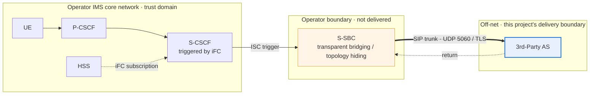
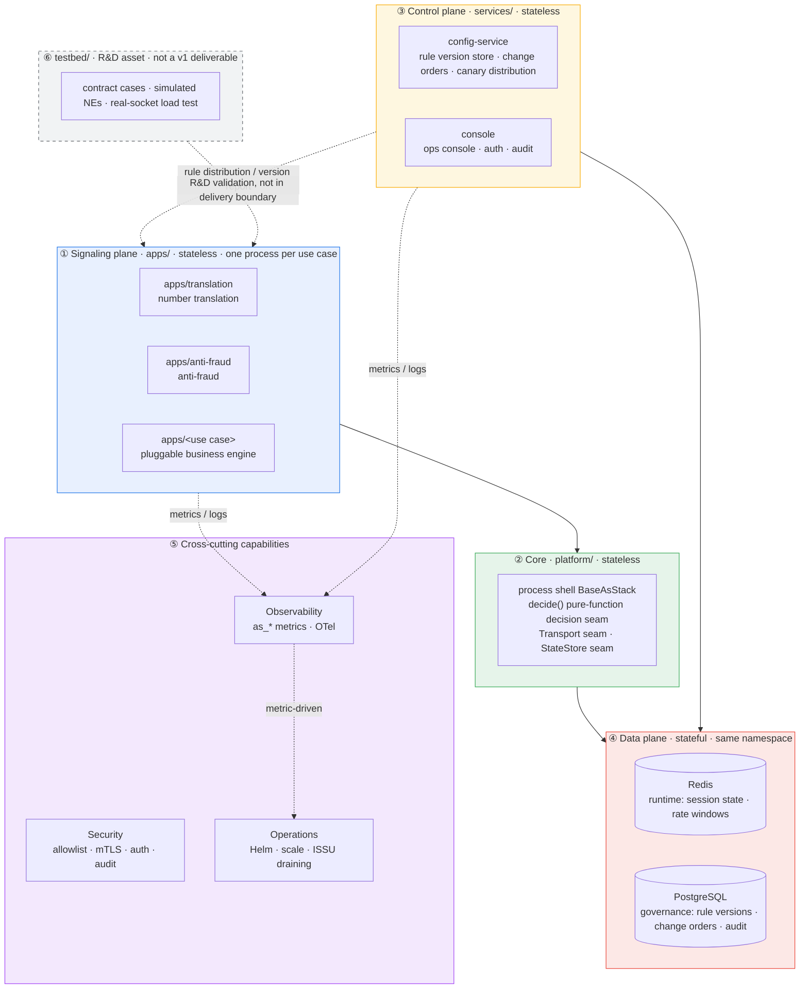

<!--
Inhouse-IMS-AS — Copyright 2026 Dolan Shu <dolan.d.shu@gmail.com>, Apache-2.0

Licensed under the Apache License, Version 2.0 (the "License");
you may not use this file except in compliance with the License.
You may obtain a copy of the License at

    http://www.apache.org/licenses/LICENSE-2.0

Unless required by applicable law or agreed to in writing, software
distributed under the License is distributed on an "AS IS" BASIS,
WITHOUT WARRANTIES OR CONDITIONS OF ANY KIND, either express or implied.
-->

# In-house IMS Application Server (documentation descriptor name)

> **Status block (read this before the rest of the page)**
>
> - **The product name is a documentation descriptor name (not a trademark / brand claim).** Throughout this document we use **In-house IMS Application Server**, first appearing as the title above; its network role is the 3GPP **Third-Party AS role**. This descriptor name has been formally adopted by G8-2 (not a trademark / brand claim); the authoritative naming decision lives in [`docs/plan.md`](docs/plan.md) §0 "Product Decision Log".
> - **git repo name**: Per the [`docs/plan.md`](docs/plan.md) §0 decision line, the git repository name and remote URL use `inhouse-ims-as` (**only** at the repository-name / remote-URL level); **the chart name, image name, and OTel service name remain `3rdparty-as` unchanged** (see [`deploy/helm/Chart.yaml`](deploy/helm/Chart.yaml)). Internal content and component naming are unaffected.
> - **Target scenario**: **xx Operator internal production-readiness / release review** —— **G8-1 official wording** (confirmed by maintainer 2026-10-09, recorded in [`docs/plan.md`](docs/plan.md) §0 "Product Decision Log"), not intended for external commercial use.
> - **Current status**: **M8 exit sign-off completed (2026-10-13, path C: countersigned + written acceptance of external hard-dependency risk)**, but **no claim of all-green, no coverage of REQ-level acceptance** ([`docs/acceptance/report.md`](docs/acceptance/report.md) §0.11). E1 (reSIProcate production-path behavior) / E4 (TLS certificate hot-rotation) / E5 (state externalization & recovery) **remain un-accepted at REQ level** (accepted on engineering evidence only).
> - **This document contains no capacity/performance numbers**: no CPS / CAPS / BHCA / concurrency / throughput / latency / percentage capacity. O1 (capacity target) **is unresolved** ([`AGENT.md`](AGENT.md) §2).

A **multi-service hosting platform**: each business use case is an independent process, business engines are pluggable, and **adding a new service requires no change to the IMS core network** —— the S-CSCF triggers ISC based on the iFC subscription in the HSS, the operator's S-SBC acts as a transparent bridge to deliver calls off-net, and the core network only sees a standard ISC trigger. Business logic runs in our own processes, so we are **not bound by any core-network vendor's service release version**. The delivery form is **single-tenant, on-premises**: runtime and governance-state data all remain inside the customer's data center and never leave the customer boundary. It is a **product**, not a POC —— the POC (`../3rtparty_AS_POC`) and its extracted library (`../as_platform`) entered this repository only after per-file triage ([`docs/migration/triage.md`](docs/migration/triage.md)).

---

## Position in the network



The S-SBC performs transparent bridging on both sides: to the S-CSCF the AS looks like an on-net AS, and to the AS the peer looks like the S-CSCF. Therefore this system implements **only one access semantic —— ISC** (ADR-0003). The iFC trigger logic belongs to the S-CSCF / HSS, outside our delivery boundary; the AS only implements the business decision after the ISC trigger. **The charging domain is not in the diagram**: this product has no interface to the charging domain, marked **N/A** (no CDR / charging, ADR-0017).

## Architecture overview



**Decision seams (swap parts, not architecture)**: `decide()` is a pure-function decision seam (no socket, no clock, no global state inside the module, TDD enforceable); the Transport seam makes peer admission and transport policy replaceable (ADR-0016); the StateStore seam makes the runtime store replaceable (ADR-0007); `apps/` one process per use case = one Deployment / one fault domain / one canary unit (ADR-0002); scale-down and upgrade use **ISSU = draining** (drain traffic → draining → exit only at zero, no in-flight call migration, ADR-0009). The full design baseline is in [`docs/architecture/新系统整体架构.md`](docs/architecture/新系统整体架构.md).

## Key KPIs (definitional, no values)

Metric names and semantics take `platform/src/as_platform/telemetry/metrics.py` as the single authority; the collection path is the process's `/metrics` endpoint (`HealthServer`, requires `AS_HEALTH_PORT`). **This page gives definitions only — no thresholds, no target values.**

| KPI | Metric name | Current observability status (stated honestly) |
|---|---|---|
| In-flight calls | `as_active_calls{use_case,pod}` | Production path **has** a producer, but it only increments/decrements on SIP-runtime-built dialog events; E1 un-accepted → **no production evidence yet** |
| Downscale removable flag | `as_downscale_removable{use_case,pod}` | Production path **wired** (periodic write based on guard config and draining status). No threshold, no target value |
| State-store availability | `as_state_store_available{use_case}` | Production path **wired but conditional**: probed only when `REDIS_URL` is non-empty; when unset the series **does not exist** (not 0) |
| SIP response count | `as_sip_responses_total{use_case,status_class,status_code}` | Production path **has no data producer yet**: only a one-time startup probe; the product SIP adapter's write point is still pending; alerts depending on it will not fire now |
| Rule-hit count | `as_rule_hits_total{rule}` | Definition and write interface exist, but production path has **no caller**, and it is not in the alert contract |
| Telemetry-dropped count | `as_telemetry_dropped_total{use_case}` | Bounded queue enabled only when `OTEL_EXPORTER_OTLP_ENDPOINT` is non-empty; exporter defaults to `NoOpExporter`, **real OTLP backend wiring incomplete** |

> **⚠️ No latency / throughput / CPS metrics.** `MetricKind` has only `COUNTER` and `GAUGE`, **no histogram type**; the registry contains no latency or throughput series; alert thresholds are all ratios, relative changes, or state conditions — **no absolute capacity values**.
>
> **⚠️ Standard-deployment scrape wiring still missing**: the `/metrics` endpoint exists, but the chart has **no** `prometheus.io/scrape` annotation, and **no** ServiceMonitor / PodMonitor template —— in a standard deployment Prometheus cannot receive the series above. Completing scrape wiring is one of the necessary actions after O1 is resolved.
>
> **Capacity metrics await O1 resolution**; the capacity model and measurement methodology are in [`docs/product/ne-datasheet.md`](docs/product/ne-datasheet.md) §3, §5.

## Specification compliance summary

The per-clause matrix is in [`docs/product/compliance-matrix.md`](docs/product/compliance-matrix.md) (four-state verdict: **Fully** / **Partial** / **N/A** / **open**; every Fully / Partial cell must give a `file:line` or contract scenario number — **never write Fully when evidence cannot be found**).

| Specification | Applicability | Status |
|---|---|---|
| 3GPP TS 24.229 (IMS SIP, ISC trigger) | Applicable | **Partial** —— clause-level conformance not checked clause by clause, recorded as open |
| RFC 3261 (SIP) | Applicable | **Partial** —— forking / 3xx / REFER / PRACK-UPDATE interleaving not implemented |
| RFC 4566 (SDP) | Applicable (passthrough only) | **Partial** —— body passed through byte-for-byte, REQ-F-4 sign-off incomplete |
| GSMA IR.92 / IR.94 | Applicable | **open** —— original text not retained in repo, no clause-by-clause implementation evidence |
| 3GPP TS 29.328 / 29.329 (Sh) | **Not applicable** | **N/A** —— data comes from our own data plane, no interaction with HSS |
| 3GPP TS 32.260 / 32.299 (charging / CDR) | **Not applicable** | **N/A** —— no collection, no delivery, no archiving, no rating (ADR-0017) |

**No cell is currently marked Fully**: every positive capability depends on at least one of E1 / E4 / E5, and these three are **not yet accepted**. **The production SIP stack is reSIProcate** (ADR-0019 accepted); **sippy is only a behavioral baseline reference under `testbed/`, not a production dependency** (attribution in [`NOTICE`](NOTICE)). testbed simulation results are R&D / demo assets and **must not be used as operator IOT or live-network evidence**.

## Three-step deployment

Helm is the only production delivery form (ADR-0013), chart name `3rdparty-as`. Parameter semantics take [`deploy/helm/README.md`](deploy/helm/README.md) as the **single authority**; this page does not repeat the values parameters.

| Step | What to do | Exit criteria |
|---|---|---|
| ① Preflight environment | `docs/delivery/preflight.sh -n as-prod -f deploy/helm/values-onprem.example.yaml` —— validate K8s version & API, node resources, dependency services, Helm, RBAC, chart render fail-closed | No `FAIL` (no `WARN` under `--strict`) → exit code 0 |
| ② Install | After images and customer Secrets are in place: `helm upgrade --install as deploy/helm -f deploy/helm/values-onprem.example.yaml --namespace as-prod --create-namespace` (each business use case renders as an independent Deployment) | Helm release succeeds; the three fail-closed guards not tripped |
| ③ Connect & verify | Peer the SIP trunk with the S-SBC (UDP/TCP 5060, TLS 5061, mTLS + peer allowlist); trigger via iFC subscription on the S-CSCF / HSS side; verify `/health/live`, `/health/ready`, console item by item per `NOTES.txt` | Pod / Endpoint ready, verification items evidenced one by one |

The full command sequence and delivery checklist are in [`docs/delivery/install-guide.md`](docs/delivery/install-guide.md); for air-gapped data centers see [`docs/delivery/airgap-package.md`](docs/delivery/airgap-package.md). **Out of scope**: production ingress (7.2d) and real-cluster evidence are currently still **blocked**; this page offers no in-cluster verification conclusions.

## What we are / are not

The full comparison table is in [`docs/product/one-pager.md`](docs/product/one-pager.md) §2.

| Dimension | What we are | What we are not | Basis |
|---|---|---|---|
| Network role | An external AS **outside** the IMS network | Not a replacement for S-CSCF / S-SBC / HSS | Core network is the operator's (`AGENT.md` §1) |
| Access semantic | Only ISC | No "on-net / off-net" dual-mode adapter | ADR-0003 |
| Service plane | Signaling only, SDP passed through as-is | **No media** (no RTP / transcoding / DTMF / MRF) | ADR-0004 |
| Call records | Call trace by Call-ID | **No CDR / no charging / no rating** | ADR-0017 |
| Compliance | In-boundary security: allowlist + mTLS + auth audit | **No LI** (IRI belongs to on-net NEs) | ADR-0016 |
| Interface plane | Only SIP trunk outward | **No Diameter Sh** | `AGENT.md` §2 (no separate ADR) |
| Deployment form | Single-tenant, on-premises | **No multi-tenant** | `AGENT.md` §2 (REQ-NF-9) |
| Config governance | Change order → approval → write DB → canary → rollbackable | **No GitOps** | ADR-0006 |
| Deliverables | Helm + standard Deployment / ConfigMap / Secret | **No Operator (CRD)** | ADR-0013 |
| Capacity wording | Only declares "how to measure" | **Publishes no capacity numbers** | O1 unresolved (`AGENT.md` §2) |

## Documentation index

Layered by reader. Full documentation navigation is in [`docs/README.md`](docs/README.md).

| Reader | Documents |
|---|---|
| **Review** | [`docs/product/one-pager.md`](docs/product/one-pager.md) one-pager · [`ne-datasheet.md`](docs/product/ne-datasheet.md) NE profile · [`compliance-matrix.md`](docs/product/compliance-matrix.md) spec compliance · [`responsibility-matrix.md`](docs/product/responsibility-matrix.md) responsibility boundaries RACI · [`version-lifecycle.md`](docs/product/version-lifecycle.md) version lifecycle & EOL · [`security-privacy.md`](docs/product/security-privacy.md) security & privacy (PDPO) |
| **Operations** | [`docs/operations/README.md`](docs/operations/README.md) section overview · [`runbook-l1.md`](docs/operations/runbook-l1.md) L1/NOC · [`runbook-l2.md`](docs/operations/runbook-l2.md) L2/second-line · [`fault-demarcation.md`](docs/operations/fault-demarcation.md) fault demarcation · [`rollback-playbook.md`](docs/operations/rollback-playbook.md) drain-and-rollback · [`backup-restore.md`](docs/operations/backup-restore.md) backup & restore · [`alert-response-matrix.md`](docs/operations/alert-response-matrix.md) alert-to-action matrix · [`grafana-dashboards/README.md`](docs/operations/grafana-dashboards/README.md) dashboard templates |
| **Delivery** | [`docs/delivery/README.md`](docs/delivery/README.md) overview · [`install-guide.md`](docs/delivery/install-guide.md) install & deploy guide · [`airgap-package.md`](docs/delivery/airgap-package.md) offline install package · [`preflight.sh`](docs/delivery/preflight.sh) environment preflight · [`deploy/helm/README.md`](deploy/helm/README.md) Helm parameter authority |
| **Engineering** | [`AGENT.md`](AGENT.md) collaboration rules (read first) · [`docs/architecture/新系统整体架构.md`](docs/architecture/新系统整体架构.md) design baseline · [`docs/architecture/adr/`](docs/architecture/adr/) decision records · [`docs/requirements/prd.md`](docs/requirements/prd.md) requirements · [`docs/plan.md`](docs/plan.md) milestones & open items · [`docs/migration/triage.md`](docs/migration/triage.md) POC triage · [`docs/acceptance/report.md`](docs/acceptance/report.md) acceptance report · [`CONTRIBUTING.md`](CONTRIBUTING.md) · [`SECURITY.md`](SECURITY.md) · [`CHANGELOG.md`](CHANGELOG.md) · [`docs/product-packaging-plan.md`](docs/product-packaging-plan.md) packaging plan |

## Development & gate

```bash
uv sync            # resolve and lock the whole workspace (8 members)
make gate          # ruff format --check → ruff check → mypy → pytest unit+contract
make help          # all targets
make chart-check   # helm lint + template guards (requires helm 3.x)
make alert-check   # promtool check rules (requires promtool)
```

Requires `uv` and Python 3.10 —— but **D1 (Python 3.10 end-of-life) is unresolved**: the product locks 3.10 because that is the version sippy was validated on (ADR-0001); that version has reached end-of-life, and a migration or registering it as an accepted risk in an ADR **has not been resolved** ([`docs/plan.md`](docs/plan.md) §5.2 D1).

The local gate runs the same four layers: **① fast (unit or contract) → ② integration → ③ e2e → ④ performance**. `make gate` is layer ①, with four fixed steps; the AST scan (REQ-G-3 ADR annotation) is **not** inside `make gate`, triggered by `make gate-strict` (= four steps + ADR-annotation scan). **A local gate's conclusion covers only what it actually ran** — never phrase a local rerun's result as stronger than the verification it performed.

## Repository tour

```
AGENT.md            ★ read this first: rules, layering, gate, git rules
pyproject.toml      uv workspace root (virtual manifest): the only tool config
VERSION              product release version number (single source of truth, ADR-0018)
platform/           core library, includes "no reverse dependency" guard test
apps/               translation/ · anti-fraud/
services/           config-service/ · console/
testbed/            contracts/ · simulators/ · load/
deploy/             helm/ (only production form) · compose/ (dev only) · alerts/ · kind/
docs/               product/ (review) · operations/ (ops) · delivery/ (delivery)
                    architecture/ (incl. adr/) · requirements/ · acceptance/ · reviews/
                    migration/ · handoff/ · agents/ + plan.md + product-packaging-plan.md
tests/              cross-cutting structural guards: layout, version, dependency direction
Makefile            make gate = gate layer ① (lint → type → unit/contract)
```

**Layering is guaranteed not by directories but by tests**: in a monorepo any import resolves, so dependency direction is asserted by `platform/tests/test_library_independence.py` and `tests/test_workspace_layout.py`; the single source of version is guarded by `tests/test_version_consistency.py`. The ADR ledger has three states — `accepted` / `draft` / `skeleton` — check each file header before referencing.

## System layering

| Layer | Directory | Responsibility | Statefulness |
|---|---|---|---|
| ① Signaling plane | `apps/` | One process per use case, carries calls & business decisions | **Stateless** (state in Redis) |
| ② Core | `platform/` | Process shell, B2BUA state machine, `decide()` decision seam, Transport/StateStore seams | Stateless |
| ③ Control plane | `services/` | Rule version store & change orders, ops console | Stateless (state in PostgreSQL) |
| ④ Data plane | — | Redis runtime, PostgreSQL governance | **Stateful**, redundant |
| ⑤ Cross-cutting | — | Observability, security, operations | Stateless (except backends) |
| ⑥ Testbed | `testbed/` | Contract case set, simulated NEs, real-socket load test | R&D asset |

The full design is in [`docs/architecture/新系统整体架构.md`](docs/architecture/新系统整体架构.md).

## Current status

**Pre-release stage.** Current product version `0.2.0` ([`VERSION`](VERSION) / [`CHANGELOG.md`](CHANGELOG.md) marked **Unreleased**) —— `v1` / `v1.1` are scope references, **not release versions**.

- **M8**: release-candidate artifacts ready, **exit sign-off completed (2026-10-13, path C: countersigned + risk accepted)**, but **no claim of all-green, no coverage of REQ-level acceptance**. **Sign-off ≠ all-green**.
- **M2 / M6 / M7 / M7.1**: **engineering complete / engineering closed**, but engineering closure **does not equal** REQ-level acceptance (`docs/plan.md` §2).
- **Sign-off matrix** ([`docs/acceptance/report.md`](docs/acceptance/report.md) §0.10 current count, matrix "M8 batch 4 finalization countersigned"): pass **27** / fail 0 / **blocked 12** / n-a 4 / **open 24** —— **no claim of all-green** (M8 sign-off does not cover REQ-level acceptance, matrix count unchanged).
- **E1 / E4 / E5 un-accepted**: reSIProcate production-path behavior, TLS certificate hot-rotation, state externalization & recovery. 7.2d production ingress still **blocked**, lacking a real operator S-SBC and customer K8s environment.
- **e2e landed**: `testbed/e2e/` already has stable passing end-to-end cases (no longer zero; running on kind / self-signed-cert environment, not a real operator S-SBC).
- **Capacity numbers unresolved**: O1 open; M6 dev-host measurements are internal references, **not for external use**, not cited here.
- **testbed is an R&D asset**: ADR-0014 explicitly excludes testbed from v1 deliverables.

The full list of open and blocked items is held in [`docs/plan.md`](docs/plan.md) §5 (**O1 / D1 still open**; O4 / D5 / O5 / D3 values resolved, only details such as RTO/RPO figures remain open). **Do not silently resolve an open item** (`AGENT.md` §15).

## License

Apache-2.0 ([`LICENSE`](LICENSE)). Third-party notices in [`NOTICE`](NOTICE), which includes sippy's BSD-2-Clause attribution (sippy is a testbed behavioral baseline only, not a production dependency).
