<!--
Inhouse-IMS-AS — Copyright 2026 Dolan Shu <dolan.d.shu@gmail.com>, Apache-2.0

Licensed under the Apache License, Version 2.0 (the "License");
you may not use this file except in compliance with the License.
You may obtain a copy of the License at

    http://www.apache.org/licenses/LICENSE-2.0

Unless required by applicable law or agreed to in writing, software
distributed under the License is distributed on an "AS IS" BASIS,
WITHOUT WARRANTIES OR CONDITIONS OF ANY KIND, either express or implied.
-->

# Third-Party IMS AS System — Overall Architecture (Extended from the POC)

> This document is the **overall architecture of the new project**, formed by reading both the `3rtparty_AS_POC` and `as_platform` repositories end to end and confirming each decision item by item.
> Every architecture decision comes with its rationale; undecided items are collected in Chapter 12 "Open Items and Risk Register" rather than hidden.
> Conventions: ✅ = confirmed in this round; ⏳ = deferred to a later version; ❓ = undecided (open).

---

## 0. Decision Ledger (One-Page Quick Reference)

| # | Decision Point | Conclusion |
|---|---|---|
| 1 | Target form | Productized third-party AS system, single-tenant on-prem delivery |
| 2 | Runtime model | One process per use case + state externalized to Redis, AS stateless multi-replica; call recovery direction is Redis application-layer necessary-state checkpoint, not serializing the full DUM / `SipStack` (proposed ADR-0023; D10 still not passed) |
| 3 | Repository organization | Single monorepo + uv workspace |
| 4 | Users and scenarios | Operator side (business configuration staff + platform SRE); **no CDR** |
| 5 | Module breakdown | Layered + cross-cutting reorganization (none of the original 13 items dropped) |
| 6 | Deployment form | Kubernetes + Helm (compose only as a dev environment) |
| 7 | Redundancy | In-site N+1 zero single point of failure + cross-site 1+1 warm standby |
| 8 | SIP stack and B2BUA control | Production stack: reSIProcate (C++) DUM provides SIP session/dialog/transaction mechanics; the product `CallController` handles cross-leg business control and invokes Python decision modules; Python/native integration, UAS rehydrate, and process-restart recovery remain blocking open items (ADR-0019, proposed ADR-0022 / ADR-0023) |
| 9 | Implementation consistency | Language-agnostic behavior contract + cross-implementation contract tests as the behavioral-equivalence gate; product business decision modules stay Python |
| 10 | IMS position | Out-of-network deployment, iFC triggering, S-SBC transparent bridge → **single ISC semantics** |
| 11 | Media | Do not touch media; keep the seam and trigger conditions |
| 12 | Observability | OTel three signals (backend-neutral) + productized call-trace query on an independent channel |
| 13 | Configuration governance | PostgreSQL + change-order state machine + interface abstraction |
| 14 | Data plane | Redis (call necessary-state checkpoint direction + independent runtime aggregate state) + PG (rule versions/change orders/audit/users); ADR-0023 proposed |
| 15 | Scaling | Capacity planning as the base + custom-metric HPA + downscale protection controller |
| 16 | Test platform | testbed three layers; not a deliverable in v1 |
| 17 | R&D model | Layered TDD + ADR institutionalization + four-layer test gates |
| 18 | Security boundary | Whitelist + end-to-end TLS + auth audit; **no LI involvement**. Console roles + password auth / sessions are proposed [ADR-0024](adr/0024-console-password-sessions.md), pending maintainer review; persistent audit is not yet delivered and does not constitute REQ-S-4 or M4b acceptance. |
| 19 | Feature capability gating | Layered: deployment-level master switch + runtime fine-grained override; reuse the configuration governance change chain; every feature must have its default state/grayscale/removal conditions adjudicated; no License gating |

---

## 1. The System's Position in the IMS Network

### 1.1 Key Correction of Understanding

The third-party AS **is still triggered by the S-CSCF per iFC** (3GPP TS 24.229). The S-SBC is introduced precisely for this, providing a **transparent bridge**:

- On the **S-CSCF side**: the third-party AS is regarded as an **in-network AS**, transparent to the S-CSCF; messages are sent out of the network by the S-CSCF;
- On the **AS side**: messages arriving from the S-SBC "are" from the S-CSCF; the AS is also transparent and believes it is still inside the IMS network.

**Architectural corollary (an important simplification)**: the AS only needs to implement **one** access semantics — **ISC (triggered by the S-CSCF)**. No "in-network/out-of-network dual-mode adapter" is needed; a trunk is only a bearer layer, not a second business semantics. The S-SBC is an **operator-side network element, not part of our deliverables**, but a simulator must exist in the testbed.

### 1.2 Position and Trust Boundary

The S-SBC sits inside the operator IMS network, on the side that leaves the network. What leaves the network is the trunk from the S-SBC to the third-party AS, not the S-SBC itself.

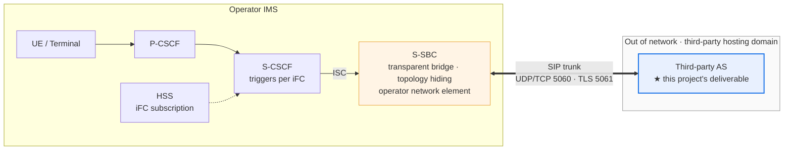

The S-CSCF hands the call to the S-SBC over ISC according to the iFC subscription in the HSS. The S-SBC forwards it over the trunk to the third-party AS outside the network, and the AS's responses and outgoing legs also return over this trunk. To the S-CSCF, the AS looks like an in-network AS; to the AS, the S-SBC is the S-CSCF.

### 1.3 Correspondence to the Current POC

| Item | Current POC | New project |
|---|---|---|
| Upstream | `s_sbc_mock` (forward :15060 / return :15061) | Operator S-SBC (production) / testbed simulator (R&D) |
| iFC chain | `ims_mock` (P-CSCF + S-CSCF#1/#2, ADR-0014) | Operator network elements / testbed simulators |
| Bearer | SIP over UDP (RFC 3261) | SIP over UDP **or TLS** |
| Media | No RTP, SDP passed through as-is | Unchanged: do not touch media (see §9) |
| Number translation AS | `as_app` (two-legged B2BUA) | Productized, multi-replica |
| Anti-fraud AS | `anti_fraud_as` (single leg, 608 Rejected / RFC 8688) | Productized, multi-replica |

---

## 2. Overall Architecture Diagram

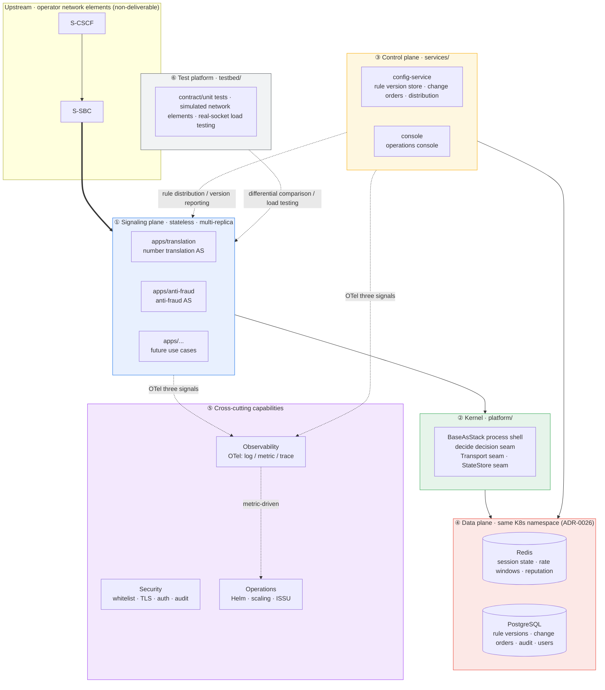

**Layered responsibilities**

| Layer | Responsibility | Statefulness |
|---|---|---|
| ① Signaling plane `apps/` | Use-case processes, carrying SIP calls and business decisions | **Stateless** (all state in Redis) |
| ② Kernel `platform/` | Process shell, B2BUA state machine, decision seam, two pluggable seams | Stateless |
| ③ Control plane `services/` | Rule governance (versions/approval/distribution), operations console | Stateless (state in PG) |
| ④ Data plane | Redis holds runtime state, PG holds governance state | **Stateful**, needs redundancy |
| ⑤ Cross-cutting | Observability, security, operations | Stateless (except backends) |
| ⑥ testbed | Three-layer test assets + simulated network elements | R&D-period assets |

---

## 3. Functional Module Checklist ↔ Architecture Diagram Element Mapping Table

> Corresponds to item 3 "correspondence between the architecture diagram and functional modules" in `tmp/架构.md`. None of the original 13 items dropped, only repositioned.

| Original 13 items | Layer | Architecture diagram element | Component/landing | Status |
|---|---|---|---|---|
| AS basic modules | ② Kernel | `platform/` | `BaseAsStack`, `BaseCallController/BaseCallMap`, `decide()` decision seam | Existing |
| Business modules | ① Signaling plane | `apps/<use case>` | Number translation, anti-fraud (pure functions `routing/engine`, `screening`) | 2 existing |
| Configuration module | ③ Control plane | `config-service` | Rule version store, change orders, distribution, hot reload, rollback | New |
| Monitoring module | ⑤ Cross-cutting | Observability | OTel metrics + `active_calls` / `cps` | Refactored |
| Logging module | ⑤ Cross-cutting | Observability | OTel logs (structured) | Refactored |
| Alerting module | ⑤ Cross-cutting | Observability | Alertmanager / Grafana Alerting + default rule set | **New** |
| Security module | ⑤ Cross-cutting | Security | Peer whitelist, end-to-end TLS, console auth, operation audit | Partially existing |
| Operations module | ⑤ Cross-cutting | Operations | Helm, scaling controller, ISSU draining | New |
| Cache module | ④ Data plane | Redis | Session state, rate windows, reputation decay | Seam existing |
| Data module | ④ Data plane | Redis + PG | Runtime state + governance state | New |
| Database module | ④ Data plane | PostgreSQL | Rule versions, change orders, audit, console users | **New** (added back by Q13′) |
| Messaging module | — | — | ❌ **Removed** (originally CDR delivery; no billing out of network) | Removed |
| Storage module | — | — | ❌ **Removed** (originally CDR archiving) | Removed |

**Two supplementary items (not in the original list, but required by the architecture)**

| Supplementary item | Landing | Description |
|---|---|---|
| Test platform `testbed/` | ⑥ | contract/unit + simulated network elements + real-socket load testing |
| Call trace record | ① + ⑤ | Replacement for CDR: queryable by Call-ID, used for complaint tracing and anti-fraud evidence (not a call record, no delivery channel, no pricing) |

---

## 4. Runtime View

### 4.1 Process and Replica Model

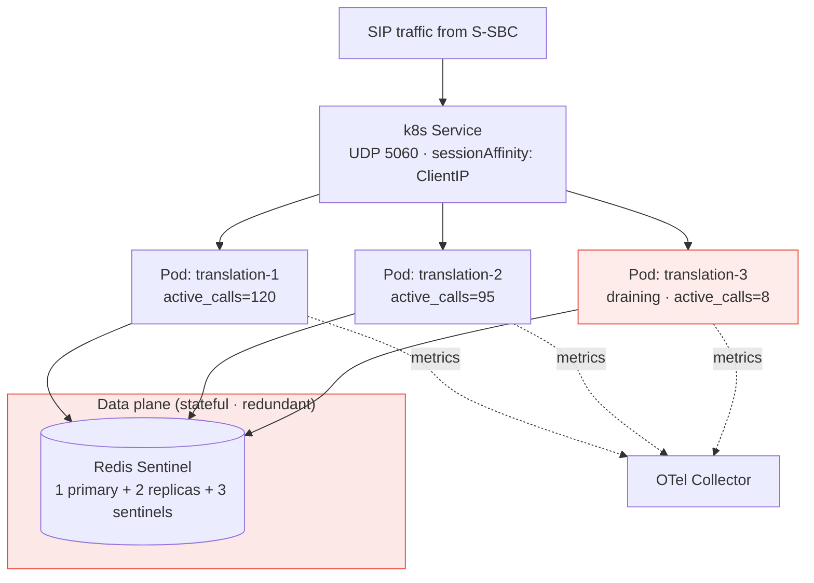

**Key points**

- **One process per use case**: each use case remains an independent process/failure domain/grayscale and scaling boundary; the production SIP direction is reSIProcate DUM, and the product adapter/controller is not yet implemented.
- **Statelessness is a hard prerequisite, but recovery is not yet proven**: the chosen direction is to use a Redis checkpoint to store the minimal call state required for application-layer recovery, not to serialize all DUM / `SipStack` objects (proposed ADR-0023). The DUM runtime still owns live transaction/dialog/session objects; externalizing data does not equal being able to reconstruct these objects. D10's ACK-established-dialog BYE baseline currently still fails: a fresh DUM's UAS dialog returns 481, and UAS rehydrate and product two-leg recovery are unsolved. REQ-NF-1 remains a hard requirement; ADR-0002 remains accepted, and the conflict between its wording and current DUM recovery capability is unresolved.
- **Affinity double insurance**: LB layer `sessionAffinity: ClientIP` + application-layer Redis session table as the fallback (the S-SBC may reuse source ports).
- **Graceful offline**: under the sippy blocking model, `preStop` draining + extended `terminationGracePeriodSeconds` are required.

### 4.2 Single-Node Capacity Baseline

The current production stack direction is reSIProcate (ADR-0019). Single-node CPS, concurrent sessions, and setup latency have not been actually measured; do not cite old candidate comparisons as capacity evidence, and do not overturn the chosen stack based on capacity. Capacity targets and thresholds are left to the M6 real-socket study (see §12.1).

---

## 5. Control Plane: Rule Governance and the Change Chain

### 5.1 Why Not GitOps

Operator networks have restrictions on GitHub/GitLab access; the cost of self-hosted Git lies not in deployment but in **operations**:

| Self-hosted option | Form | Resources | Conclusion |
|---|---|---|---|
| Gitea | Go monolith, single binary/single container, built-in SQLite | 1 core 1GB to start (2 cores recommended) | Light to deploy, but **only a small part of diff/approval is used**, and HA/backup/upgrade/user system are still required |
| GitLab CE | Nginx + Redis + PG + Sidekiq + Gitaly + Prometheus | **4GB to start, 8GB recommended** | Introducing a distributed system for a configuration version store is **not worth it** |

The more critical constraint is: **operator operations staff should not be required to learn Git/PRs just to change number-range rules**. Therefore we adopt **PostgreSQL + change-order state machine**.

### 5.2 Change Chain

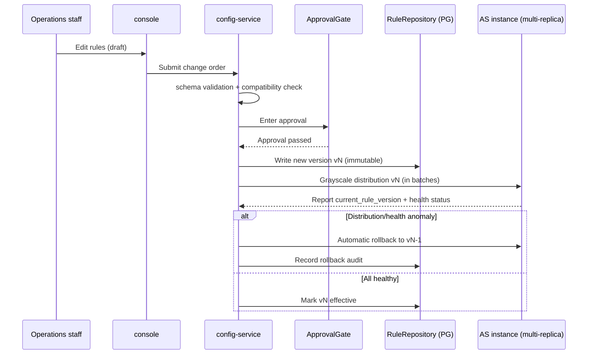

**Key points**

- Rules remain **declarative data** (YAML); the business-side pure functions (`routing/engine`, `screening`) are not changed by a single line.
- **Every AS instance reports "the rule version currently loaded"** — this is the basis for judging rule compatibility between old and new versions during ISSU (see §6.2).
- Interface abstraction: `RuleRepository` (version read/write/diff/rollback) and `ApprovalGate` (approval). **Approval can be externally integrated with the customer's OSS/ticket system**, but the version store must be owned by us — do not tie rule availability to the availability of the customer's system.
- Full operation audit lands in PG (carrying §10 security).

### 5.3 Feature Flags and Capability Gating (Decision 19)

Enabling/disabling, grayscale, and rollback of capabilities use **layered gating**, with each layer playing its role:

| Layer | Granularity | Effect mode | Storage | Relationship to the change chain |
|---|---|---|---|---|
| ① Deployment-level master switch | Entire deployment | Via the configuration change chain, **hot-reloaded, no restart** | A type of versioned configuration in the PG version store | Goes through change order → approval → write PG → grayscale distribution → rollback |
| ② Runtime fine-grained override | Number range / call / user / percentage | Hot evaluation (evaluated at decision time) | Externalized state (Redis), eventually consistent | Override values are also governed by the change chain; evaluation must be idempotent |

**Relationship to the §5.2 change chain**: feature flags are **a type of versioned configuration** in the change chain, following the same path as rules — change order → approval → write PG → grayscale distribution → rollback, with no new channel opened.

**Default off + grayscale + removal conditions (preventing switch debt)**:

- Every feature must be explicitly adjudicated in the ADR / HLD: whether a switch is needed, default state (**default off**), grayscale strategy, and **removal conditions**.
- Switches only enable/disable capabilities; they **do not change interface contracts**; when off, the **existing default path** is used.
- Switches are **temporary scaffolding**, not a permanent form; switches without removal conditions will accumulate cost continuously in long-term maintenance.

**Mechanism details** (the complete background, consequences, and accepted gaps of the two-layer model) point to [ADR-0020](adr/0020-feature-capability-gating.md).
**The evaluation granularity and configuration schema of runtime overrides are undecided** — see [`../plan.md`](../plan.md) §5.2 undecided **D7**. Layer ② evaluation must remain idempotent under the Redis split-brain window (risk R5, undecided D3).

---

## 6. Operator-Grade Trio

### 6.1 Redundancy

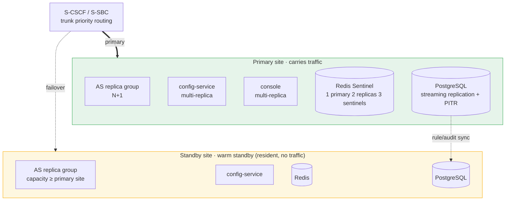

**Within a site: zero single point of failure** (N+1, tolerates single-node failure)
- AS stateless multi-replica; config-service / console / observability aggregation multi-replica;
- **Delivery landing ([ADR-0026](adr/0026-in-cluster-state-stores-proposal.md))**: governance PG and runtime Redis are rendered by Helm `stateStores` in the **same customer namespace** as the AS workloads (or customer-managed endpoints); **not** the operator IMS core database.
- Redis upgraded to Sentinel (**D3 / M2**); PG streaming replication + periodic backup + PITR;
- Stateful components (Redis, PG) are all included in the redundancy and backup list (implementation see `docs/acceptance/m5-state-stores-runbook.md`).

**Cross-site: 1+1 warm standby**
- The standby site is resident but carries no traffic; rules/configuration are synced via config-service;
- Failover relies on the S-SBC-side trunk priority + automatic/manual scripts;
- **No active-active**: how traffic is shared between the two sites is decided by the operator network element configuration, outside our control; and active-active either shares session state across sites (latency + split-brain), or accepts the loss of in-flight calls at the moment of failure — this SLA should be defined by the operator. Warm standby has the simplest failover semantics: the standby site has no in-flight calls.

> ⚠️ If tolerating an **entire rack/AZ** failure (N+M) is required, Redis needs to span AZs and Pods must be forcibly spread — currently recorded as N+1 (single node); please point out if a change is needed.

### 6.2 In-Service Upgrade (ISSU)

**Premise fact**: `sippy==2.4.2` blocks on `ED2.loop()`, and SIP transaction/dialog state is **all in process memory** with no serialization or migration interface — therefore "seamlessly handing in-flight calls over to the new version" is **architecturally untenable**. ISSU can only go via **draining**.

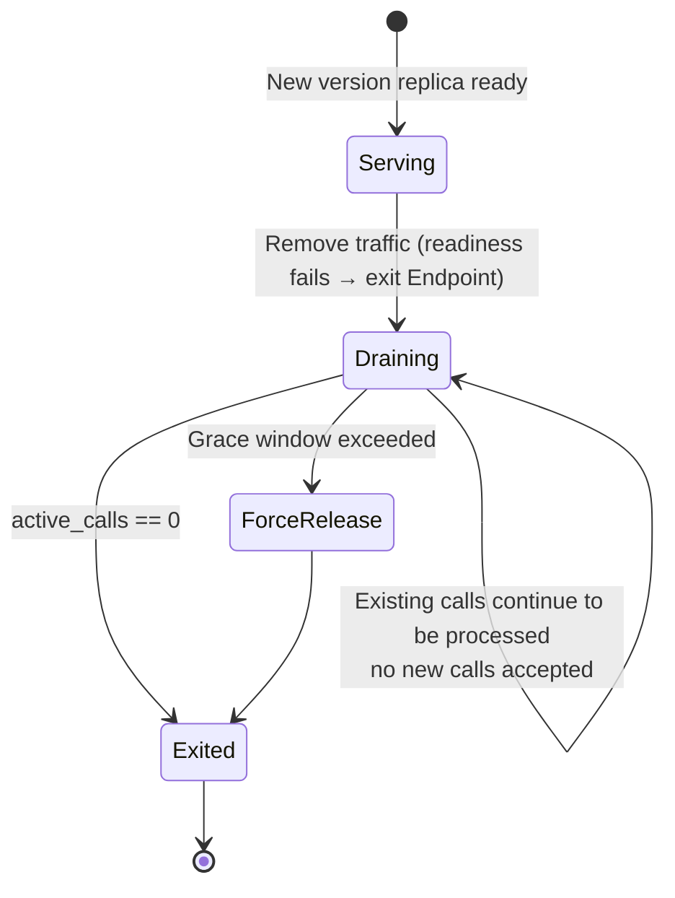

**Rules and constraints**

| Item | Constraint |
|---|---|
| Upgrade window | ≈ the longest duration of existing calls; grace window is configurable; a "timeout force release" policy and a hard cap on call duration must be defined |
| Version coexistence | During old/new coexistence the **rule schema must be bidirectionally compatible** — therefore "rule schema versioning + compatibility matrix" is a hard prerequisite for ISSU |
| Certificate rotation | Treated as a configuration hot update; **must not trigger a restart** and must not interrupt in-flight calls |
| Orchestration | k8s RollingUpdate + `preStop` draining + extended `terminationGracePeriodSeconds` + PDB |
| Not in v1 | Operator (Helm + standard Deployment/ConfigMap/Secret are sufficient) |

### 6.3 Dynamic Scaling (grow / down-grow)

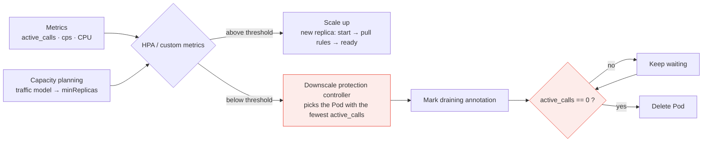

**Key points**

- **Do not use standard CPU/memory HPA**: sippy is a blocking event loop, so CPU correlates poorly with real SIP load; more fatally, it **cannot see active sessions**, so downscaling will inevitably drop calls.
- **The downscale protection controller is a necessity, not an optimization**: first remove traffic → drain → delete only when `active_calls==0`. The native controller's Pod-selection strategy is uncontrollable (similar to cluster-autoscaler's safe-to-evict approach).
- **Two new metrics**: `active_calls` (gauge), `cps` (rate). The existing `MetricsRegistry` only has `CallDisposition`/`PeerStatus` and must be extended; these two metrics serve both OTel and scaling.
- **Scale-up latency**: a new replica must start + pull rules from config-service before it can accept calls → tide pre-scaling (option D) is left to **v1.1**; v1 only does A.
- The configuration baseline `minReplicas` is set per the traffic model; HPA only does **burst fallback** (holidays, group calls, and call floods targeting this system in anti-fraud scenarios).

---

## 7. Data Plane

| Store | Carries | Redundancy requirement | Notes |
|---|---|---|---|
| **Redis** | Call signaling/controller necessary-state checkpoint direction, independent rate-window aggregate state, reputation decay | Sentinel (1 primary 2 replicas 3 sentinels) | `StateStore` + `InMemoryStateStore` / `RedisStateStore` are generic storage seams; they do not imply an existing call recovery adapter |
| **PostgreSQL** | Rule versions, change orders, audit stream, console users/permissions | Streaming replication + backup + PITR | Very small data volume (thousands of rule entries, audit grows slowly) |
| **Call traces** | Per-message record by Call-ID | Short-term persistence (retention configurable) | Operations/evidence data, **not a call record** |

**Call checkpoint and aggregate runtime state are separate.** The Redis application-layer call checkpoint is the proposed ADR-0023 direction, intended to store the complete logical unit needed by a call's two legs and controller recovery; there is currently no recovery adapter or D10 passing evidence. The rate-window counter is an independent aggregate domain, not copied per call into the dialog checkpoint. The current anti-fraud decision function only receives read-only counters injected by the caller; there is no `StateStore` write wiring in the app source/tests. The translation decision module has no app-specific per-call state. PostgreSQL still carries governance data only and is not the call checkpoint selected in this round.

**Explicitly not doing**: CDR collection, CDR delivery channel, CDR archive storage — no billing out of network (correction 2).

**Redis split-brain fallback**: during the Sentinel failover window, anti-fraud rate windows may double count → decisions must remain idempotently acceptable in extreme cases; see §12 for risks.

---

## 8. Observability

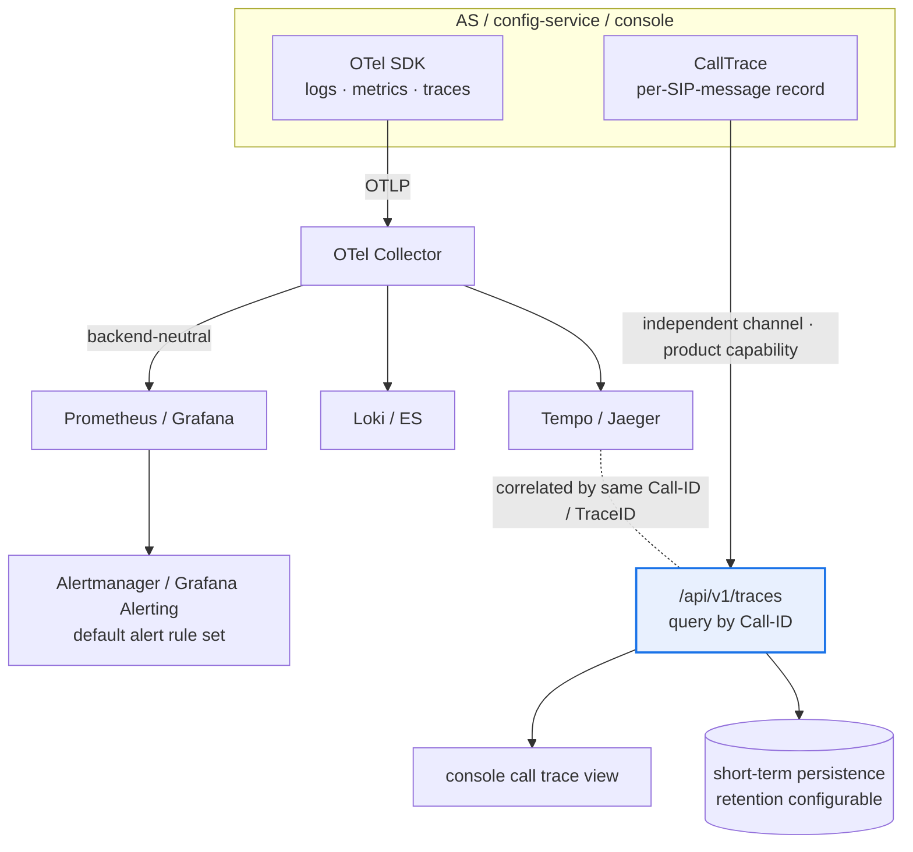

**The dual identity must be separated**: the call trace is both an **operations signal** (via OTel trace into Tempo/Jaeger) and a **product capability** (console query by Call-ID, complaint tracing, anti-fraud evidence). The latter **cannot depend on whether the customer has deployed a trace backend**, so the AS's own `/api/v1/traces` query channel is retained, and the two channels are correlated by the same **Call-ID / TraceID**.

**Two hard constraints**

1. **Export must not block the call path**: sippy blocks `ED2.loop()`, so OTel batch export must go through an independent thread/background flusher, otherwise observability becomes an SLA killer.
2. **In-process in-memory metrics are meaningless with multiple replicas**: the current `MetricsRegistry` is an in-process in-memory view and must be changed to expose an endpoint per Pod + centralized scraping and aggregation.

**Alerting**: the POC had no alerting; v1 adds it; the rule set ships with the product and is not tied to a backend.

---

## 9. Media and Security Boundary

### 9.1 Media: Do Not Touch, But Leave an Opening

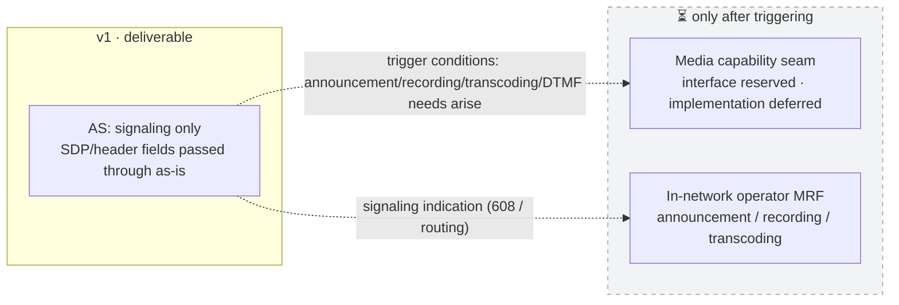

Rationale: an out-of-network third-party AS doing media relay is **triangular routing** (media leaves the network and comes back, doubling bandwidth + adding latency), and out-of-network nodes handling user voice involves lawful interception and privacy compliance; if anti-fraud needs announcement playback, it should be played by the **in-network MRF**, with the AS only giving the decision.

### 9.2 Security: Security Within the Boundary, No LI

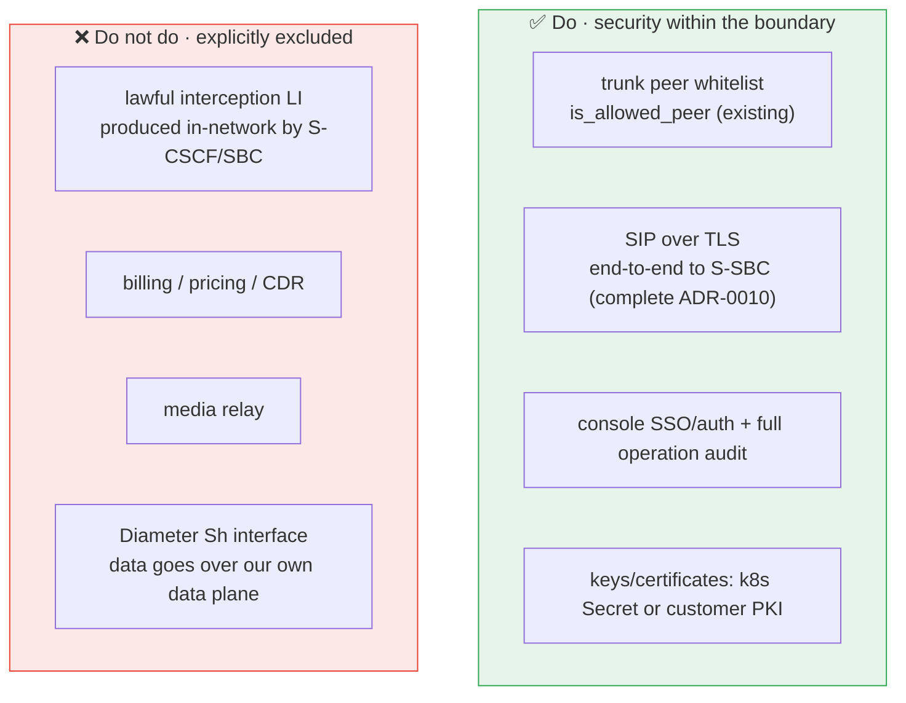

**Why TLS is mandatory**: the out-of-network trunk crosses the operator trust boundary; and per §1.1, the AS side considers the peer to "be the S-CSCF" — the **peer authenticity** of this link must be guaranteed by TLS + whitelist together, otherwise anyone impersonating the S-SBC could inject calls. ADR-0010 currently only reaches the listening side; v1 must extend it end-to-end (including certificate rotation, which cannot be a static certificate).

**Why not LI**: Q11 has decided not to touch media, so LI's communication content (CC) cannot be captured in the first place; the signaling-layer IRI should be produced by in-network network elements, and third-party AS involvement brings cross-entity/cross-jurisdiction compliance risk.

---

## 10. SIP Stack and Product B2BUA Control

The production SIP stack remains **reSIProcate C++** (ADR-0019); old candidate comparisons and migration path materials no longer describe the current direction. sippy only serves as a `testbed/` behavioral baseline reference. DUM provides SIP session, dialog, and transaction mechanics, which is not the same as a complete product B2BUA.

The product logic `CallController` sits above DUM: it correlates the independent inbound UAS leg and outbound UAC leg and their different Call-IDs; converts DUM session events into business decisions and outbound commands; coordinates provisional/final response, CANCEL/BYE, in-dialog requests, non-2xx, races, and cleanup; and invokes the existing Python decision modules. Transaction retransmissions and protocol timers are owned by DUM and must not be reimplemented in the controller; DUM callbacks must be non-blocking. See [proposed ADR-0022](adr/0022-resiprocate-b2bua-control.md), [HLD](hld.md), and [LLD](lld.md).

The integration design is not yet determined: upstream 1.14.0's `BUILD_PYTHON=ON` does not provide a general-purpose `resip`/DUM Python module. Native C++ DUM S1/S4 self-loop smoke is not a product E1, nor a requirement acceptance. A Python/native integration spike must be completed before implementing the product adapter; at the same time, it must be proven that protocol/dialog state recovery after process restart satisfies REQ-NF-1/E5, or a clear design-gap review must be formed. Protocol objects live in DUM are not objects serializable to Redis; REQ-NF-1 remains a hard acceptance requirement. ADR-0019's stack selection is unchanged; K2 and E1/E4/E5 remain open.

---

## 11. Repository Organization and Engineering Governance

### 11.1 Monorepo Structure (Q3 = B)

Current hard pain: every build job must `git clone ../as_platform`; `deploy/Dockerfile.as` fails because the build context is outside the repo; `VERSION`(0.2.0) and `pyproject`(0.1.0) have already drifted. The monorepo + uv workspace solves this in one shot.

```
as-product/                       # single repo · uv workspace
├── platform/                     # kernel library (originally as_platform, merged in)
│   ├── src/as_platform/
│   └── tests/                    # includes test_library_independence.py (no-reverse-dependency guard)
├── apps/
│   ├── translation/              # number translation AS (originally as_app)
│   ├── anti-fraud/               # anti-fraud AS (originally anti_fraud_as)
│   └── <future>/                 # future use cases
├── services/
│   ├── config-service/           # rule version store + change orders + distribution
│   └── console/                  # operations console
├── testbed/
│   ├── simulators/               # s_sbc_mock / ims_mock formalized as simulated network elements
│   ├── load/                     # real-socket load testing (capacity_harness productized)
│   └── contracts/                # cross-implementation contract case set
├── deploy/
│   ├── helm/                     # production delivery form
│   └── compose/                  # dev environment only
├── docs/adr/                     # ADR institutionalization (carrying the original 0009–0015 and extended)
└── AGENT.md                      # development rules / DoD / AI rules
```

**"No reverse dependency" is guaranteed not by repository boundaries but by tests**: `test_library_independence.py` uses AST to scan `APPLICATION_PACKAGES`; after moving into the monorepo it continues to run, and the guard scope is extended to `services/` and `testbed/`.

### 11.2 Four-Layer Test Gates

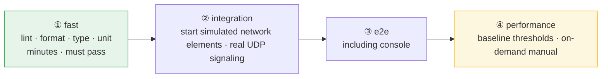

### 11.3 Development Model (Q16 = A)

| Layer | Method | Rationale |
|---|---|---|
| **Business decision layer** (`routing/engine`, `screening`) | **Mandatory TDD**, Red-Green-Refactor | Pure functions; TDD has the highest return and lowest cost |
| **Protocol/access layer** | Primarily contract tests + simulated integration tests | No strict TDD; high cost, low return |
| **Design decisions** | **ADR institutionalization** | Every decision in this round (statelessness, ISSU, scaling, configuration governance, stack migration) lands in an ADR |

**AI-assisted (loop engineering) hard rules** (written into `AGENT.md`):
1. AI-produced code must pass the **exact same** gates and differential tests; standards **must not** be lowered because "it was written by AI";
2. PRs must be marked "AI generated" to facilitate focused review;
3. Product business decision modules stay Python; protocol adapters and controllers must follow established contracts and the same acceptance criteria.

**Version governance**:
- The product uses a **unified release version number** (a single system version delivered to the operator), while component internal interfaces are independently semantically versioned — eliminating the `VERSION` and `pyproject` drift;
- SIP stack: the production direction is reSIProcate (ADR-0019); the exact vendored source pin and Python/native integration approach are still pending a blocking spike (D9), and upstream `BUILD_PYTHON=ON` must not be described as a general-purpose DUM binding.

**Feature gating**:
- New features must be **explicitly declared** in the ADR / HLD for **enablement** (whether a switch is needed, default state, grayscale, removal conditions); the mechanism is in [ADR-0020](adr/0020-feature-capability-gating.md) and §5.3.

### 11.4 Test Platform

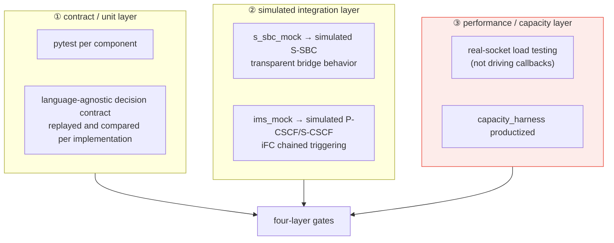

**Key points**

1. **Performance testing must be upgraded from "driving callbacks" to "real-socket load testing"**: the existing `CapacityDriver` calls callbacks directly, bypassing sockets and the event loop, so it tests business logic rather than system capacity. The capacity baseline is not comparable; M6 must cover the real SIP stack/event-loop path, and there are currently no capacity conclusions.
2. **Simulated network elements are first-class assets**: in the delivery environment, S-CSCF/S-SBC are operator network elements, and locally we can only rely on simulation; the iFC chain and S-SBC transparent bridge behavior must be simulatable, otherwise integration tests have nowhere to run.
3. The load testing tool can be SIPp (GPL, **for internal testing only, not distributed with the product**, no compliance issue) or a self-developed load tester.
4. ⏳ **v1 does not treat the testbed as a deliverable**, only as an R&D asset; customer acceptance testing capability is left to v1.1.
5. **Both the on and off states of feature switches must be reproducible** and included in test coverage (see [ADR-0020](adr/0020-feature-capability-gating.md)).

---

## 12. Open Items and Risk Register

### 12.1 ❓ Undecided (open, not adjudicated)

| # | Item | Impact | What is needed to adjudicate |
|---|---|---|---|
| O1 | **Capacity target numbers**: single-node CPS / concurrent sessions / call setup latency budget | M6 capacity planning and scaling thresholds; no longer used to reselect the SIP stack | Business traffic model and real-socket measurements |
| O2 | reSIProcate C++ has been selected by ADR-0019; DUM/controller product integration and E1/E4/E5 are not yet verified | D9, D10, M7/M8 | Complete integration spike, protocol acceptance, and REQ-NF-1 state recovery proof |
| O3 | SIP behavior acceptance for the reSIProcate production path (E1, S1–S11) | M7 / M8 | Run the product adapter's real-socket probe after the D9 spike; native DUM smoke is not a product E1 |
| O4 | Call trace retention period | Storage cost and compliance | Customer compliance requirements |
| O5 | Cross-site disaster recovery level: N+1 (single node) or N+M (rack/AZ) | Whether Redis spans AZs, Pod spread strategy | Customer SLA |

### 12.2 ⚠️ Risk Register

| # | Risk | Trigger condition | Mitigation |
|---|---|---|---|
| R1 | **UDP session affinity failure** causing dialog requests to land on a stateless replica | S-SBC reuses source ports / LB has no affinity | LB affinity + Redis session table fallback (double insurance) |
| R2 | **Downscale drops calls** | Pod still has active calls at downscale | Downscale protection controller (remove traffic → drain → delete only at zero) |
| R3 | **ISSU window too long** | Long calls stretch the grace window | Hard cap on call duration + force release policy |
| R4 | **Rule schema incompatibility** causing parse failures mid-rolling-upgrade | Old/new coexistence | Schema versioning + compatibility matrix + version reporting |
| R5 | **Redis becomes a new SPoF** | After statelessness | Sentinel + decisions remain idempotently acceptable under the split-brain window |
| R6 | **DUM and Python decision module integration boundary undecided** | Adapter implementation may duplicate protocol mechanics or block callbacks | D9 spike to define responsibilities and acceptance boundaries first; no bridge preselected in this risk item |
| R7 | **OTel export blocks the call path** | Synchronous export under a blocking event loop | Independent thread batch flusher |
| R8 | **Certificate rotation interrupts in-flight calls** | TLS certificate expiry | Rotation treated as a configuration hot update, no restart triggered |
| R9 | **Single-process throughput ceiling** | CPS hits the wall | Horizontal scaling with multiple replicas; stack selection see ADR-0019 (§10) |

---

## 13. Gap List Against the Original POC (new/refactored for v1)

| Component | Current state | v1 action |
|---|---|---|
| State store | `InMemoryStateStore` | Switch to `RedisStateStore` + Sentinel |
| Configuration | Local YAML files + hot reload | config-service + PG version store + change orders + grayscale distribution |
| Console | Read-only, no auth, vendored Chart.js | Read/write + SSO/auth + full audit |
| Observability | Self-built log/metric/trace + in-memory registry | OTel three signals + alerting + Pod endpoint aggregation |
| Alerting | None | Default rule set |
| TLS | Listening side only (ADR-0010) | End-to-end + certificate rotation |
| Deployment | docker-compose (demo) | Helm (the only production form) |
| Scaling | None | Custom-metric HPA + downscale protection controller |
| Tracing | In-memory `CallTrace` | Short-term persistence + query by Call-ID (CDR replacement) |
| Testing | unit 21 / integration 9 / e2e 6 | + contract differential layer + real-socket load testing |
| SIP stack and B2BUA control | `sippy==2.4.2` (`testbed/` baseline reference only) | reSIProcate DUM + product `CallController`; Python/native integration and REQ-NF-1/E5 recovery remain blocking open items, see ADR-0019/proposed ADR-0022 |
| Version | VERSION 0.2.0 vs pyproject 0.1.0 drift | Unified release version + interface semantic versioning |

---

*This document was finalized item by item through the grill-me / plan-grilling process. Any change to a decision should update this document synchronously and add a corresponding ADR.*
