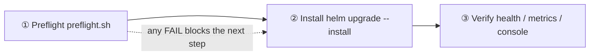

<!--
Inhouse-IMS-AS — Copyright 2026 Dolan Shu <dolan.d.shu@gmail.com>, Apache-2.0

Licensed under the Apache License, Version 2.0 (the "License");
you may not use this file except in compliance with the License.
You may obtain a copy of the License at

    http://www.apache.org/licenses/LICENSE-2.0

Unless required by applicable law or agreed to in writing, software
distributed under the License is distributed on an "AS IS" BASIS,
WITHOUT WARRANTIES OR CONDITIONS OF ANY KIND, either express or implied.
-->

# `docs/delivery/` — delivery documents and scripts

> **Product**: In-house IMS Application Server, **formally adopted as the product / documentation descriptor name** (G8-2; not a trademark / not a brand claim; 3GPP Third-Party AS role; naming status in [`../product-packaging-plan.md`](../product-packaging-plan.md) §4.3). Naming boundary: chart name / image name / OTel service name remain `3rdparty-as` unchanged; the git repo name has been reported renamed to `inhouse-ims-as` by the maintainer (G8-3; repo name and remote URL only).
>
> **Status of this directory**: a **newly added** delivery-document directory. Deliverables **3.1 Preflight environment-validation script** and **3.2 offline install package (air-gapped)** are persisted; the install guide [`install-guide.md`](./install-guide.md) is the entry point for the delivery command sequence.
> **Production form**: **Helm-only** —— Helm + standard K8s resources are the only production delivery form; no Operator, **no second install form** (ADR-0013; review G-P1-7).
> **Air-gapped scenario**: customer data centers are commonly without external network. 3.2's goal is "one image sync on the networked side + `helm package`, then verify and import on the offline side", **with no online installer**.
> **Zero capacity numbers**: `AGENT.md` §2 —— O1 capacity target unresolved (`docs/plan.md` §5.1); no file in this directory gives CPS / concurrency / latency / resource-spec recommendation values. `useCases[].resources` defaults empty; scripts only prompt, they do not invent.
> **Not validated on a real cluster**: M8 real-cluster evidence 7.2d blocked (`docs/plan.md` §5.4). The scripts' syntax and local behavior are validated, **real customer-environment conclusions need on-site evidence**.

---

## 1. Three-step delivery flow

| Step | What to do | Which file | Exit criteria |
|---|---|---|---|
| ① Preflight | K8s version and API, node resources, storage, dependency services, Helm, RBAC, chart render fail-closed, image and port prompts | [`preflight.sh`](./preflight.sh) (deliverable 3.1) | No `FAIL` (no `WARN` under `--strict`) → exit code 0 |
| ② Install | Images in place + customer Secret in place + `helm upgrade --install` (do image sync first when air-gapped) | [`airgap-package.md`](./airgap-package.md), [`install-guide.md`](./install-guide.md) | Helm release succeeds; the chart's three fail-closed guards not tripped |
| ③ Verify | Pod/Endpoint, `/health/live`, `/health/ready`, `as_state_store_available`, console HTTPS | [`../../deploy/helm/templates/NOTES.txt`](../../deploy/helm/templates/NOTES.txt), [`../operations/`](../operations/) | Verify item by item per NOTES.txt commands |

Parameter wording is not repeated in this directory: **Helm parameters and behavior take [`../../deploy/helm/README.md`](../../deploy/helm/README.md) as the single authority**.

---

## 2. Directory contents

| File | Purpose | Reader | Prerequisites |
|---|---|---|---|
| [`preflight.sh`](./preflight.sh) | One-click pre-deployment environment check; each item prints `PASS`/`FAIL`/`WARN`/`SKIP` + evidence + fix guidance; supports `--dry-run` / `--strict` / `--skip-network` | Delivery engineer, K8s admin | `kubectl`, `helm` 3.x |
| [`airgap-package.md`](./airgap-package.md) | Offline package **creation and use**: scope, networked-side flow, offline-side flow, checksum and supply chain, image manifest, known gaps | Delivery engineer, customer ops | None (read) |
| [`install-guide.md`](./install-guide.md) | Delivery checklist + image sync + `helm install` command sequence | Delivery engineer, customer ops | None (read) |
| [`scripts/bundle-images.sh`](./scripts/bundle-images.sh) | **Networked side**: read image manifest → `docker pull/tag/save` → `SHA256SUMS` → `helm package` → `MANIFEST.txt` | Delivery engineer (networked side) | `docker`, reachable upstream registry, `helm` 3.x |
| [`scripts/load-images.sh`](./scripts/load-images.sh) | **Offline side**: first verify `SHA256SUMS` (abort on mismatch) → import images → chart / helm / context / Secret pre-checks → print install-command skeleton | Delivery engineer, customer ops | `sha256sum`; `--load` needs `docker` (or `ctr` / `crictl` per prompt) |
| [`scripts/images.txt`](./scripts/images.txt) | Dependency-image manifest template (format, placeholders, digest-pinned precedent) | Delivery engineer | Rewrite per customer registry and delivery version |
| [`../../deploy/alerts/as-alerts.yaml`](../../deploy/alerts/as-alerts.yaml) + [`../../deploy/alerts/README.md`](../../deploy/alerts/README.md) | Alert rules (judged a delivered product by G9-a): 3 groups, 10 rules | Delivery engineer, customer ops | `promtool check rules` passed 2026-10-11 (verified, docs/acceptance/artifacts/m5/2026-10-11/PASS-alert-check-2026-10-11.txt, 2026-10-11, `SUCCESS: 10 rules found`); **scrape wiring not closed (X1) — must be explained to the customer** —— under a standard deployment the `as_*` series will not be collected by Prometheus |

> `install-guide.md` is the install-guide entry for the same delivery batch (delivery checklist + command sequence), persisted. Its command sequence is consistent with [`airgap-package.md`](./airgap-package.md) §3/§4; Helm parameter wording takes [`../../deploy/helm/README.md`](../../deploy/helm/README.md) as authority.

All three scripts depend only on basic tools (`bash` / `awk` / `grep` / `sed` / `sort` / `sha256sum`), **no `jq` / `yq` / `python` required**; they never print any Secret content, token, or certificate; they contain no real hostname, IP, or registry credential (always `registry.example.com` placeholder); on failure they abort and indicate which step.

---

## 3. Prerequisites summary

| Category | Requirement | Notes |
|---|---|---|
| K8s | Default validation against **1.23** floor (`preflight.sh --min-k8s` can override) | The chart has **no** `kubeVersion` declaration; the floor is derived from the APIs the templates actually use, with the basis written in the `preflight.sh` header comment (quoting Kubernetes's official Deprecated API Migration Guide "available since" entries) |
| Tools | `kubectl`, `helm` 3.x (chart `apiVersion: v2`); offline side also needs `sha256sum` | `KUBECTL_BIN` / `HELM_BIN` / `DOCKER` / `HELM` can override binary paths |
| Image | The product image in the customer's internal registry, or imported to nodes via this directory's offline package | `registry.example.com` is a placeholder address; air-gapped uses [`airgap-package.md`](./airgap-package.md) |
| Dependency services | External PostgreSQL (`postgres.host` + credential Secret) or built-in `stateStores.enabled=true`; Redis likewise | Built-in PG default `postgres:12.22`, built-in Redis default `redis:7-alpine`; Redis HA topology value resolved (O5 / D3, G7: primary/replica + Sentinel, ADR-0008, not Redis Cluster; chart still renders single-replica, no failover-behavior evidence; RPO / RTO values still unresolved) |
| Secret | TLS (customer PKI), PostgreSQL credentials, config-service runtime (`AS_CONFIG_DSN` + `AS_AUDIT_RESOURCE_HMAC_KEY_B64`), migrate owner DSN (`AS_CONFIG_OWNER_DSN`) | The chart **only references, never creates** customer credentials; the owner DSN never enters the runtime Pod; the runtime login is `as_config_web`, the runtime role pre-provisioned by the DBA |
| chart | Can pass `make chart-check` (`deploy/helm/scripts/chart-check.sh`) | Run before packaging; `helm package` failure usually means the chart itself fails to render |
| Permissions | Install account must be able to create Deployment / StatefulSet / Service / ConfigMap / Secret / ServiceAccount / Job / NetworkPolicy / PVC / PDB / HPA | This chart **does not create** Role/RoleBinding; permissions are granted by the customer K8s admin (`preflight.sh` checks with `kubectl auth can-i`) |

---

## 4. Boundary with authoritative documents

| Topic | Authoritative document | This directory |
|---|---|---|
| Helm parameters, values semantics, render guards, fail-closed behavior | [`../../deploy/helm/README.md`](../../deploy/helm/README.md) | **Does not repeat the parameter table**, only references |
| Delivery checklist and command sequence | [`install-guide.md`](./install-guide.md) | Overview + links |
| Migration / owner DSN / backup-restore | [`../acceptance/m5-state-stores-runbook.md`](../acceptance/m5-state-stores-runbook.md) | References |
| Alert handling, fault demarcation, inspection | [`../operations/`](../operations/) | References |
| Positioning / capacity model / compliance | [`../product/`](../product/) | Not repeated |

---

## 5. Not-yet-delivered / not-yet-validated items

| # | Item | Status |
|---|---|---|
| 1 | Real-cluster evidence (7.2d HTTPS ingress / trusted-proxy / browser workflow) | **blocked** (`docs/plan.md` §5.4); `preflight.sh` and the offline-package flow **have not been run in a real customer environment** |
| 2 | M8 exit sign-off | **still on hold**; M8 RC artifacts ready ≠ acceptance closure |
| 3 | chart has no `kubeVersion` declaration | Known gap; `preflight.sh` uses the derived floor as a backstop, but Helm itself does not block |
| 4 | Chart `version` / `appVersion` not synced with root `VERSION` | Known gap; run [`../../scripts/sync-chart-version.sh`](../../scripts/sync-chart-version.sh) `--check` before packaging (read-only, drift exits 1), `--apply` left to the maintainer for first sync (bundle-images.sh prints all three) |
| 5 | Pod has no `prometheus.io/scrape` annotation | Known gap; AS metric scrape wiring not closed, see [`../operations/grafana-dashboards/README.md`](../operations/grafana-dashboards/README.md) |
| 6 | `useCases[].resources` defaults empty | Capacity specs pending O1 resolution, then given by the NE datasheet; this directory gives no recommended values |
| 7 | `pytest -m e2e` currently 8 stably passing; REQ-S-4 / M4b not accepted as a whole | REQ-F-1 = automated subset covered / full text still open; see `docs/acceptance/test-plan.md`, `docs/plan.md` §5.4 |
| 8 | Items depending on S-CSCF / HSS-side coordination | iFC trigger and canary are on the S-CSCF/HSS side; the AS side only implements the decision after the ISC trigger (G-P1-10) |

---

## 6. Traceability

- Deliverables 3.1 / 3.2: [`../product-packaging-plan.md`](../product-packaging-plan.md) §1 third-batch (Class A, not blocked by O1 / O4 / D5).
- Scope narrowing: **G-P1-7** (image-sync script + `helm package` + dependency-image manifest + offline-load script, no second install form); review record [`../reviews/product-packaging-plan-review-2026-10-09.md`](../reviews/product-packaging-plan-review-2026-10-09.md).
- Helm-only: **ADR-0013**.
- Engineering-fact constraints: [`../product-packaging-plan.md`](../product-packaging-plan.md) §0.3.

---

> **B6 review status**: this document has left a review record with the B6 review —— [`../reviews/product-packaging-review-checklist-2026-10-12.md`](../reviews/productaging-review-checklist-2026-10-12.md) §6 (2026-10-12 initial review) and §7 (2026-10-12 closed-loop re-review); **conclusion pending maintainer confirmation**, and before confirmation it is not used as a basis for external delivery or acceptance (`AGENT.md` §3.3).
