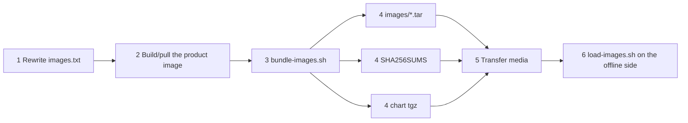

<!--
Inhouse-IMS-AS — Copyright 2026 Dolan Shu <dolan.d.shu@gmail.com>, Apache-2.0

Licensed under the Apache License, Version 2.0 (the "License");
you may not use this file except in compliance with the License.
You may obtain a copy of the License at

    http://www.apache.org/licenses/LICENSE-2.0

Unless required by applicable law or agreed to in writing, software
distributed under the License is distributed on an "AS IS" BASIS,
WITHOUT WARRANTIES OR CONDITIONS OF ANY KIND, either express or implied.
-->

# Air-gapped installation package — deliverable 3.2

> **Product**: In-house IMS Application Server, **officially adopted as the product / documentation descriptor name** (G8-2; not a trademark / not a branding claim; 3GPP Third-Party AS role; naming status see [`../product-packaging-plan.md`](../product-packaging-plan.md) §4.3). Naming boundary: chart name / image name / OTel service name remain `3rdparty-as`.
>
> **Deliverable**: 3.2 air-gapped installation package
> **Status**: the scripts and this document are on disk; **never executed in a real customer environment** (M8 real-cluster evidence 7.2d blocked, `docs/plan.md` §5.4). This document contains no capacity figures — the O1 capacity target is undecided (`AGENT.md` §2).
> **Production form**: **Helm-only** (ADR-0013); scope narrowed per review **G-P1-7** ([`../reviews/product-packaging-plan-review-2026-10-09.md`](../reviews/product-packaging-plan-review-2026-10-09.md)).
> **Target environment**: the customer's machine room (air-gapped, no external network). Images and the chart are carried by hand on media.
>
> **B6 review status**: this document has a review record from the B6 review — [`../reviews/product-packaging-review-checklist-2026-10-12.md`](../reviews/product-packaging-review-checklist-2026-10-12.md) §6 (first review 2026-10-12) and §7 (closed-loop re-review 2026-10-12); **the conclusion awaits maintainer confirmation** and until then must not be used as a basis for external delivery or acceptance (`AGENT.md` §3.3).

## 1. Scope and non-scope

### Scope (these five things only)

Image mirroring (`docker pull` + `docker save` → `images/*.tar`), the dependent image inventory (`scripts/images.txt`), checksums (`SHA256SUMS` + `MANIFEST.txt`), `helm package` (artifacts named per the name/version in Chart.yaml, currently `3rdparty-as-0.0.0-skeleton.tgz`), and the offline loading script (`scripts/load-images.sh`: checksums → import images → installation pre-checks).

> **Note (added 2026-10-13)**: the `0.0.0-skeleton` in the package artifact name in the paragraph above is factually stale (the chart was first synced to `0.2.0` on 2026-10-12); the handling of this (keep the original text + add this note) is in [`../next-release-v1.1-plan.md`](../next-release-v1.1-plan.md) §5-1, pending a maintainer decision on whether to sync it.

### Non-scope (explicitly not done)

| Non-scope statement | Reason / basis |
|---|---|
| **Does not produce a second installation form outside Helm** (no online installer, no standalone `install.sh`, no second set of manifest templates) | ADR-0013; review G-P1-7. There is exactly one installation form, `helm upgrade --install` |
| **Does not do automatic private-registry mirroring** | This repository has no automatic image-mirroring chain; image mirroring is a one-off action performed by the delivery team on the controlled networked side |
| **Does not replace the customer's internal registry** | If the customer already has an internal registry, the correct approach is to push the images into the customer registry and point values at it; this package is the "fallback path for when there is no registry" |
| **Does not do configuration data migration / database initialisation** | The configuration version is a row in PostgreSQL (ADR-0006); schema migration is done by `as-config-migrate` over the owner DSN (see [`../acceptance/m5-state-stores-runbook.md`](../acceptance/m5-state-stores-runbook.md)) |
| **Contains no capacity / performance figures** | O1 is undecided (`AGENT.md` §2). This package makes no claim about CPS, concurrency, latency, or resource specifications |
| **Contains no testbed / emulator; provides no backup and restore plan** | ADR-0014: the testbed is not a v1 deliverable; backup and restore belong to deliverable 2.5 (`docs/operations/backup-restore.md`), depend on a real-cluster drill and are currently blocked |
| **Does not replace pre-deployment environment validation** | That is deliverable 3.1, [`preflight.sh`](./preflight.sh) |

## 2. Deliverable inventory

| File | Location | Purpose | Prerequisites |
|---|---|---|---|
| `preflight.sh` | `docs/delivery/` | One-shot pre-deployment environment validation (deliverable 3.1) | `kubectl` + `helm` 3.x |
| `airgap-package.md` | `docs/delivery/` | This document: how to produce and use the offline package | None |
| `install-guide.md` | `docs/delivery/` | Delivery checklist + image mirroring + `helm install` command sequence | None (cross-links this document) |
| `scripts/images.txt` | `docs/delivery/scripts/` | Dependent image inventory template | Rewrite per the customer registry and the delivery version |
| `scripts/bundle-images.sh` | `docs/delivery/scripts/` | **Networked side**: image mirroring + checksums + `helm package` | `docker`, access to the upstream registry, `helm` 3.x |
| `scripts/load-images.sh` | `docs/delivery/scripts/` | **Offline side**: checksum verification + image import + installation pre-checks | `sha256sum`; `--load` needs `docker`, otherwise use `ctr` / `crictl` on the node as instructed |
| `deploy/alerts/as-alerts.yaml` + `deploy/alerts/README.md` | `deploy/alerts/` | Alert rules (3 groups, 10 rules; judged by G9-a to be a delivery product) | `promtool check rules` passed on 2026-10-11 ((verified, docs/acceptance/artifacts/m5/2026-10-11/PASS-alert-check-2026-10-11.txt, 2026-10-11), `SUCCESS: 10 rules found`); **the scrape wiring is not closed (X1) and must be explained to the customer** — under a standard deployment the `as_*` series will not be collected by Prometheus |
| `3rdparty-as-0.0.0-skeleton.tgz` (the actual current artifact name) | Produced by `bundle-images.sh` | Helm chart package (the only installation form); `helm package` names it per the name/version in Chart.yaml, which is not synced with the root `VERSION` 0.2.0 | The chart must pass `make chart-check`; version consistency is verified with [`../../scripts/sync-chart-version.sh`](../../scripts/sync-chart-version.sh) `--check` (read-only, exits 1 on drift); the first `--apply` is a maintainer decision |

The single authority on Helm parameters and rendering behaviour is [`../../deploy/helm/README.md`](../../deploy/helm/README.md). This document **does not repeat** the parameter table.

## 3. Production flow on the networked side



### Steps

1. **Rewrite `scripts/images.txt`**: replace `registry.example.com` with the actual source (or use `--repository` to re-tag on the script side), and replace `<VERSION>` with the delivery version (consistent with the root `VERSION`, `AGENT.md` §8). Never write credentials into the inventory.

2. **Prepare the product image**: this repository does not publish images, so they must be built first (context is the **repository root**):

   ```sh
   docker build -t <registry>/3rdparty-as:<VERSION> -f deploy/docker/Dockerfile .
   docker build -t <registry>/3rdparty-as-config-service:<VERSION> -f deploy/docker/config-service.Dockerfile .
   ```

   Or `docker pull` the images already published to a registry the customer can reach.

3. **Run the packaging**:

   ```sh
   docs/delivery/scripts/bundle-images.sh \
     --images docs/delivery/scripts/images.txt \
     --out ./airgap-out
   ```

   Common variants: re-tag for the customer registry with `--repository registry.customer.internal/as --tag-prefix rel-` (add `--push` to push to the registry, otherwise the target tags exist only locally on the packaging machine and are written into the tar); specify the platform with `--platform linux/amd64`; images only without the chart with `--skip-helm-package`. Add `--dry-run` first to see the plan.

4. **Artifacts** (`./airgap-out`):

   ```text
   airgap-out/
   ├── images/<image>-<tag>-<platform>.tar   docker save archive
   ├── 3rdparty-as-0.0.0-skeleton.tgz        helm package artifact (named per Chart.yaml; not synced with root VERSION 0.2.0)
   ├── SHA256SUMS                            sha256 of each tar and tgz
   └── MANIFEST.txt                          image/tag/digest/tar/sha256/generation time (UTC)/tool version
   ```

   Note: when `--platform` is not passed, the platform suffix in the tar filename is in fact `unspecified` (the actual behaviour of `bundle-images.sh`).

5. **Transfer media and verification requirements**:
   - Copy the whole `airgap-out` directory together (a missing file makes the offline side abort); handle the media per the customer's security rules (encrypted media, offline registration). This package contains **no** credentials, certificates or private keys — Secrets are prepared separately on the customer side per §4.
   - After transfer, run `cd airgap-out && sha256sum -c SHA256SUMS` **on the networked side** one more time and hand the output to the customer together with the media, so that "transfer corruption" can be distinguished from "packaging error".

## 4. Installation flow on the offline side

1. **Verify `SHA256SUMS` (first step, must abort on mismatch)**:

   ```sh
   cd airgap-in && sha256sum -c SHA256SUMS
   ```

   Or use the script directly (it places checksum verification before every other action):

   ```sh
   docs/delivery/scripts/load-images.sh --bundle ./airgap-in --verify-only \
     --namespace as-prod --context <customer-cluster-context>
   ```

2. **Import the images**:

   ```sh
   docs/delivery/scripts/load-images.sh --bundle ./airgap-in --load --namespace as-prod
   ```

   - The target machine has `docker`: `docker load -i` (in a multi-node cluster the image must be imported on **every node that will schedule AS Pods**, or pushed into the customer's internal registry with values pointing at it).
   - The target machine only has containerd: the script does not run node commands on your behalf, it prints the per-node instructions for the customer to execute:
     `sudo ctr -n k8s.io images import airgap-in/images/<tar>` or `sudo crictl images import ...`.
   - After importing, confirm that the tags match `values.image.tag` / `services.configService.image.tag` exactly and that `image.pullPolicy` is `IfNotPresent` (the chart default).

3. **Prepare the values file and Secrets** (the chart only references customer credentials, it never creates them; for the key names see [`../../deploy/helm/README.md`](../../deploy/helm/README.md)):

   | Secret | Keys | When needed |
   |---|---|---|
   | Customer PKI TLS Secret | `tls.crt` / `tls.key` / `ca.crt` | `tls.enabled=true` (default) → **required** |
   | PostgreSQL credentials Secret | `CONFIG_DB_USER`, `CONFIG_DB_PASSWORD`, `CONFIG_DB_OWNER_PASSWORD`, `POSTGRES_SUPERUSER_PASSWORD`, `REDIS_PASSWORD` | `stateStores.enabled=true` and `bootstrapDevCredentials=false` → **required** |
   | config-service runtime Secret | `AS_CONFIG_DSN` (the **`as_config_web` login**), `AS_AUDIT_RESOURCE_HMAC_KEY_B64` | `services.configService.enabled=true` → **required** |
   | migrate owner DSN Secret | `AS_CONFIG_OWNER_DSN` | `stateStores.migrateJob.enabled=true` → **required** |

   `AS_CONFIG_OWNER_DSN` is used **only** for migrations run manually or by the Job; it **must never** enter Helm values, chart-managed Secrets or the web Pod. The `AS_CONFIG_DSN` login must be able to `SET ROLE` into the pre-provisioned `NOLOGIN` runtime role (roles are pre-provisioned by the DBA; the chart does not create roles).

4. **Install** (for the parameters see [`../../deploy/helm/README.md`](../../deploy/helm/README.md); for the complete command sequence see [`install-guide.md`](./install-guide.md)):

   ```sh
   helm upgrade --install as ./airgap-in/<chart>.tgz \
     --namespace as-prod --create-namespace \
     -f <customer-values.yaml> \
     --set image.repository=<customer-registry>/3rdparty-as \
     --set image.tag=<release-tag> \
     --set tls.secretName=<tls-secret> \
     --set sip.peerAllowlist=<s-sbc-cidrs>
   ```

   Tip: the chart has three **fail-closed** guards ([`../../deploy/helm/templates/validate-install.yaml`](../../deploy/helm/templates/validate-install.yaml)): `tls.enabled` without `secretName`, an empty `sip.peerAllowlist`, and a missing `postgres.secretName` when `stateStores.enabled` — a missing item fails at the **render stage** rather than going live with an empty certificate.

5. **Schema migration (when config-service / built-in state stores are enabled)**: run `as-config-migrate` (owner DSN) plus `as-config-bootstrap-admin` per [`../acceptance/m5-state-stores-runbook.md`](../acceptance/m5-state-stores-runbook.md); when using `stateStores.migrateJob`, wait for the Job to complete as the runbook states.

6. **Acceptance checks**: Pods and Endpoints ready, `/health/live` and `/health/ready`, `as_state_store_available` (emitted only when `REDIS_URL` is non-empty; a missing series ≠ 0), console HTTPS and same-origin `/internal/v1`.

## 5. Checksums and supply chain

The verification style follows the `m5_verify_ingress_manifest` guard in [`../../deploy/kind/scripts/m5-lib.sh`](../../deploy/kind/scripts/m5-lib.sh): the verification manifest (`SHA256SUMS`) is kept separate from the objects being verified, a mismatch is `exit 1`, and there is no "warn and continue".

| Step | What is verified | Consequence of not verifying |
|---|---|---|
| Networked-side artifact | `sha256sum` written into `SHA256SUMS`; `MANIFEST.txt` records the source, tool versions and generation time | Packaging errors cannot be distinguished from transfer corruption |
| Transfer handover | Both sides run `sha256sum -c` once | Corrupted images get installed into the customer environment and are hard to demarcate afterwards |
| First step on the offline side | `load-images.sh` verifies before importing | Corrupted images enter the node's containerd image store, after which there is no accountability |
| Chart package | Enters `SHA256SUMS` alongside the image tars | A substituted chart amounts to a set of unreviewed installation forms |

**Handling tags and digests when offline with no external network**:

- **Tags still have to be right**: in an offline environment you cannot pull, so `image.tag` and the tag actually imported must match character for character; a mismatch gets you nothing but `ImagePullBackOff`.
- **Prefer pinning by digest**: `images.txt` supports `repository:tag@sha256:...`. See [`../../deploy/kind/manifests/ingress-nginx-kind-deploy.yaml`](../../deploy/kind/manifests/ingress-nginx-kind-deploy.yaml) for a precedent (`image: registry.k8s.io/...@sha256:...`). In production, fill in the version and digest the customer actually uses; the kind one is a development manifest, not a source of production values.
- **Re-tagging changes the digest**: after re-tagging with `--repository` / `--tag-prefix` the digest changes (same content, different reference). In that case, trust the `RepoDigests` recorded by `docker inspect` in `MANIFEST.txt` and record the mapping for this delivery.
- **Multi-architecture**: one `docker save` tar carries only one platform. Package per platform (`--platform linux/amd64`, `--platform linux/arm64`), put the platform suffix in the filename, and verify each platform separately.

## 6. Dependent image inventory (`images.txt`)

| Entry | Required when | Basis for the default |
|---|---|---|
| `<registry>/3rdparty-as:<VERSION>` | Always | `values.yaml`'s `image.repository` defaults to `registry.example.com/3rdparty-as` |
| `<registry>/3rdparty-as-config-service:<VERSION>` | `services.configService` is enabled | `values.yaml`'s `services.configService.image.repository` defaults to `registry.example.com/3rdparty-as-config-service` |
| `postgres:12.22` | `stateStores.enabled=true` (built-in governance store) | Matches the default of `stateStores.postgres.image` in `values.yaml` |
| `redis:7-alpine` | `stateStores.enabled=true` (built-in runtime store) | Matches the default of `stateStores.redis.image` in `values.yaml` |
| ingress-nginx controller / kube-webhook-certgen | The cluster has no ingress-nginx and the config-service Ingress is enabled | This chart's Ingress template only supports ingress-nginx (`className` must be `nginx`); **in production, fill in per the customer's ingress version and digest** — the fixed kind development inventory is above |

Inventory format: each line is `repository:tag[@sha256:...]`, `#` starts a comment (to end of line), blank lines are ignored. The template header comment states "never commit real credentials/addresses" and the two ways to rewrite it (edit the file / re-tag with `--repository`).

## 7. Known gaps and cautions

| # | Gap / caution | Impact and handling |
|---|---|---|
| 1 | **Chart version is not synced with the root `VERSION`** | `VERSION` is the single source of the release version (`AGENT.md` §8); the chart's `version` / `appVersion` are still skeleton values; before packaging run [`../../scripts/sync-chart-version.sh`](../../scripts/sync-chart-version.sh) `--check` (read-only, exits 1 on drift); the timing and values of the first `--apply` are a separate maintainer decision |
| 2 | **The chart has no `kubeVersion` declaration** | Helm will not stop a too-old cluster for you. `preflight.sh` derives a lower bound from the APIs the templates actually use (default 1.23, rationale in that script's comments) and probes API availability |
| 3 | **Image registry address needs the customer's internal registry** | `registry.example.com` is a placeholder address and cannot be pulled; in an air-gapped scenario either import onto nodes with this package or push the images into the customer's internal registry |
| 4 | **Image digests and multi-architecture** | See §5; across architectures the images must be packaged and verified separately |
| 5 | **The offline machine must bring its own `helm` (3.x), `kubectl`, `sha256sum`** | This package does not provide offline distribution of these binaries; `load-images.sh` states clearly which one is missing |
| 6 | **`useCases[].resources` defaults to empty** | The chart renders no requests/limits. This package performs no capacity validation and gives no recommended values (O1 undecided) |
| 7 | **`stateStores.bootstrapDevCredentials` is for dev/kind only** | Production values must be `false` and use customer-managed Secrets, otherwise development passwords go to production |
| 8 | **Redis HA topology (O5 / D3) values are decided but the implementation is not landed** | Values are decided (G7: primary/replica + Sentinel, ADR-0008, Redis Cluster not chosen; RPO / RTO figures still undecided); the chart still renders a single replica, and there is no evidence for measured failover behaviour — the built-in Redis is a single replica, not HA; this package does not solve that |
| 9 | **This package has not been validated in a real customer environment** | 7.2d real-cluster evidence is still blocked (`docs/plan.md` §5.4). For the first delivery it is recommended to walk the complete flow once on the customer's lab cluster and keep the evidence |

## 8. Boundaries against other documents

| Topic | Authoritative document | This document |
|---|---|---|
| Helm parameters, values semantics, render guards, fail-closed behaviour | [`../../deploy/helm/README.md`](../../deploy/helm/README.md) | References only, does not copy the parameter table |
| Delivery checklist, image mirroring, `helm install` command sequence | [`install-guide.md`](./install-guide.md) (a deliverable from the same batch) | Gives the offline package production/usage flow |
| Pre-deployment environment validation | [`preflight.sh`](./preflight.sh) + [`README.md`](./README.md) | Referenced in §4 step 1 |
| Migration / owner DSN / backup and restore | [`../acceptance/m5-state-stores-runbook.md`](../acceptance/m5-state-stores-runbook.md) | Referenced in §4 step 5 |
| Fault demarcation and alert handling | [`../operations/`](../operations/) | Not repeated |

**Traceability**: deliverable 3.2 ([`../product-packaging-plan.md`](../product-packaging-plan.md) §1, third batch); scope narrowing per G-P1-7; Helm-only per ADR-0013; review record [`../reviews/product-packaging-plan-review-2026-10-09.md`](../reviews/product-packaging-plan-review-2026-10-09.md).
