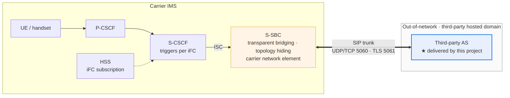
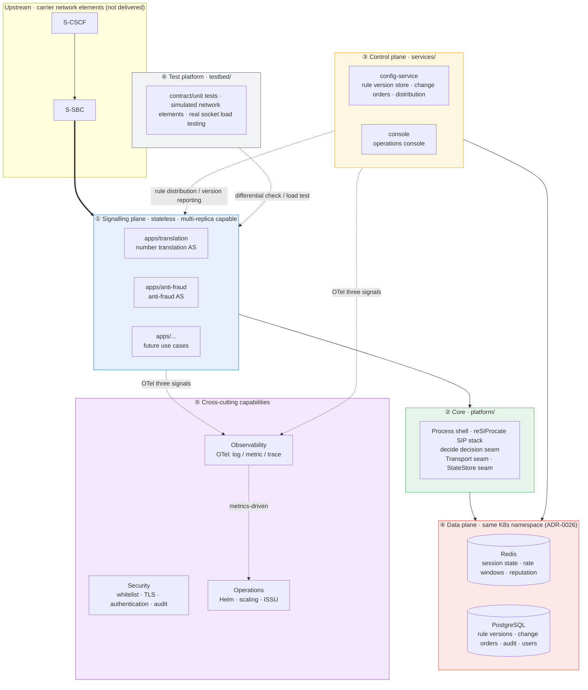
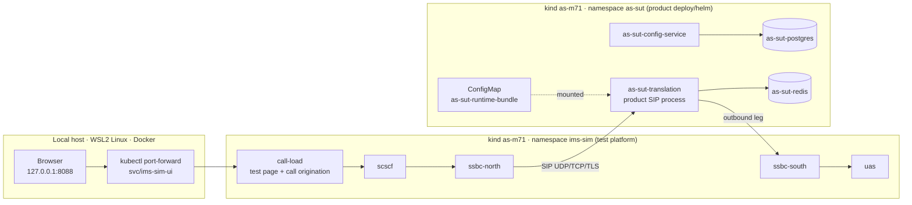
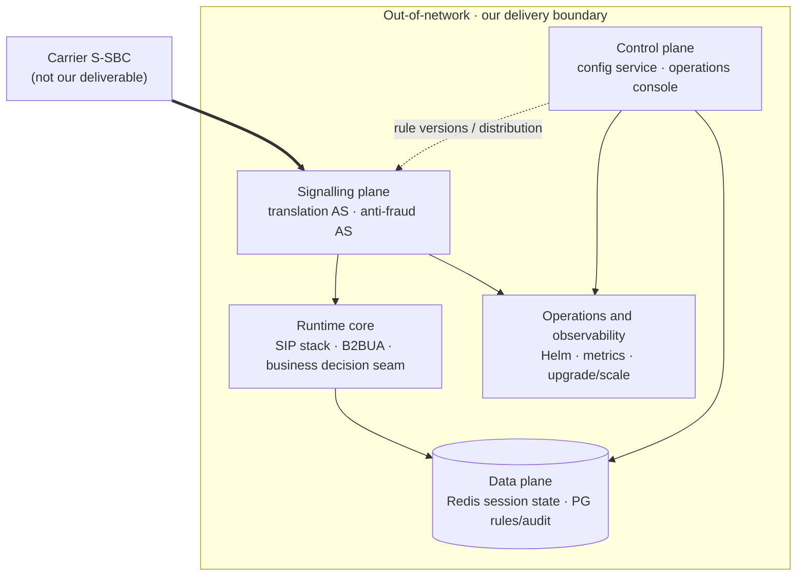

<!--
Inhouse-IMS-AS — Copyright 2026 Dolan Shu <dolan.d.shu@gmail.com>, Apache-2.0

Licensed under the Apache License, Version 2.0 (the "License");
you may not use this file except in compliance with the License.
You may obtain a copy of the License at

    http://www.apache.org/licenses/LICENSE-2.0

Unless required by applicable law or agreed to in writing, software
distributed under the License is distributed on an "AS IS" BASIS,
WITHOUT WARRANTIES OR CONDITIONS OF ANY KIND, either express or implied.
-->

# Pre-M8 Product Demo / Review Plan

> **Status (2026-10-08)**: stories A/B run live on the kind `as-m71` test page. The adjudication rules come from the config-service compiled bundle. The cluster shot of story C has been moved to `as-m71` and is still L1; 7.2d stays in `kind-as-m5`. Stories D/E only got narration added. The run sheet is [`2026-10-07-demo-on-m71-platform-plan.md`](2026-10-07-demo-on-m71-platform-plan.md).
>
> **Audience**: carrier business configuration staff, the operations lead, signalling/integration engineers (**customer and stakeholders**).  
> **Purpose**: before formal M8 acceptance, use repeatable scenarios to explain **what the product does** and where its boundaries are.  
> **Not this**: an internal milestone walkthrough, an R&D process report, or a test-plan sign-off meeting.  
> **Basis**: [`architecture/system-architecture.md`](../architecture/system-architecture.md), [`requirements/prd.md`](../requirements/prd.md).

Evidence directory (for internal use by the running party): `artifacts/demo-review/<YYYY-MM-DD>/`.

---

## 1. The Three Things the Customer Should Take Away

1. **What we are**: a third-party AS deployed **outside** the IMS network; the S-CSCF triggers it via the carrier's **S-SBC** per iFC; we execute the business adjudication and send the SIP result back (**no media, no CDR**).
2. **What we deliver**: configurable use-case processes such as **number translation / anti-fraud**, plus a **rule governance console**, plus **Kubernetes deployment and operations capability** (scaling, upgrades, observability seams).
3. **How the customer uses it**: business staff change rules through the **HTTPS console** and go through **approval**; the signalling plane is **stateless and multi-replica**, with the necessary session state in **Redis**; rules and audit are in **PostgreSQL**.

---

## 2. Product Introduction

Which units make up the product and what the demo environment looks like. Use §2.6 to open for the customer. The full architecture is in [`system-architecture.md`](../architecture/system-architecture.md).

### 2.1 Position Within the IMS Network

The third-party AS is still triggered by the S-CSCF per iFC (3GPP TS 24.229). The carrier's S-SBC does transparent bridging:

- To the S-CSCF, the third-party AS is just an in-network AS; the message leaves the network from the S-CSCF.
- To the AS, a message coming from the S-SBC is a message coming from the S-CSCF; the AS believes it is still inside the network.

The AS implements only one access semantic: ISC (triggered by the S-CSCF). The S-SBC is a carrier network element, not one of our deliverables. In the demo a simulator stands in for it.



The product touches no media (SDP is passed through verbatim), does no CDR, billing, or lawful interception (LI).

### 2.2 Overall Architecture



| Layer | Responsibility | Statefulness |
|---|---|---|
| ① Signalling plane `apps/` | Use-case processes, carrying SIP calls and business adjudication | Stateless (the necessary state is externalized to Redis) |
| ② Core `platform/` | Process shell, SIP stack and B2BUA control, decision seam, two pluggable seams | Stateless |
| ③ Control plane `services/` | Rule governance (versions, approval, distribution), operations console | Stateless (the state is in PG) |
| ④ Data plane | Redis holds runtime state, PG holds governance state | Stateful, redundancy required |
| ⑤ Cross-cutting | Observability, security, operations | Stateless (back ends excepted) |
| ⑥ testbed | Three-layer test assets and simulated network elements | R&D asset, not delivered in v1 |

The deployment form is Kubernetes + Helm, single-tenant on-premises. compose is used only for development and for the console demo. The redundancy target is N+1 within a site and 1+1 warm standby across sites; active-active is not done.

### 2.3 The Units

**Product (deliverables)**

| Unit | Code location | What it does | Current state (2026-10-08) |
|---|---|---|---|
| Number translation AS | `apps/translation` + `platform` | Receives the INVITE from the S-SBC, adjudicates on the called-party prefix: translate, forward, block, or no match. After translation it places the outbound leg with a new Call-ID, and once answered it forwards the inbound BYE to the outbound leg | UDP, TCP and TLS all work on kind. T1 `+8613800138000` outbound user `013800138000`, T4 404, T5/F1 200, F2 603. The TLS outbound leg uses `sips:` |
| Runtime core | `platform/src/as_platform` | Process shell, `SipStackService`, native extension `_resip_runtime` (reSIProcate DUM), `decide()` decision seam, peer whitelist, `/metrics` and `/health` (8080), draining | Adjudication rules are read from the activated bundle pointed to by `AS_CONFIG_BUNDLE_PATH`; `AS_RULESET_JSON` takes priority when non-empty. The process does not proactively pull packages |
| Translation outbound hook | `apps/translation/.../outbound.py` | Loaded via `AS_SIP_ROUTE_HOOK`. Rewrites numbers per `AS_TRANSLATION_RULES_JSON` (strip `+86`, add `0`), assembles the outbound URI, and the next hop is the S-SBC southbound side | The bundle cannot express prefix stripping or prefix addition, so the rewrite table still goes through this environment variable |
| Anti-fraud AS | `apps/anti-fraud` | Caller screening, single-leg rejection with 608 (RFC 8688) | The decision module and unit tests exist. This process is not started on kind: it would contend with translation for SIP 5060. F1/F2 are forwarded or blocked by the translation process core |
| config-service | `services/config-service` | Rules, change orders, approval (the submitter cannot self-approve), ConfigBundle compilation, activation, distribution notification, users and sessions, HMAC audit. The API is under `/internal/v1` | Enabled on kind via lab values; before the demo it is used to walk the proposal, approval, distribution and activation of the four rules. In production `services.configService.enabled` defaults to false |
| Operations console | `services/console` | Pure HTML/JS, served by config-service from `/`. Views: Rules, Change orders, Call traces, Operations | Login requires HTTPS. The demo is done on compose (Caddy, `https://localhost:8443`). The kind `as-m71` cluster offers no console login |
| PostgreSQL | Helm `stateStores` | Rule versions, change orders, audit, console users | On kind it is the `as-sut-postgres` StatefulSet, with tables created by a migration Job |
| Redis | Helm `stateStores` | Direction of the call checkpoint necessary for calls, rate windows | `as-sut-redis` is running on kind. Restoring a call after a process restart (REQ-NF-1) is not signed off |
| Helm chart | `deploy/helm` | Use-case Deployment/Service, config-service, Ingress templates, PG/Redis, migration Job, NetworkPolicy, HPA, PDB | Production defaults are fail-closed: when TLS is enabled a certificate Secret must be supplied, and the peer whitelist cannot be empty |
| Alert templates | `deploy/alerts/as-alerts.yaml` | Ratio-based and state-based alerts | There are no absolute CPS or concurrency thresholds; awaiting the capacity study |
| Release image | `deploy/docker/Dockerfile` | The product image for delivery | Currently a process shell with no SIP listening. To be filled in before reopening M8 |

**Test platform (not delivered)**

| Unit | Code location | What it does |
|---|---|---|
| Simulated S-CSCF | `testbed/simulators`, role `scscf` | Receives the calls issued by the test page and forwards them to the northbound S-SBC |
| Simulated S-SBC northbound / southbound | Roles `ssbc-north`, `ssbc-south` | Transparent bridging: the northbound side sends the call into the product AS, and the southbound side sends the AS's outbound leg to the called party. Each hop writes its own headless Service name in Via, Record-Route and Contact |
| Simulated called party | Role `uas` | Returns 200 to INVITE (with minimal SDP), returns 200 to BYE |
| call-load and the test page | Role `ui` + `testbed/load` | Standard-library HTTP page, no login. Select the call type (T1, T4, T5, F1, F2), transport, CPS, duration, hold time, concurrency cap, and press start. It shows per-type sent, answered, failed, response codes, setup latency and non-torn-down count. It sends SIP only to the simulated S-CSCF |
| Test CA | `python -m as_simulators issue-certs` | Generated temporarily at install time. Not a carrier PKI; the page banner says "not a carrier PKI" |
| Contracts and differential checks | `testbed/contracts`, `testbed/probe` | Decision contracts, SIP baseline (S1–S4, etc.) differential checks |
| Local load-testing harness | `testbed/load` | Sends SIP over real sockets and tallies response codes and BYEs. Story E's internal capacity study uses it |
| Local console environment | `deploy/compose` | PG, config-service, Caddy (HTTPS 8443), migrations, initial administrator. Story A's console is here |

The test page tallies the counts of this round; it is not a capacity commitment. Sending SIP directly from call-load to the product's SIP is dropped by network policy (timeout), which is the expected behavior.

### 2.4 The infra Used by the Current Demo



In `ims-sim`, `scscf`, `ssbc-north`, `ssbc-south`, `uas` and `call-load` are each one Deployment (1 replica, 1 container, 1 process, image `ims-sim:dev`, distinguished by `--role`). What the browser opens is the test page, not the product console. The product console is compose's `https://localhost:8443` and is not on this cluster.

One kind node; the two namespaces share the Calico pod subnet `192.168.0.0/16`. NetworkPolicy: call-load may connect only to `scscf`; the product translation Pod's SIP talks only to the two simulated S-SBCs. The ConfigMap `as-sut-runtime-bundle` is mounted at the translation process's `/etc/as/bundle/bundle.json`.

| Item | Value |
|---|---|
| Host | WSL2 Linux, Docker engine |
| Tools | `kind` v0.29.0, `kubectl`, `helm`, placed in `.tools/m71-bin` |
| Cluster | kind `as-m71`, context `kind-as-m71`, one control-plane node `kindest/node:v1.33.1` |
| Network | Calico v3.28.2. The two namespaces share the pod subnet `192.168.0.0/16` |
| Images | `ims-sim:dev` (`testbed/sim-platform/Dockerfile`); `as-sut:dev` (`testbed/sim-platform/Dockerfile.product`, which copies in the locally built `_resip_runtime` and the reSIProcate libraries); `as-config-service:m71-lab` (`deploy/docker/config-service.Dockerfile`). All are loaded into the node with `kind load` |
| Helm | `ims-sim` uses `testbed/sim-platform/chart`; `as-sut` uses the product chart `deploy/helm`, overlaid with `values-product-as.yaml` and `values-product-as-bundle.yaml` |
| Secrets | `ims-sim-test-ca` (both namespaces), `as-sut-test-tls` (product TLS), `as-sut-config-runtime` (lab database and audit keys) |
| Rules | Adjudication rules: ConfigMap `as-sut-runtime-bundle`, the four `t1-plus86`, `t5-forward`, `f1-allow`, `f2-block`. Rewrite table: `t1-plus86` inside `AS_TRANSLATION_RULES_JSON` |
| Network policy | call-load may connect only to `scscf`. Product SIP accepts only port 5060/5061 from the northbound S-SBC and the replies of the southbound S-SBC; outbound goes only to the two S-SBCs, Redis and DNS. The metrics port 8080 is open |
| Access | Only the test page reaches the local host on `8088` via `port-forward`. There is no Ingress |
| Install / cleanup | Install see §4 "Before the session", cleanup see §4 "After the session". The definition of clean is in §4 "Clean" |

The kind `as-m5` cluster is a different cluster; it holds only the 7.2d Ingress login evidence and is not part of this session's environment.

### 2.5 Points Worth Bringing Up While Presenting

- **How rules reach the process.** Rules are changed in the console or via API → change order → approval by another person → config-service compiles an immutable version → distribution notification (carrying only the change id and version number) → activation. In this session a script writes the activated bundle into a ConfigMap and mounts it into the Pod; the process reads the file at startup. The process does not proactively pull packages.
- **One access semantic.** Only ISC; the trunk is the bearer, not a second kind of business.
- **One process per use case.** Each use case is an independent process, fault domain, and scaling boundary. This is also why the anti-fraud process is not started in this session: two processes would contend for the same SIP port.
- **SIP result codes.** 404 for no match, letting the S-CSCF continue the iFC chain; 603 for block; 608 for the anti-fraud process's rejection. In this session F2 is 603.
- **Security boundary.** Three layers: peer whitelist + TLS + network policy. Console login requires HTTPS, the submitter cannot self-approve, and operations are audited. LI is not involved.
- **Scaling.** The metric `as_active_calls`; downscale drains first and deletes the Pod only when active calls reach zero. The HPA thresholds await the capacity study and are not filled in now.
- **What this session does not sign.** REQ-S-2 / REQ-S-3 (test CA), REQ-S-4 (the test page is not the console), REQ-NF-1 (call recovery), capacity figures. M8 remains on hold.

### 2.6 One Diagram to Open the Demo

For the customer, talk only about the five delivered blocks; do not mention repository directory names:



| Block as stated to the customer | What it does | What is seen in this session |
|--------------|--------|-------------|
| **Signalling plane** | Catches the trunk INVITE and translates, rejects, or forwards per the rules | The test page hits the product AS through the simulated S-CSCF / S-SBC: T1 200, T4 404, F2 603 |
| **Runtime core** | reSIProcate, two-leg semantics, UDP/TCP/TLS, whitelist | One round per transport, BYE torn down cleanly; the TLS outbound leg uses `sips:` |
| **Control plane** | Rules, change orders, approval, distribution, users and sessions | The HTTPS console on compose; on kind the adjudication rules come from the config-service compiled bundle |
| **Data plane** | Redis checkpoint direction; PG governance and audit | `as-sut-redis` and `as-sut-postgres` are running; call recovery is not signed |
| **Operations** | Containerization, Helm, draining, metrics, alert templates | The Deployments of the two `as-m71` namespaces, `as_active_calls`, the alert YAML |

testbed is mentioned only when explaining to a technical audience "how behavior is verified"; it is never stated externally as a product deliverable.

---

## 3. Delivery Capability Map (organized by "what was built")

The following capabilities correspond to PRD user stories / REQ families; the demo selects scenes by **capability**, not by R&D phase.

### 3.1 Calls and Business Adjudication (signalling + core)

| Capability | Customer value | Typical SIP result | How it is demoed (locally) |
|------|----------|---------------|------------------|
| **Basic call completion** | After iFC triggers, the AS can complete dialog establishment | 100/180/200… | Contract differential check of the S1 shape (see Appendix A-Signalling) |
| **No matching service** | The S-CSCF can continue the iFC chain | **404** | A process shell with an empty rule set, or the S2 differential check |
| **Policy rejection (anti-fraud shape)** | An immediate rejection when a blocked number range is hit | **603** | Anti-fraud/translation `decide()` + the S3 differential check |
| **Number translation (two legs)** | A new Call-ID for the outbound leg, the called party rewritten | 200 + a second-leg INVITE | Decision demo + the FORWARD integration test |
| **Downstream busy** | The busy signal is mapped reasonably | **486** | FORWARD second-leg 486 mapping |
| **Caller cancel** | An early cancel does not hang | **487** | The S4 differential check (Story B step 5, one click; see `test_e1_s4_*`) |
| **SDP pass-through** | No media is touched, the offer bytes are identical | The SDP body is unchanged | The SDP byte-comparison integration test |
| **Anti-fraud single leg** | Caller screening rejection | **608** (RFC 8688) | The `apps/anti-fraud` decision cases (can run without sockets) |

### 3.2 Configuration Governance (control plane)

| Capability | Customer value | v1 scope | How it is demoed |
|------|----------|---------|----------|
| **Rule management (called party + prefix)** | Bind translation/rejection and the like to number ranges | **Excludes** caller/regex (v1.1) | Create/change in the console + the PG pipeline integration test |
| **Change orders and approval** | Prevents operator error | The submitter cannot self-approve | Two accounts in the browser: draft → submit → approve/reject |
| **Rule compilation and activation** | A ConfigBundle consumable at runtime | `runtime_bundle` pure function + the activation API | Show the shape of the bundle after activation (exportable as JSON) |
| **Distribution and rollback** | Consistent version across instances | Fleet notification + health placeholder | Operations UI + the fleet API test |
| **Identity and sessions** | Secure console login | Password sessions, HTTPS, CSRF | compose login + (optionally) the kind Ingress login |
| **Operation audit** | Who changed what | append-only audit | API/table description + the integration test summary |

### 3.3 Security and Access

| Capability | Customer value | How it is demoed | On-site limitation |
|------|----------|----------|----------|
| **Same-origin HTTPS console** | Browser and API on the same domain | `deploy/compose` + Caddy | Self-signed certificate |
| **SIP peer constraint** | Only the carrier trunk is trusted | peer allowlist / TLS seam | loopback policy test; **not** a real carrier PKI network |
| **SIP TLS** | Trunk encryption | TLS runtime smoke | Local certificate |
| **Certificate rotation seam** | Operations can hot-rotate certificates | Documentation + unit tests | Full dual-certificate overlap window → carrier environment |

### 3.4 Reliability and Sessions

| Capability | Customer value | How it is demoed | On-site limitation |
|------|----------|----------|----------|
| **Session checkpoint (direction)** | The dialog is restored after a process restart | Redis + establish callback + the D10 harness | **Not** a formal NF-1 sign-off on a customer K8s |
| **Graceful shutdown / ISSU** | Fewer dropped calls during upgrades | draining + readiness 503 | kind evidence (`active_calls` can be simulated) |
| **Downscale protection** | Instances are not removed while calls are active | downscale runbook + criteria | At the operations script layer, not a fully automatic actuator |
| **Redis Sentinel wiring** | Redis HA within a site | Client resolution and unit tests | A real Sentinel cluster need not be started |

### 3.5 Operations, Capacity and Observability

| Capability | Customer value | How it is demoed | Talking points |
|------|----------|----------|------|
| **Kubernetes deployment** | Standard on-premises delivery | Helm chart, kind Pods Running | Cross-checked against `deploy/helm/README.md` |
| **Metrics** | Capacity and fault discovery | `as_active_calls` and the like in `/metrics` | In M5 these may be simulated values; real call counting goes through the signalling path |
| **Alert rule set** | Out-of-the-box monitoring templates | `deploy/alerts/as-alerts.yaml` | **No** absolute CPS thresholds (to be filled from the capacity study) |
| **Capacity study method** | Provides the basis for HPA/scaling | as_load on the product path + the internal O1 report | **Internal study only**, no external SLA |

---

## 4. On-site Steps (After M7.1)

The live site is the kind `as-m71`. Run from the repository root. When `kubectl` is not on PATH, add `.tools/m71-bin`. Scripts and logs: [`scripts/demo-review/README.md`](../../scripts/demo-review/README.md), `artifacts/demo-review/<date>/story-*/`. Execution record: [`2026-10-07-demo-on-m71-platform-plan.md`](2026-10-07-demo-on-m71-platform-plan.md).

Each step has three columns: **what to do** is the operation, **what to look at** is the pass criterion, and **what to say** is what is said to the customer. This session does not sign REQ-S-2 / REQ-S-3 / REQ-S-4.

Before the opening it must be the clean environment defined below. The Pods are created by the two pre-session install scripts, not by the opening commands. After the session, return the environment to clean.

### Clean

**Prerequisites; the cleanup script does not touch them**

| Item | Notes |
|---|---|
| Docker engine | Running. Base image caches are left behind, e.g. `kindest/node`, `python`, `postgres`, `redis` |
| `kind`, `kubectl`, `helm` | On PATH, or in the repository's `.tools/m71-bin` |
| `uv`, Python 3.10, `make`, C toolchain | The native SIP module must be built before the session |
| Local reSIProcate cache | `.cache/m2-resiprocate` and the already-built `_resip_runtime*.so`. When there is no `.so`, the pre-session `make m2-platform-resip-build` builds it |
| Network | Able to pull images. When the local host uses a proxy, export `http_proxy` / `https_proxy` yourself |
| Other kind clusters | For example 7.2d on `as-m5`. This session deletes only `as-m71` |

**Clean: this must hold both before the demo starts and after it ends**

- `as-m71` is not in `kind get clusters`
- The local host has no image tags `ims-sim:dev`, `as-sut:dev`, `as-config-service:m71-lab`
- There is no `kubectl port-forward` of `ims-sim-ui` to local `8088`, or of Postgres to local `15432`
- There is no local container named `as-d10-redis`

```bash
bash scripts/demo-review/reset-m71-between-demos.sh --check
```

It prints `as-m71 demo environment is clean` and exits 0.

### Before the Session: Bring the Environment Up

This step is not shown to the customer. Confirm clean first. If it is not clean, run the post-session cleanup first, then install.

**What to do**

```bash
bash scripts/demo-review/reset-m71-between-demos.sh --check
uv sync
make m2-platform-resip-build
bash testbed/sim-platform/kind-up.sh
bash scripts/demo-review/publish-m71-bundle.sh
```

`make m2-platform-resip-build` builds the native module used by the product's SIP, and `kind-up.sh` copies it into the lab images. `kind-up.sh` creates the kind cluster `as-m71` (where the Pods appear), installs Calico and the network policies, issues the test certificates, builds and loads `ims-sim:dev`, `as-sut:dev`, `as-config-service:m71-lab`, and then installs `ims-sim` and `as-sut` with Helm. `publish-m71-bundle.sh` walks the four adjudications through proposal, approval, distribution and activation inside config-service and mounts the bundle into the translation process.

The two install scripts pass `http_proxy` / `https_proxy` to `docker build`. Building the images for the first time takes a dozen-odd minutes.

**What to look at**

`--check` passes first. `kind-up.sh` exits 0 and prints the test page's `port-forward` hint. `publish-m71-bundle.sh` exits 0 and prints `translation is reading the compiled bundle`. If only `kind-up.sh` was run and not the publish script, the translation process still reads `AS_RULESET_JSON`, and the opening check fails.

**What to say**

Nothing before the session is told to the customer. The cluster, the three lab images and the compiled bundle were all brought up for this session and are deleted at the end.

### Opening

**What to do**

```bash
kubectl --context kind-as-m71 -n ims-sim get deploy
kubectl --context kind-as-m71 -n as-sut get deploy
kubectl --context kind-as-m71 -n as-sut exec deploy/as-sut-translation -- python -c '
import os
path = os.environ.get("AS_CONFIG_BUNDLE_PATH", "")
rules = os.environ.get("AS_RULESET_JSON", "")
rewrite = os.environ.get("AS_TRANSLATION_RULES_JSON", "")
print("AS_CONFIG_BUNDLE_PATH", path)
print("AS_RULESET_JSON", repr(rules))
print("AS_TRANSLATION_RULES_JSON", rewrite)
assert path.endswith("/etc/as/bundle/bundle.json"), path
assert not rules.strip(), rules
assert "t1-plus86" in rewrite and "strip_prefix" in rewrite and "+86" in rewrite and "add_prefix" in rewrite
'
if kubectl --context kind-as-m71 -n as-sut get deploy as-sut-anti-fraud >/dev/null 2>&1; then
  echo "anti-fraud deployment is present" >&2
  exit 1
fi
echo "anti-fraud deployment absent"
kubectl --context kind-as-m71 -n ims-sim port-forward svc/ims-sim-ui 8088:8088
```

The browser opens `http://127.0.0.1:8088`.

**What to look at**

`scscf`, `ssbc-north`, `ssbc-south`, `uas` and `call-load` in `ims-sim` are Ready. `as-sut-translation`, `as-sut-redis` and `as-sut-config-service` in `as-sut` are Ready. Python exits 0: `AS_CONFIG_BUNDLE_PATH` ends with `/etc/as/bundle/bundle.json`, `AS_RULESET_JSON` is empty, and the rewrite table contains `t1-plus86`, `strip_prefix`, `+86`, `add_prefix`. It prints `anti-fraud deployment absent`. The page title is "IMS Simulation Platform", the banner says "not a carrier PKI", and it states that the test tool does not log in.

`printenv AS_RULESET_JSON` cannot be used to judge this: when the variable is unset, `printenv` itself exits 1.

**What to say**

This is a lab of a simulated IMS plus a product Helm AS. The test page has no login, the certificate is the test CA, and the banner says it is not a carrier PKI. This is not the product console.

### Story A — Activate the Translation Number Range

**What to do**

The console is optional, on compose at `https://localhost:8443` (self-signed certificate): log in as the administrator, create an approver, and open the called-prefix rules, change orders, approval and distribution. `bash scripts/demo-review/story-a.sh --with-compose` runs `smoke-https` only when `.env` and the certificates are complete.

The signalling is on the test page: tick T1, T4, T5, F1, F2. Duration 3 seconds, target CPS 5, hold time 0.2 seconds, max concurrent calls 8. Select transport UDP, press start, and wait until "this run's results" no longer says it is running. Script stand-in: `make demo-story-a` (`--skip-pg` may be added).

**What to look at**

The response codes for T1 include 200 and for T4 include 404. The product log contains the outbound user `013800138000`:

```bash
log="$(kubectl --context kind-as-m71 -n as-sut logs deploy/as-sut-translation --since=3m)"
printf '%s\n' "$log" | grep -F '013800138000'
printf '%s\n' "$log" | grep -F 'OUTBOUND_BYE_FORWARD'
```

Both `grep` commands exit 0. The not-torn-down count in the footer is 0. The counts need not be 200×9.

**What to say**

The four adjudications (T1 translation, T5/F1 forwarding, F2 blocking) come from the bundle compiled by config-service and mounted in; the process reads `AS_CONFIG_BUNDLE_PATH`. Rewriting `+86` to a leading `0` is still the translation application's `AS_TRANSLATION_RULES_JSON`, because the bundle cannot carry strip/add. The process does not pull packages. Console HTTPS login is not on this cluster; the compose page is the console.

### Story B — Block Fraud Number Ranges

**What to do**

On the same page with the same parameters, change the transport to TCP, then to TLS, running one round each. UDP has already been seen in story A, so it need not be run again; run UDP too only when all three rounds must be recorded. Script stand-in: `make demo-story-b`.

The caller-cancel 487 and the anti-fraud process's 608 are not exercised on this page. The second half of the script is local unit tests: `test_e1_s4_*` and `apps/anti-fraud/tests/test_decision.py`.

**What to look at**

| Type | Response code |
|---|---|
| T1 | 200 |
| T4 | 404 |
| T5 | 200 |
| F1 | 200 |
| F2 | 603, with no 608 |

The not-torn-down count in the footer is 0. The page states that this is not a capacity commitment. The counts need not be 200×9, 404×3, 603×3 on every round. After the TLS round:

```bash
log="$(kubectl --context kind-as-m71 -n as-sut logs deploy/as-sut-translation --since=3m)"
printf '%s\n' "$log" | grep -F 'sips:013800138000'
```

This `grep` exits 0. The three checks must be done separately; when the two statements are combined into one `grep` with `|`, it also exits 0 if only one of them matches.

**What to say**

F2's called prefix `+15550003` gets 603. This block rule is in the compiled bundle. 608 belongs to a different anti-fraud process that is not started on this network, because it would contend with translation for 5060. 487 is only a contract shape, not a first-version call type, and is not demoed on this cluster.

### Story C — The Platform Can Be Operated

**What to do**

The two `get deploy` commands from the opening are the cluster shot. Then read the translation process's metrics. Script stand-in: `make demo-story-c`.

```bash
kubectl --context kind-as-m71 -n as-sut exec deploy/as-sut-translation -- \
  python -c 'import urllib.request; t=urllib.request.urlopen("http://127.0.0.1:8080/metrics").read().decode(); print([l for l in t.splitlines() if l.startswith("as_active_calls")])'
```

The 7.2d Ingress login stays in `kind-as-m5`. Run `make m5-7.2d-evidence` only when `M5_7_2D_E2E_PASSWORD` is set and that context still exists. Skip it otherwise.

chart-check, the draining unit tests and the head of the alert YAML are surfaced by `story-c.sh`. Manually, it is enough to look at the cluster and that one line of metrics.

**What to look at**

The five simulated Deployments in `ims-sim` and translation, Redis and config-service in `as-sut` are Ready. The anti-fraud Deployment does not exist. The metrics print one line of `as_active_calls`. The alert file `deploy/alerts/as-alerts.yaml` contains no absolute CPS value.

**What to say**

This is L1: the shape of the Helm contract, the metrics and the alert templates. The anti-fraud process is not started, and the 603 of F1/F2 is on the translation process. This one line of `as_active_calls` only shows that the metric exists. Production alerting and downscaling are not closed out here. The test page is not the 7.2d console login. See [`m5-full-chain-review-2026-10-05.md`](../reviews/m5-full-chain-review-2026-10-05.md) and the F10 reconciliation.

### Story D — Calls Are Not Dropped Casually

**What to do**

Look at `as-sut-redis` already being Ready from the opening. The measurement script is unchanged; run it separately when needed: `AS_REDIS_URL=redis://127.0.0.1:6379/0 make demo-story-d`. That one uses a local Redis, not a customer cluster.

**What to look at**

`as-sut-redis` is Ready. If the local harness was run, its logs are in `artifacts/demo-review/<date>/story-d/`.

**What to say**

Multi-replica and stateless, with the necessary session state checkpointed to Redis. Redis is running in `as-sut`. Actually killing Pods and the upstream BYE are done on a customer K8s and are not done before Close; this is not an REQ-NF-1 sign-off.

### Story E — How Much We Can Handle

**What to do**

Open the first 45 lines of [`m6-o1-measurement-report-2026-10-05.md`](../acceptance/m6-o1-measurement-report-2026-10-05.md). The counts just run on the test page are not copied into that report. The full batch is optional: `make demo-story-e` with `--full-o1`.

**What to look at**

The report describes dev-host samples and the study method. The body does not contain the few-second counts of this session's `as-m71` test page.

**What to say**

This is an internal capacity study method, not an external CPS or concurrency SLA. The HPA thresholds are filled in after the O1 conclusion.

### After the Session

**What to do**

```bash
bash scripts/demo-review/reset-m71-between-demos.sh
```

**What to look at**

The script exits 0 and prints `as-m71 demo environment is clean`. `as-m71` is not in `kind get clusters`. The three lab image tags are gone. The port forwards for `8088` and `15432` are stopped. `as-m5` and the other base images are still there.

**What to say**

The environment is back to the clean state it had before the session. The next session must reinstall from "Before the Session: Bring the Environment Up"; it cannot continue from the opening by inspecting Pods.

## 5. Session Packages (Pick a Capability Package by Audience)

| Package | Duration | Stories | Audience |
|------|------|------|------|
| **Business half-day** | 3–4 h | A + B (console-focused, with signalling bridged in) | Carrier business configuration |
| **Signalling half-day** | 3–4 h | B + A-5 + SDP/486/487 | Core network / integration |
| **Operations half-day** | 3–4 h | C + D (light) | Platform SRE |
| **Full-view day** | 6–8 h | A → B → C → (optional E) | Joint review |
| **Remote 90 min** | 1.5 h | The §2.6 opening diagram + a trimmed story A (console only + one recorded 404/603 differential check) | Management |

---

## 6. How to Choose the Environment (How to Say It to the Customer)

| Environment | What it represents | Suitable stories |
|------|----------|----------|
| **`deploy/compose`** | Single-host dev: **real** PG + config-service + HTTPS console | A, B's control plane |
| **Loopback + process shell** | Signalling behavior, simulated S-SBC | A-5, B, D's signalling part |
| **kind `as-m71`** | Simulated IMS + product Helm AS. The test page is not the console | A's signalling, B, C's cluster shot |
| **kind `as-m5`** | 7.2d Ingress login evidence. Not moved to `as-m71` | C's optional login step |
| **The internal O1 report** | Capacity **study** evidence | E |

See **Appendix B** for the pre-session technical preparation; see [`scripts/demo-review/README.md`](../../scripts/demo-review/README.md) for the script descriptions.

---

## 7. Demo Boundaries (Must Be Stated Proactively)

Do **not** imply to the customer that a capability is accepted or delivered when it is not:

| Topic | How to say it |
|------|--------|
| **S-SBC / carrier PKI** | We verify behavior on the simulated S-SBC and the test CA of kind `as-m71`; integration with your S-SBC is an integration project plus M8 environment evidence. |
| **Full Call-ID trace query (US-3)** | The product design direction exists; **console live trace is not delivered**; complaint tracing is M8 / a later version. |
| **Caller / regex rules** | v1 covers **called party + prefix** only; caller/regex is on the v1.1 list. |
| **Automatic push of rules to SIP Pods** | Governance and compilation are delivered; **on-site joint debugging** can inject a bundle file; the production pull method is closed by the deployment agreement. |
| **HPA numbers / CPS SLA** | There is only internal measurement methodology and dev-host samples; **no** commercial capacity commitment is made. |
| **CDR / LI / media** | Explicitly non-goals (PRD). |

---

## 8. Review Scorecard (By Capability, Not Milestone)

| Capability area | Question | 1–3 |
|--------|------|-----|
| Positioning | Is the out-of-network AS + S-SBC semantics clear? | |
| Translation | Do the two legs and the number-range rules match expectations? | |
| Anti-fraud | Is the 603/608 policy acceptable? | |
| Governance | Do approval and audit satisfy the operations rules? | |
| Security | Is the HTTPS/TLS/whitelist narrative credible? | |
| Reliability | Are the upgrade/downscale/checkpoint expectations aligned? | |
| Deployment | Does the K8s/Helm form meet procurement expectations? | |
| Capacity | Is the distinction between "study" and "SLA" understood? | |
| Gaps | Which items in §7 need to go into the contract / integration plan? | |

---

## Appendix A — Quick Reference for the Running Party

```bash
# 全会前冒烟（有 Redis 时含 D）
AS_REDIS_URL=redis://127.0.0.1:6379/0 make demo-review-all

# 分故事
make demo-story-a    # 加 --with-compose：见 scripts/demo-review/story-a.sh
make demo-story-b
make demo-story-c
AS_REDIS_URL=redis://127.0.0.1:6379/0 make demo-story-d
make demo-story-e
```

Browser console: [`m4b-8-runbook.md`](../acceptance/m4b-8-runbook.md) (compose, not the `as-m71` test page). Cluster shots for this session: [`m71-sim-platform-evidence.md`](../acceptance/m71-sim-platform-evidence.md). 7.2d still see [`m5-7.2d-ingress-runbook.md`](../acceptance/m5-7.2d-ingress-runbook.md).

---

## Appendix B — Pre-Session Checks (For Internal Use by the Running Party)

| Check item | Command/condition |
|--------|-----------|
| Dependencies | `uv sync` |
| One-click verification | `AS_REDIS_URL=redis://127.0.0.1:6379/0 make demo-review-all` |
| Native SIP | `make m2-platform-resip-build` (the A/B/D/E scripts build it as needed) |
| Compose (story A's on-site UI) | `deploy/compose` + `story-a.sh --with-compose` |
| Kind (story C's cluster shot) | `kubectl` context `kind-as-m71` |
| 7.2d browser | `M5_7_2D_E2E_PASSWORD`, and the context is still `kind-as-m5` |
| Redis (story D) | `docker run -d --name as-d10-redis -p 6379:6379 redis:7`. The post-session script deletes this container |

---

## Appendix C — Document Index (Internal Tracing)

| Document | Purpose |
|------|------|
| [`prd.md`](../requirements/prd.md) | User stories and REQs |
| [`system-architecture.md`](../architecture/system-architecture.md) | Layering and deployment |
| [`m4b-8-runbook.md`](../acceptance/m4b-8-runbook.md) | Console steps |
| [`test-plan.md`](../acceptance/test-plan.md) | Formal M8 acceptance (not this session) |
| [`plan.md`](../plan.md) §4 | Internal only: engineering gate-closure record |

**Maintenance**: when a capability or the PRD changes, update the §3 tables and the story steps; the appendix commands change when the scripts are renamed.
