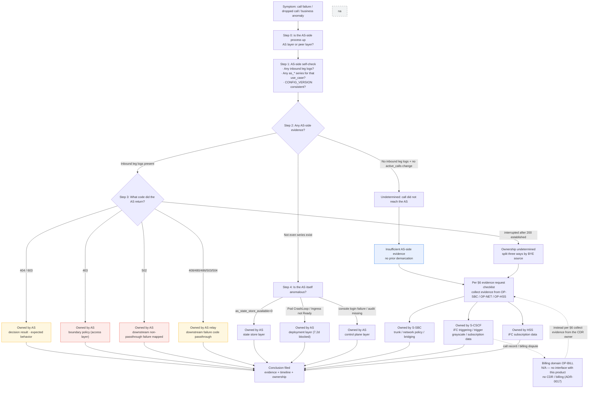

<!--
Inhouse-IMS-AS — Copyright 2026 Dolan Shu <dolan.d.shu@gmail.com>, Apache-2.0

Licensed under the Apache License, Version 2.0 (the "License");
you may not use this file except in compliance with the License.
You may obtain a copy of the License at

    http://www.apache.org/licenses/LICENSE-2.0

Unless required by applicable law or agreed to in writing, software
distributed under the License is distributed on an "AS IS" BASIS,
WITHOUT WARRANTIES OR CONDITIONS OF ANY KIND, either express or implied.
-->

# Fault Demarcation Manual (Fault Demarcation) — In-house IMS Application Server

> **Deliverable ownership**: [`../product-packaging-plan.md`](../product-packaging-plan.md) §1 first batch **1.4 Fault demarcation manual**. Per §3.2 of that plan, this deliverable is **class A** (the document itself does not depend on undecided items); but **real-cluster / real-peer evidence is still blocked** (see §8).
>
> **Cross-links**: cross-linked with [`../product/responsibility-matrix.md`](../product/responsibility-matrix.md) (RACI; the ownership conclusions in §3 of this document are bound by that document's §4), [`runbook-l1.md`](runbook-l1.md), [`runbook-l2.md`](runbook-l2.md) (layered fault tree), and [`rollback-playbook.md`](rollback-playbook.md) (rollback).
>
> **Status note**: the outdated "not created" annotations in upstream documents were cleaned up uniformly on 2026-10-10; the blocked states described in this document (**real cluster evidence / drill records**) **still hold**.
>
> **⚠️ iFC triggering is on the S-CSCF / HSS side (review G-P0-5 adjudicated)**. This product **only implements the business decision, traffic removal, and rollback after ISC triggering**, and **does not implement iFC**. The AS side holds neither the iFC trigger context nor iFC trigger logs. For all "why didn't the call reach the AS" questions, the **trigger-side** evidence can only be provided by OP-NET / OP-HSS / OP-SBC.
>
> **This document provides no LI / IRI** (ADR-0016: **no collection point reserved for it**; IRI is an in-network network element function, and third-party AS involvement would introduce cross-jurisdiction exposure). **TLS decryption is each party's own responsibility, and keys are not shared across parties** — the AS side **does not accept** copying peer private keys for decryption (`AGENT.md` §11 / §13).
>
> **testbed simulation is not production evidence**. `testbed/` is an R&D / demo asset, and ADR-0014 explicitly makes the testbed not a v1 deliverable; packet captures and logs on kind / compose **must not** serve as operator IOT or production evidence.
>
> **Evidence wording**: M8 RC artifacts are ready but **exit sign-off is still shelved** (RC ready ≠ passed); **E1 / E4 / E5 not accepted**; **e2e**: `pytest -m e2e` **8 tests pass stably** (fail, not skip, when native is missing), REQ-F-1 = **automated subset covered / full text still open**; **7.2d (M4b-7.2d / M8-7.2d) still blocked**; sign-off matrix pass 9 / fail 0 / **blocked 12** / n-a 4 / **open 24** ([`../acceptance/report.md`](../acceptance/report.md) §0.5).
>
> **Zero capacity numbers**: this document contains no CPS / CAPS / BHCA / concurrency / throughput / latency / percentage capacity, and does not cite M6 dev-host numbers. The O1 capacity target is **undecided** (`AGENT.md` §2). **Demarcation must not use capacity numbers** — any inference of "above a certain magnitude it must be the peer's problem" **does not hold** under this document's wording.
>
> **Billing domain N/A throughout**: no CDR, no delivery, no archiving, no pricing (ADR-0017); replaced by call traces by Call-ID, and **call traces are not call records**. Diameter Sh not done (data comes from our own data plane); media not done (ADR-0004).
>
> **B6 review status**: this document has been reviewed under B6 with a review record left — [`../reviews/product-packaging-review-checklist-2026-10-12.md`](../reviews/product-packaging-review-checklist-2026-10-12.md) §6 (2026-10-12 first review) and §7 (2026-10-12 closure re-review); **the conclusion awaits maintainer confirmation** and must not serve as a basis for external delivery or acceptance before confirmation (`AGENT.md` §3.3).

---

## 1. General Demarcation Principles

**Fixed order: layer first, then assign responsibility.** The layering order is consistent with [`runbook-l2.md`](runbook-l2.md) §1: deployment layer → access layer → control plane layer → decision layer → state store layer. Reversing it (suspecting the decision first) is the most common waste. **Ask "does this layer have evidence" before asking "whose fault is it"**.

**"Prove in 5 minutes it is not your fault" — what the AS side can self-certify**

| Can self-certify | Forensics method |
|---|---|
| Whether the process is ready | `/health/live`, `/health/ready` (port from `AS_HEALTH_PORT`) |
| Which SIP messages were received / sent | Runtime logs by Call-ID (§4.2 field contract) |
| Whether the configuration version in effect per replica is consistent | `printenv CONFIG_VERSION` |
| Whether Redis is reachable | `as_state_store_available{use_case}` |
| Which instances may be drained | `as_downscale_removable{use_case,pod}` |
| The decision path itself | `decide()` is a pure function (no socket / no clock / no global state), replayable |

**What the AS side cannot self-certify (must collect evidence from the peer, see §6)**: ① the **iFC trigger context and result** of the S-CSCF → S-SBC segment (that segment **does not pass through the AS at all**); ② the **peer-side** signaling landing result of the S-SBC → AS trunk segment (both sides **capture on their own side**); ③ what the outgoing leg signaling was received by at the **downstream network element**; ④ the **capacity boundary** (O1 undecided, so no capacity number holds); ⑤ long-term retention and query of call traces (O4 / D5 **values adjudicated (G6, 2026-10-10)**: retention default 10 days, deployment-configurable; storage selection in-cluster PostgreSQL — **not yet implemented**, and trace storage / query / deletion capabilities do not currently exist).

**Three disciplines**: ① **no prior demarcation when AS-side evidence is insufficient** — first align both timelines jointly with OP-NOC (RACI §4, the A role in row ⑧ is OP-NOC); ② **404 / 603 are not failures**, they are decision results (§3, §5.3, §5.4); ③ **"not checked" is not the same as "ruled out"** — in help requests and escalations, state what has been done and with what results ([`runbook-l1.md`](runbook-l1.md) §4 evidence checklist).

---

## 2. Four-Party Ownership Judgment Flow



**Key points for reading the diagram**

1. Step 1 is the **watershed**: whether the AS side has evidence determines whether what follows is "assigning responsibility" or "collecting evidence". **Without evidence, do not proceed to assigning responsibility**.
2. `404 / 603` take the **business result** branch, not the failure branch.
3. The dashed billing domain has **no responsibility without a connection**: no interface with this product. If a complaint involves call records/billing, instead collect evidence from the customer's CDR owner per §6; do not assign responsibility on the AS side.

---

## 3. Ownership Judgment Quick Reference

> The ownership wording is consistent with [`../product/responsibility-matrix.md`](../product/responsibility-matrix.md) §4; file:line evidence is in [`../product/compliance-matrix.md`](../product/compliance-matrix.md) and §5 of this document.

| # | Symptom | AS-side evidence characteristics | Ownership | Our action | Evidence needed from the peer |
|---|---|---|---|---|---|
| 1 | **Call did not reach the AS** | No inbound leg logs; no change in `as_active_calls`; `as_downscale_removable` all 0 (protected while draining) | **Split into three branches first**: ① Pod / Endpoints anomalous → AS; ② boundary policy rejection → AS; ③ both normal → **peer** | Check Pod, `/health/ready`, whether `AS_PEER_ALLOWED_ADDRESSES` / `AS_PEER_ALLOWED_CERT_FINGERPRINTS` hit | Whether the S-SBC trunk side sent the INVITE, whether it was dropped by its local policy; **the S-CSCF-side iFC trigger context and result** (that segment does not pass through the AS) |
| 2 | **AS returns 403** | Three cases share one code: cleartext rejected when TLS is required / peer whitelist not matched / certificate validation failed | **AS (access layer · boundary policy)** | Confirm whether the peer initiated with TLS; whether `AS_TLS_CA_PATH` contains the peer's issuing chain; whether the peer address / fingerprint is in the whitelist. Empty policy is **fail-closed** (`transport.py:272-273`) | Peer certificate and handshake details (**keys are not shared across parties**); ⚠️ `403/000` caused by the host's `http_proxy` is an **evidence-collection path** issue, not a product 403 |
| 3 | **AS returns 404 / 603** | `404` = **no matching rule**; `603` = **policy rejection** (e.g., anti-fraud limit exceeded) | **AS, but an expected decision, not a failure** | Ask "what is the expected decision" before asking "why it did not hit"; should have hit → go through the **change order** (not GitOps) | No peer evidence needed |
| 4 | **AS returns 502** | Downstream failure code **not** in the passthrough set `{408, 480, 486, 503, 504}`, mapped to `502` (`call_controller.py:19-21,98-104`) | **AS relay**: the AS received the downstream failure and mapped it | Look at the runtime log's `RESIP_RUNTIME_UAS_FAILURE_MAPPED`'s `downstream_status` / `upstream_status` | The cause of that `downstream_status` on the downstream network element side |
| 5 | **Downstream failure code passthrough** | The inbound leg returned `408/480/486/503/504`, consistent with the downstream | **Downstream network element** (the AS only passes through) | Use `RESIP_RUNTIME_UAC_FAILURE`'s `status` and `RESIP_RUNTIME_UAS_FAILURE_MAPPED` comparison to prove "the AS did not change the code" | The downstream rejection/failure reason. ⚠️ The native product path **has end-to-end tests only for `486`**; the other four codes have **no evidence** on the product path, so do not report defects as verified behavior yet |
| 6 | **Call interrupted after establishment** | Three BYE sources: inbound leg remote BYE / downstream BYE / local active end; `RESIP_RUNTIME_OUTBOUND_CANCEL_FORWARD` only covers CANCEL forwarding | **Split three ways by BYE source**, must not default to the AS | Use the two-leg correlation method in §4.1 to match the inbound leg's `inbound_call_id` with the outgoing leg's `outgoing_call_id`, then judge who sent BYE first | Inbound leg remote BYE → S-SBC / caller side; downstream BYE → downstream network element |
| 7 | **CANCEL / 487 branch anomaly** | `RESIP_RUNTIME_OUTBOUND_CANCEL_FORWARD inbound_call_id=...` (`direction=inbound`, `method=CANCEL`); 487 is usually the **caller giving up** | **Treat as expected behavior first**; escalate only for anomalous counts | Align with contract scenario S4. ⚠️ Native DUM semantics are still within the **E1 not accepted** scope, so no product conclusions may be drawn from this | Caller-give-up initiating side record |
| 8 | **State store unavailable** | `as_state_store_available{use_case}` persistently `0` → `ASCallStateStoreUnavailable` (critical). In-flight call state is all in Redis | **AS (state store layer)** | Session / dialog / anti-fraud rate windows are all in Redis, so **Redis unavailable = in-flight calls cannot be sustained**. ⚠️ When `REDIS_URL` is not configured the **series does not exist (not 0)**, so the rule never triggers | If Redis is customer-built, the customer needs to provide their side's reachability and topology (**Redis HA topology values are adjudicated — O5 / D3 (G7)**: primary/replica + Sentinel, following the ADR-0008 topology, not Redis Cluster; the chart still renders single replica, with no evidence of measured failover behavior) |
| 9 | **config-service CrashLoop / Ingress not Ready** | DSN hostname is the placeholder `postgres:5432`; Ingress annotation prefix rewritten; `empty reply` (curl 52); admission webhook Job WARN | **AS (deployment layer)**, but **real-cluster evidence blocked** | Per the comparison table in [`runbook-l2.md`](runbook-l2.md) §4.6, troubleshoot item by item; **treat `empty reply` as not passed**, and do not tick 7.2d closure in the plan | Customer ingress standards and LB-side forensics cooperation (**7.2d currently blocked**) |
| 10 | **Console login failure / audit missing** | Role matrix `viewer`/`approver`/`admin`; audit table append-only (`BEFORE UPDATE OR DELETE` / `BEFORE TRUNCATE` triggers) | **AS (control plane layer)** | Privilege escalation and audit integrity events **also notify OP-SEC** | None |
| 11 | **Dropped calls during downscale or upgrade (draining not converging)** | `as_active_calls` does not drop; `as_downscale_removable` persistently `0`; readiness is not `503` | **AS (draining / orchestration)**, mechanism see ADR-0009 / ADR-0010 | Per the four steps in [`runbook-l1.md`](runbook-l1.md) §3.1; **must not SIGKILL**; check the `preStop sleep` + SIGTERM path | None. ⚠️ Existing draining evidence comes from `AS_M5_SIMULATED_ACTIVE_CALLS` **simulated** in-flight calls (G-P1-1), and **not dropping calls under real SIP load is not accepted**; **must not** use simulated evidence to promise the peer "no dropped calls in production" |

---

## 4. Packet Capture and Log Alignment Methods

### 4.1 Per-Segment Packet Capture Responsibility

The authoritative table see [`../product/responsibility-matrix.md`](../product/responsibility-matrix.md) §3. Key points:

| Link segment | Who captures | What the AS side can provide |
|---|---|---|
| S-CSCF → S-SBC (iFC triggering) | **Peer** | **Not provided** — that segment does not pass through the AS at all |
| S-SBC → AS trunk (SIP over TLS `5061`) | **Both sides capture on their own side** | Call-ID correlated JSON log field contract + `as_*` series from `/metrics` |
| AS → downstream (outgoing leg) | **Peer** | `inbound_call_id` / `outgoing_call_id` both directions for inbound / outgoing legs |
| AS internal | **Ours** | Decision results, state store interactions, configuration version |
| `testbed/` simulated link | **Ours** | All — ⚠️ **not production evidence** |

**Method**: ① both sides capture on **their own side**, and **decryption under TLS is each party's responsibility, with keys not shared across parties**; ② **the two legs' Call-IDs differ** (B2BUA sides are independent, REQ-F-2), so cross-leg correlation uses "**timestamp + Route / Record-Route**" — starting from the inbound leg's `inbound_call_id`, following `route_uri` and the `Record-Route` returned by the downstream, then aligning the outgoing leg's `outgoing_call_id`; ③ align the time base before comparison, and when the window is insufficient **do not** use "appears simultaneous" as evidence; ④ **never commit real packet captures** (`AGENT.md` §11 / §13); only commit redacted fields / text lines.

### 4.2 AS-Side Log Field Contract (forensics wording)

REQ-NF-13's forensics mounting point is JSON logs, with fields fixed as **`timestamp` / `level` / `trace_id` / `call_id` / `direction` / `method`** (`trace_id` is the Call-ID). The authoritative document is the **field contract** (not the runbook): [`../acceptance/m8-resip-runtime-log-contract.md`](../acceptance/m8-resip-runtime-log-contract.md). The parser is `platform/src/as_platform/sip/resip_runtime_log_contract.py`, guarded by `platform/tests/test_resip_runtime_log_contract.py` (`contract` marker) — **renaming or changing keys in C++ turns it red**.

**Example lines (copied verbatim, directly usable for searching)**

```text
RESIP_RUNTIME_LISTENING address=127.0.0.1 advertised=127.0.0.1 udp_port=5060
RESIP_RUNTIME_UAC_INVITE_SENT outgoing_call_id=out-1@127.0.0.1 inbound_call_id=in-1@127.0.0.1 route_uri=sip:downstream@127.0.0.1:5070
RESIP_RUNTIME_UAC_NEW_SESSION outgoing_call_id=out-1@127.0.0.1
RESIP_RUNTIME_UAC_FAILURE outgoing_call_id=out-1@127.0.0.1 status=486
RESIP_RUNTIME_UAS_FAILURE_MAPPED outgoing_call_id=out-1@127.0.0.1 downstream_status=486 upstream_status=486
RESIP_RUNTIME_OUTBOUND_CANCEL_FORWARD inbound_call_id=in-1@127.0.0.1
RESIP_RUNTIME_UAS_ANSWER_RELAYED outgoing_call_id=out-1@127.0.0.1
```

**How to read**: ① `RESIP_RUNTIME_UAC_INVITE_SENT` is the **only entry point for cross-leg correlation** (the only event carrying both `inbound_call_id` and `outgoing_call_id`); ② only `inbound_call_id` → the outgoing leg was not sent; ③ only `outgoing_call_id` → correlation missing, check `*_CORRELATION_MISS`; ④ `message=` lines containing spaces are **fail-closed** on format drift (the parser returns `None`), so **do not** manually assemble fields to fit.

> ⚠️ **Boundary of JSON enrichment**: native lines themselves do not pass through Python logging, and enrichment happens on the **collection-forwarding side**; when the cluster does not do this step, Pod logs still contain the native `key=value` lines, **not** JSON. **This is not the complete OTel three signals** — traces are absent, the OTLP exporter is currently `NoOpExporter`, so **do not** infer "the call path did not happen" from "not in the trace view".

### 4.3 AS-Side Forensics Commands (commands as written)

```sh
# Pod and ready status
kubectl -n <ns> get pods -l app.kubernetes.io/part-of=3rdparty-as

# Configuration version in effect per replica (inconsistent → control plane layer)
kubectl -n <ns> exec deploy/<release>-<use-case> -- printenv CONFIG_VERSION

# Runtime logs (search by Call-ID; example lines see §4.2)
kubectl -n <ns> logs deploy/<release>-<use-case> --since=30m | grep 'RESIP_RUNTIME_'

# Metrics (go through port-forward when curl is not in the image, see the next line)
kubectl -n <ns> exec deploy/<release>-<use-case> -- curl -s :8080/metrics | grep '^as_'
kubectl -n <ns> port-forward deploy/<release>-<use-case> 8080:8080
```

**Three known pitfalls during forensics**

- **The chart has not wired scraping**: the Pod template has no `prometheus.io/scrape` annotation, and the chart has no ServiceMonitor / PodMonitor → under standard deployment, Prometheus **cannot receive** `as_*` series. "Absent in Prometheus" ≠ "the process produced nothing".
- **The "no data" of `as_state_store_available` is not `0`**: it probes and writes the series only when `REDIS_URL` is non-empty.
- **`as_rule_hits_total` has no production caller** (defined in `telemetry/metrics.py`, not in the alert contract table) → **cannot rely on it to judge rule hits**; use `call_id` + the effective rule version + the decision path (pure function, replayable) to judge.

---

## 5. Common Fault Playbooks

Each is structured: **trigger observation → judgment steps → handling → rollback → evidence retention**.

### 5.1 Call Did Not Reach the AS

- **Trigger observation**: user-side call failure; searching the AS side by that number yields **no inbound leg logs**; no corresponding change in `as_active_calls`.
- **Judgment steps**: ① whether Pod / Service Endpoints are anomalous → if yes, AS; ② whether `/health/ready` is `503` (normal traffic removal while draining) → if yes, AS (switch to §5.7); ③ whether `as_downscale_removable` is all `0` → if yes, AS; ④ whether ingress / network policy rejects the peer, or `AS_PEER_ALLOWED_ADDRESSES` / `AS_PEER_ALLOWED_CERT_FINGERPRINTS` did not hit → if yes, AS; ⑤ in `/metrics`, that `use_case` **has the series but no inbound leg logs** → **peer**.
- **Handling**: if the AS side hits ①–④, handle in place; if ⑤ is hit, **stop demarcation immediately** and switch to §6 evidence collection.
- **Rollback**: if caused by our boundary policy misconfiguration (fail-closed rejection), restore the policy through the change pipeline — configuration **does not go through GitOps**, it goes through change orders ([`rollback-playbook.md`](rollback-playbook.md) L1).
- **Evidence retention**: timeline (including time zone), Pod list, ready status, that `use_case`'s `as_*` series, policy configuration snapshot (**redacted**, saving no Secret).

### 5.2 AS Returns 403

- **Trigger observation**: the inbound leg is rejected by the AS with `403 Forbidden`, or the TLS handshake fails.
- **Judgment steps**: ① whether the peer initiated with TLS (when TLS is required, any transport other than `tls` / `sips` is rejected) → cleartext initiation means AS; ② whether the CA pointed to by `AS_TLS_CA_PATH` contains the peer's issuing chain; ③ whether the peer address / certificate fingerprint is in the whitelist (empty policy is **fail-closed**, authorizing nobody); ④ if the `403 / 000` came from the host's `curl` → check `http_proxy`, and re-capture with `NO_PROXY=127.0.0.1,localhost kubectl port-forward` — this is an **evidence-collection path** issue, not a product 403.
- **Handling**: policy correct but the peer is still rejected → jointly handle with customer PKI / network department; **must not** change the whitelist to `*` to pass integration testing (a security control is not an availability switch).
- **Rollback**: policy changes go through change orders; certificate rotation is a **configuration hot update** that **never restarts the process and never drops in-flight calls** (ADR-0016 / `AGENT.md` §13).
- **Evidence retention**: **variable names and value sources** of `AS_TLS_*` / `AS_PEER_*` (not saving certificate contents); the time window in which `403` appeared. ⚠️ **E4 / REQ-S-2 / REQ-S-3 currently have no lab evidence**; this playbook is operational discipline, **not** a verified process.

### 5.3 AS Returns 404 (not a failure)

- **Trigger observation**: the inbound leg is rejected with `404 Not Found`.
- **Judgment steps**: `404` = **no matching rule**, the default result of the decision chain. Check whether the number range / prefix rules cover the called party.
- **Handling**: should have hit → rule issue, submit through the **change order** (edit draft → submit → approval → grayscale distribution); **not** operations staff directly UPDATE-ing the database.
- **Rollback**: roll back the change order to `vN-1` (`rolled_back` terminal state), see [`rollback-playbook.md`](rollback-playbook.md) L1.
- **Evidence retention**: `call_id`, the effective `CONFIG_VERSION`, rule version number, decision path replay result. ⚠️ The live Call-ID trace (REQ-F-13) is currently **BLOCKED** (no live trace source / API), so the trace **cannot be retrieved**, and only the three items above can substitute for the judgment.

### 5.4 AS Returns 603 (not a failure)

- **Trigger observation**: the inbound leg is rejected with `603 Decline`.
- **Judgment steps**: `603` = **policy rejection / policy decision rejection** (e.g., anti-fraud limit exceeded). Check the effective rule version and the hit policy.
- **Handling**: the decision matches expectations → not a failure, just record; if it does not match expectations → adjust rules or roll back through the change order.
- **Rollback**: same as §5.3.
- **Evidence retention**: same as §5.3. ⚠️ The product path **currently only sends `603 Decline`**; `608 Rejected` appears only in the operator-side peer declaration of the POC packet capture baseline, so **do not** treat it as a product rejection code.

### 5.5 AS Returns 502

- **Trigger observation**: the inbound leg receives `502 Bad Gateway`.
- **Judgment steps**: check the runtime log's `RESIP_RUNTIME_UAS_FAILURE_MAPPED`: `downstream_status` is not within `{408, 480, 486, 503, 504}` → mapped to `502`. **The AS did not change the code; it is the mapping rule**.
- **Handling**: handle as a downstream failure — the downstream network element needs to give the cause of the `downstream_status`; the AS side does not retry and does not change the decision.
- **Rollback**: if the mapping itself is judged unreasonable → change the decision mapping through the documentation chain; **must not** hot-patch code during fault handling.
- **Evidence retention**: the `downstream_status` / `upstream_status` comparison line, timestamp, `outgoing_call_id`.

### 5.6 Downstream Failure Code Passthrough (486 / 480 / 408 / 503 / 504)

- **Trigger observation**: the inbound leg returned a code from the passthrough set.
- **Judgment steps**: use `RESIP_RUNTIME_UAC_FAILURE status=<code>` and `RESIP_RUNTIME_UAS_FAILURE_MAPPED downstream_status=… upstream_status=…` comparison to prove `upstream_status == downstream_status` → the AS **did not change the code**.
- **Handling**: owned by the downstream network element; the AS side does not take on this code.
- **Rollback**: not applicable (the AS made no change).
- **Evidence retention**: the two log lines above + the downstream-side evidence request (§6). ⚠️ **the native product path has end-to-end tests only for `486`**; the other four codes have **no evidence** on the product path.

### 5.7 Dropped Calls During Downscale or Upgrade (draining not converging)

- **Trigger observation**: the Pod is cordoned / deleted, but `as_active_calls` does not drop and `as_downscale_removable` is persistently `0`.
- **Judgment steps**: ① whether readiness is `503`; ② whether the Endpoint has traffic removed; ③ whether `AS_DOWNSCALE_GUARD_ENABLED` / `AS_DOWNSCALE_GUARD_PROTECT_ABOVE` were correctly injected by Helm; ④ whether the `preStop sleep` + SIGTERM path was taken (**must not SIGKILL**); ⑤ `plan_scale_down`'s `allowed` / `candidates` / `reason`.
- **Handling**: the four-step operation see [`runbook-l1.md`](runbook-l1.md) §3.1 and [`../acceptance/m5-downscale-runbook.md`](../acceptance/m5-downscale-runbook.md); when `allowed=False`, **do not delete the Pod**, or first initiate draining on high-load instances.
- **Rollback**: image / manifest layer rollback goes through `helm history` → `helm rollback <revision>` → `kubectl rollout status` (commands as written see [`rollback-playbook.md`](rollback-playbook.md) L3); draining itself is the exit path defined by ADR-0009 and is **not** a capacity conclusion.
- **Evidence retention**: `plan_scale_down` output, `as_active_calls` / `as_downscale_removable` time series, readiness status, Helm revision. ⚠️ **Evidence boundary**: existing draining / downscale evidence uses `AS_M5_SIMULATED_ACTIVE_CALLS=N` to **simulate** in-flight calls (decreasing by 1 per second after SIGTERM), which is **mechanism evidence** on kind; **not dropping calls under real SIP load awaits M7 / M8 acceptance** (G-P1-1). **Must not** use simulated evidence to promise the peer no dropped calls in production.

---

## 6. Evidence Request Checklist When the AS Side Has No Evidence

**Trigger condition**: step 2 in §2 judges "no AS-side evidence", or step ⑤ in §5.1 hits. **No responsibility may be assigned before this.**

**Compared with the blocked and deferred items in [`../acceptance/report.md`](../acceptance/report.md) §0.6 / §0.8, the following items currently cannot be evidenced from the AS side and require collecting evidence from the S-CSCF / HSS / S-SBC side**:

| Item | AS-side current state | From whom to collect evidence | What to collect |
|---|---|---|---|
| **REQ-S-2 / REQ-S-3** (operator PKI / end-to-end TLS / certificate hot rotation tail) | This environment has no lab or peer, **explicitly deferred**, kept **blocked** in the matrix (D-1) | OP-SEC / OP-NET | Cable-level evidence of the real peer certificate chain, handshake, and rotation |
| **REQ-F-13** live trace (trace query by Call-ID) | **BLOCKED**: missing backend, no live trace source / API (M4b-7.4) | Internal (AS-Vendor second line) | For now, only `call_id` + `CONFIG_VERSION` + decision path can substitute |
| **REQ-NF-1** (customer K8s live kill / restart / BYE state externalization) | This environment has no customer cluster, **explicitly deferred**, kept **blocked** in the matrix (D-2) | OP-NOC | The live baseline on the customer cluster |
| **REQ-NF-3 / REQ-NF-4** | **blocked** (REQ-NF-3's fixed capacity number entries conflict with `AGENT.md` §2, O1 still open) | Maintainer (wording adjudication) | Acceptance wording adjudication, not evidence collection |
| **REQ-F-15 real AS supplementary testing / REQ-S-4** | open / engineering slice only | AS-Vendor + OP-SEC | Security-related conclusions **must not** be written as passed acceptance |
| **ADR-0008 redundancy drill** (including cross-site 1+1 warm standby failover) | **blocked** | OP-NOC + OP-NET | Failover is an operations action and **must be drilled**; the standby site has no in-flight calls |
| **D6 (whether the testbed is v1 customer acceptance)** | Adjudication pending | Maintainer | The D6 row stays blocked before adjudication |
| **M5D 10 deferrals** | deferred (constituting M5 REQ-level non-pass) | Maintainer | See [`../acceptance/report.md`](../acceptance/report.md) §0.4 |

**Required fields for evidence request tickets** (missing one and the peer cannot locate it): time window (including time zone, first occurrence / persistent / most recent), Call-ID (**both cross-leg B2BUA Call-IDs**), our side's already-checked items and results, AS-side namespace / Pod names / `use_case`, AS-side `CONFIG_VERSION`, the segment hoped to be provided by the peer (S-CSCF→S-SBC trigger segment / S-SBC→AS trunk segment peer side / downstream side).

**Discipline**: request tickets and replies are filed together; **do not save** passwords / tokens / cookies / private keys, and **do not commit real packet captures** (`AGENT.md` §11 / §13).

---

## 7. Relationship with RACI and Runbook

| Section of this document | Corresponding RACI activity (RACI §2) | Corresponding runbook section |
|---|---|---|
| §1 general demarcation principles | ⑧ fault demarcation (AS-Vendor R, **OP-NOC A**) | [`runbook-l2.md`](runbook-l2.md) §1 |
| §2 four-party ownership flow | ⑧ + ① iFC triggering (**peer A/R**, ours I) | [`runbook-l2.md`](runbook-l2.md) §4.1–§4.6 |
| §3 quick reference ①②④⑨⑩⑪ | ⑧, ② (trunk interoperability, A role is OP-SBC), ③ (TLS, A role is the OP-SBC-side certificate) | [`runbook-l2.md`](runbook-l2.md) §4.2 / §4.5 / §4.6 / §4.7 |
| §3 quick reference ③ (404/603) | ④ AS-side number / number range rules and change orders (AS-Vendor **A/R**) | [`runbook-l1.md`](runbook-l1.md) §3.3; L2 §4.3 |
| §3 quick reference ⑧ (state store) | ⑪ backup and restore (AS-Vendor **A/R**); ⑦ NOC on-duty | [`runbook-l1.md`](runbook-l1.md) §3.5; L2 §4.5 |
| §4 packet capture and log alignment | ⑨ interface packet capture and log forensics (AS-Vendor **A/R**) | [`runbook-l2.md`](runbook-l2.md) §2 / §3 |
| §5 fault playbooks | ⑧ + ⑥ traffic removal / rollback after ISC triggering (AS-Vendor **A/R**, OP-NOC R) | [`runbook-l1.md`](runbook-l1.md) §3.1–§3.5 |
| §6 evidence request checklist | ⑧ + ⑩ change window coordination (**OP-NET A**) | [`runbook-l1.md`](runbook-l1.md) §4 help evidence checklist |

**Responsibility boundary reminder**: in RACI row ⑧, the **A role for "demarcation conclusion" is OP-NOC**, and AS-Vendor is R (AS-side self-check). What the AS side produces is a **self-check conclusion and evidence**, not the final responsibility assignment.

---

## 8. Undecided and Blocked

| Item | Blocking source | Impact on this document | Responsible party |
|---|---|---|---|
| Real-cluster / real-peer evidence | M8 **7.2d blocked**, M8 exit sign-off shelved | §3 row 9, §5.1, §5.2 have only engineering slice evidence; **"verified in real production" must not be written into any material** | Maintainer + OP-NOC |
| iFC trigger-side evidence | OP-NET / OP-HSS configuration (G-P0-5 / G-P1-10) | "Call did not reach the AS" in §2 and §3 row 1 **cannot be closed**; the AS side can only self-certify override effectiveness | OP-NET / OP-HSS |
| E1 (reSIProcate production path behavior) | M8 acceptance (O2 / O3) | Native-side behavior in §3 rows 5, 6, 7 has end-to-end tests only for `486`; the rest have **no product path evidence** | AS-Vendor |
| E4 / REQ-S-2 / REQ-S-3 | M8 acceptance + operator PKI | §5.2 is operational discipline, **not** a verified process | AS-Vendor + OP-SEC / OP-NET |
| E5 / REQ-NF-1 (state externalization and recovery) | REQ-NF-1 sign-off belongs to M8 (D-2 defer) | The recovery-side conclusion in §3 row 8 has no customer-cluster evidence | AS-Vendor |
| REQ-F-13 live trace | No live trace source / API (**BLOCKED**) | §5.3 / §5.4 can only judge hits with substitute fields, **cannot retrieve a live trace** | AS-Vendor |
| O1 (capacity target) | Maintainer adjudication still open | §1 is explicit: **demarcation must not use capacity numbers** | Maintainer + OP-NET |
| O5 / D3 (disaster recovery level / Redis Sentinel topology) | Customer SLA | Values adjudicated (G7): in-site N+1 + cross-site 1+1 warm standby, Redis primary/replica + Sentinel (ADR-0008); **not yet implemented** (the chart still renders single replica, with no evidence of measured failover behavior), so §3 row 8 can only reach "AS-side reachability", and failover window judgment still needs measured forensics | OP-NET + maintainer |
| O4 / D5 (trace retention period / storage selection) | Customer compliance | Values adjudicated (G6): retention default 10 days, deployment-configurable; storage selection in-cluster PostgreSQL; **not yet implemented** (trace storage / query / deletion do not currently exist), so this document **contains no retention period**; the trace-related forensics scope is confirmed as implementation lands | OP-SEC |
| ADR-0008 redundancy drill | **blocked** | The demarcation playbook for cross-site 1+1 warm standby failover is **not yet written** | OP-NOC + OP-NET |
| M8 exit sign-off | Shelved | This document as a whole must not be read as "already accepted" | Maintainer |
| This document's review status | Per `AGENT.md` §3.3 an independent review record is required | A review record has been left under B6 review — [`../reviews/product-packaging-review-checklist-2026-10-12.md`](../reviews/product-packaging-review-checklist-2026-10-12.md) §6 (2026-10-12 first review) and §7 (2026-10-12 closure re-review); **the conclusion awaits maintainer confirmation** and must not serve as a basis for external delivery or acceptance before confirmation | Maintainer |
