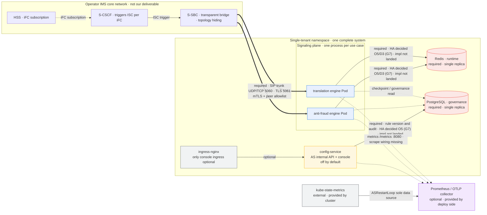

<!--
Inhouse-IMS-AS — Copyright 2026 Dolan Shu <dolan.d.shu@gmail.com>, Apache-2.0

Licensed under the Apache License, Version 2.0 (the "License");
you may not use this file except in compliance with the License.
You may obtain a copy of the License at

    http://www.apache.org/licenses/LICENSE-2.0

Unless required by applicable law or agreed to in writing, software
distributed under the License is distributed on an "AS IS" BASIS,
WITHOUT WARRANTIES OR CONDITIONS OF ANY KIND, either express or implied.
-->

# In-house IMS Application Server — NE Datasheet

> **Status block (read this first)**
>
> - **Product name**: `In-house IMS Application Server`, **formally adopted as the product / document description name** (G8-2; **not a trademark / not a brand claim**), first occurrence labeled 3GPP Third-Party AS role, hereafter abbreviated in-house AS (`docs/plan.md` §0 "product decision record" G8 row). git repo name: the maintainer has reported renaming it to `inhouse-ims-as` (G8-3; only the git repo name and remote URL; this repo performed no remote or local-path change); chart name (`3rdparty-as`, `deploy/helm/Chart.yaml:2`), image name (`registry.example.com/3rdparty-as`), and OTel service name **stay unchanged as `3rdparty-as`**.
> - **Ownership of this document**: `docs/product-packaging-plan.md` §1 first-batch deliverable **1.3 (NE Datasheet)**. Per that plan §3.2, this deliverable is **Class B**: the capacity figures are blocked by O1.
> - **⚠️ Capacity section blocked by O1**: **O1 (capacity target) not yet decided** (`docs/plan.md` §5.1 O1 "maintainer target decision still open"). `AGENT.md` §2 "no capacity number published before M6 measurement" is a hard constraint. Therefore **this document contains no CPS / CAPS / BHCA / concurrent-session count / per-thousand-call resource / throughput / latency (incl. milliseconds) / P95 / P99 / capacity percentage**, not even an "order-of-magnitude estimate". §3 delivers only **model structure and measurement methodology** (implementing review items G-P0-3, G-P1-3, G-P0-8).
> - **B6 review status**: this document has left a review record alongside the B6 review — [`../reviews/product-packaging-review-checklist-2026-10-12.md`](../reviews/product-packaging-review-checklist-2026-10-12.md) §6 (first review 2026-10-12) and §7 (closure re-review 2026-10-12); **conclusion pending maintainer confirmation**, and until confirmed it is not an external delivery or acceptance basis (`AGENT.md` §3.3).
> - **The M6 dev-host report can only serve as evidence that "methodology exists"**: `docs/acceptance/m6-o1-measurement-report-2026-10-05.md` explicitly labels its audience as "Maintainers / capacity research only", **not** a public SLA. Always cite it with the qualifier "internal measurement / not external / not SLA", and **this document cites none of its measured values** (`AGENT.md` §2; review G-P0-2 / G-P0-8).
> - **testbed boundary and alert criteria**: `testbed/` is an **R&D asset, never a runtime dependency** (`AGENT.md` §4), and ADR-0014 explicitly excludes testbed from v1 deliverables; its simulation results (incl. callload, M7.1 simulation platform, dev-host harness) **must not stand in for operator IOT or live-network capacity evidence** (`docs/product-packaging-plan.md` §0.3 item 8, §3.4). The **sole authoritative contract** for alerts and metrics is `deploy/alerts/as-alerts.yaml` and `deploy/alerts/README.md`; this document only cites, and does not establish a separate set of criteria.
> - **Terminology discipline**: the M8 release-candidate (RC) artifact is ready, but **exit sign-off is still pending** — **RC ready ≠ passed** (`docs/plan.md` §0). E1 / E4 / E5 **not accepted**. O1 **still undecided**; O4 / D5 **values decided (G6, 2026-10-10; implementation not landed)**; O5 / D3 **values decided (G7, 2026-10-10; chart still renders single-replica, no failover measured behavior evidence)**.

> **Note (appended 2026-10-13)**: the "O1 still undecided" in the paragraph above, together with other stale statements in this document (`0.0.0-skeleton`, etc.), is factually outdated — the O1 internal engineering target value has landed (external commitment value still unfilled), and the chart has been synced to `0.2.0` for the first time; disposition (original text preserved + appended note) is in [`../next-release-v1.1-plan.md`](../next-release-v1.1-plan.md) §5-1, pending maintainer decision on whether to sync.

---

## 1. NE overview

| Dimension | Content |
|---|---|
| NE type | Third-party Application Server **outside** the operator IMS network (3GPP Third-Party AS role), triggered by S-CSCF per HSS-side iFC subscription over ISC, accessed via the operator S-SBC transparent bridge (`AGENT.md` §1; ADR-0003 accepted) |
| Access semantics | **ISC only.** iFC trigger logic is on the S-CSCF / HSS side, not within our delivery boundary (review G-P0-5) |
| Service plane | **Signaling only**: SIP message processing and business decision, headers and SDP passed through verbatim. Business use cases are pluggable (`apps/translation`, `apps/anti-fraud`) |
| Deployment form | **Single-tenant, on-premises**: one namespace carries one complete system (incl. its own Redis / PostgreSQL / AS Pod group), data does not leave the customer machine room (REQ-NF-9; ADR-0026 Option E) |
| Delivery version | **One system delivered per release**: the product release version reads only the repo-root `./VERSION` (`AGENT.md` §8; ADR-0018 accepted). **Known gap**: `deploy/helm/Chart.yaml:5-6`'s `version: 0.0.0-skeleton` / `appVersion: "0.0.0"` are still skeleton values, **out of sync with `./VERSION`** |
| Production form | **Helm-only**: `Helm` + standard Deployment / ConfigMap / Secret; **no Operator (CRD)** (ADR-0013 accepted; `deploy/compose/` is dev-only) |
| What it does not do | No media, no CDR, no LI, no Diameter Sh, no billing, no multi-tenancy, no GitOps config delivery, no Operator (`AGENT.md` §2; one-line version in [`one-pager.md`](one-pager.md) §2, **not re-stating a criterion here**) |
| Status | M8 RC artifact ready, **exit sign-off pending**; E1 (reSIProcate production-path behavior) / E4 (TLS hot rotation) / E5 (state externalization and recovery) **not accepted**; e2e: `pytest -m e2e` **8 stable passes** (fails, does not skip, when native missing), REQ-F-1 = automated subset covered / full text still open |

**One-line product positioning**: a multi-business carrier platform — adding a business only needs "add one app + one change order", no change to the IMS core network (`one-pager.md` §1).

---

## 2. Interface list

| Interface | Direction | Protocol / port | Purpose | Required | Notes |
|---|---|---|---|---|---|
| SIP trunk (inbound / outbound signaling) | Bidirectional | SIP over UDP `5060`, SIP over TCP `5060` | Carry ISC trigger signaling and business decision | **Required** | Port is a **protocol constant**, not a capacity metric (as noted verbatim in `deploy/helm/values.yaml:148-153`). TCP listener requires `AS_SIP_ENABLE_TCP`, not listening by default |
| SIP trunk over TLS | Bidirectional | SIP over TLS `5061` | End-to-end TLS (mTLS) with S-SBC | **Required** (default `tls.enabled: true`) | `tls.enabled=true` with empty `tls.secretName` → **fail-closed at render** (`deploy/helm/templates/deployment.yaml:11-13`). Certificate rotation is a config hot-reload, no process restart (ADR-0016) |
| AS internal API | Inbound | HTTP `8000` (ClusterIP) | config-service serves both the console `/` and `/internal/v1` | Optional (config-service **off by default**) | `services.configService.enabled: false` (`values.yaml:115`); no separate console workload |
| Health and metrics endpoint | Outbound (for scraping) | HTTP `8080`: `/health/live`, `/health/ready`, `/metrics` | K8s probes + Prometheus text-format metrics | **Required** | Port comes from Helm `health.port` (`values.yaml:281-282`) → ConfigMap `AS_HEALTH_PORT` (`configmap.yaml:58`) → `HealthServerConfig.port` (`platform/src/as_platform/runtime/health.py:23-24`) |
| Redis (runtime) | Bidirectional | Redis protocol, chart default `6379` (`stateStores.redis.port`) | Session state / dialog state / anti-fraud rate window | **Required** (premise of stateless runtime) | Probe criterion in the §8 note; Redis HA topology **decided (G7 / D3)**: primary/replica + Sentinel (following ADR-0008 topology, not Redis Cluster); chart still renders single-replica, Sentinel wiring **implementation not landed** |
| PostgreSQL (governance) | Bidirectional | PostgreSQL, chart default `5432` (`postgres.port`) | Rule versions, change orders, approval, audit; schema `as_config` / `console_audit` | **Required** (control plane) | Three roles: `owner` / `web` / `runtime` (`state-postgres.yaml:18-22`); `runtime` is `NOLOGIN` least-privilege |
| **Diameter Sh (TS 29.328 / 29.329)** | — | — | — | **N/A** | **Reason**: the AS's business data comes from its own data plane (rule set, number-translation table, anti-fraud limits), it does not interact with HSS, hence no Diameter Sh (`AGENT.md` §2 non-goal). This document contains no Sh-related panel or alert (review G-P0-4 / G-P2-3) |
| **Billing / CDR (TS 32.260 / 32.299)** | — | — | — | **N/A** | **Reason**: not collected, not delivered, not archived, not rated (ADR-0017 accepted). Call traces keyed by Call-ID (ADR-0017) replace the CDR, for complaint tracing and anti-fraud evidence |
| **Media / RTP** | — | — | — | **N/A** | **Reason**: no media: no RTP, no transcoding, no DTMF, no MRF, no media anchoring; only one seam is kept with its trigger conditions written down (ADR-0004). Off-net media relay would form a triangular route and raise voice-compliance issues |

---

## 3. Capacity model and measurement methodology

> **This section is blocked by O1 (`docs/plan.md` §5.1 O1; `AGENT.md` §2; review G-P0-3 / G-P1-3 / G-P0-8).**
> This section delivers **model structure** (variables and relationships) and **measurement methodology**, **no values**. No number may be written into this document before O1 is decided.

### 3.1 Why no values now

| # | Reason | Basis |
|---|---|---|
| 1 | **O1 undecided**: the maintainer decision on the capacity target (CPS, concurrent sessions, setup-latency budget) is still open; blocks M7 integration capacity acceptance and HPA thresholds | `docs/plan.md` §5.1 O1 |
| 2 | **Hard rule**: "no capacity number published before M6 measurement"; the `performance` layer **uses only real sockets, never drives callbacks to test — that tests business logic, not the system** | `AGENT.md` §2, §6; ADR-0014 |
| 3 | Reviews have twice decided: the capacity section writes "blocked by O1" (G-P0-3, G-P1-3); the performance-baseline report at this stage **delivers only methodology**, with no throughput / concurrency / latency numbers (G-P0-8) | `docs/reviews/product-packaging-plan-review-2026-10-09.md` |
| 4 | The chart's capacity-bearing keys are **all left empty**: if `useCases[].resources`, `autoscaling.*`, `podDisruptionBudget.minAvailable` are empty, the template **refuses to render** that resource rather than falling back to guessed numbers | `deploy/helm/README.md` §"Keys left empty on purpose"; `deploy/helm/values.yaml:61-66` |
| 5 | The existing dev-host report is an **internal measurement**, whose limitations self-describe as "do not extrapolate" (loopback UDP, no TLS, no multi-replica K8s, accept-all fixture peer, zero-hold load model), and explicitly "not a product capacity guarantee" | `docs/acceptance/m6-o1-measurement-report-2026-10-05.md` §"Limits (do not extrapolate)" |

**Admission conditions for filling values (all three simultaneously)**: ① the maintainer decides the O1 target and lands it in the `docs/plan.md` decision row + review record; ② M6 measurement is completed on a harness with **real sockets** and a business-decision path; ③ the maintainer decides to convert the measurement result into an externally statable criterion. At that point a **separate internal-review performance-baseline report** is produced (deliverable 4.1, still an internal document), and back-filled into this section.

### 3.2 Capacity model structure (variables and relationships only, no values)

**Arrival side (Offer)**

- Variables: call-arrival process (Poisson / burst / surge), busy-hour assumption (**pending**), per-use-case business ratio (translation / anti-fraud), number-range distribution.
- Relationship: arrival process → per-use-case arrival rate; business ratio distributes total arrival across engine processes.
- **Pending items**: the busy-hour assumption and business ratio must come from the customer's traffic model; **this document must not assume them**.

**Processing side**

- Inbound INVITE processing: transport receives packet → peer admission (allowlist / cert fingerprint, ADR-0016) → message parse → `decide()`.
- Outbound INVITE processing: rewrite Request-URI per decision (`AS_SIP_NEXT_HOP`), rewrite Contact in TLS scenarios.
- State-store read/write: session / dialog state and anti-fraud rate window all in Redis (ADR-0002 / ADR-0007); checkpoint commit see ADR-0023 (**proposed, not passed**, not used as a conclusion).
- Decision judgment: `decide()` is a **pure function** (no socket, no clock, no global state), its cost decoupled from I/O → the natural baseline for relative comparison (`AGENT.md` §5).

**Resource mapping**

- Variables: CPU, memory, connections and file descriptors, Redis connection pool, Pod replica count, independent scaling per Pod.
- Relationship: per unit of arrival → per unit of decision + per unit of state-store round trip + per unit of serialization → mapped onto the above resources; replica count is the only horizontal dimension (**each process scales independently**).
- **Note**: the **coefficients** of this mapping are capacity conclusions, also blocked by O1.

**Scaling boundary**

- One use case one process → each engine has **independent scale, independent failure domain, independent canary unit** (ADR-0002 accepted).
- Per-process independent scaling: the chart renders a Deployment / Service per `useCases[]` entry (`deploy/helm/templates/deployment.yaml`, `service.yaml`).
- Session affinity **two-layer safety net**: LB-layer `sessionAffinity: ClientIP` (`service.yaml:30`) + application-layer Redis session table as backstop; either half alone is insufficient.
- Scale-down **does not use standard CPU / memory HPA**: the SIP stack is a blocking event loop, and CPU correlates poorly with real SIP load, and aggregate metrics **cannot see active sessions** → a downscale-guard controller is mandatory (ADR-0010 accepted; `docs/architecture/system-architecture.md` §6.3).
- Downscale-guard criterion: `active_calls` judged per instance, protection threshold defaults to `0` — this is a **state condition** ("does this instance still have calls"), not a capacity threshold (`platform/src/as_platform/ops/downscale_guard.py:72-88`).

### 3.3 Bottleneck candidates (causes and observation means, no thresholds)

| # | Candidate bottleneck | Cause | Observation means (currently available) |
|---|---|---|---|
| 1 | **DUM blocking event loop** | `ED2.loop()` or an equivalent blocking event loop must not block; never do a blocking operation inside a SIP callback (incl. telemetry export, ADR-0005) | Relative change of process CPU usage vs. in-flight calls; `as_active_calls` distribution (requires the scrape wiring first, see §5) |
| 2 | **State-store round trip** | Session / dialog / rate window in Redis; the read before decision and the write of checkpoint are both on the critical path | `as_state_store_available` (reachability, not latency); Redis-side connection and latency metrics (**external dependency, not collected by chart**) |
| 3 | **checkpoint serialization** | The minimal call state needed for recovery must be serialized; ADR-0023 **not passed**, semantics still shifting | Currently **no** corresponding metric; only contrastive measurement per §3.4 |
| 4 | **In-flight call convergence during downscale / draining** | ISSU = draining: stop traffic → wait for `active_calls` to zero → exit (ADR-0009); convergence speed depends on call-duration distribution | `as_downscale_removable` (`1` = removable allowed); `as_active_calls` |
| 5 | **reSIProcate transport-layer known gaps** | The TCP / TLS transport layer has known gaps on the SIP-stack side; ADR-0019 **accepted** those gaps | Only exposed via contrastive measurement (§3.4); currently no transport-layer metric |
| 6 | **Telemetry export crowding the call path** | Drop on full queue; dropping telemetry is acceptable, applying backpressure to call setup is not (ADR-0005) | `as_telemetry_dropped_total` (currently no production-data producer, see §6) |

> **This table contains no thresholds.** Each item above must **not** carry any numeric threshold before O1 is decided.

### 3.4 Measurement methodology

**Environment record items (required every measurement)**

| Record item | Description |
|---|---|
| Host and OS | CPU model, memory, disk, whether shared host |
| Container / cluster form | Pod count, replica count, requests/limits, whether HPA / PDB enabled |
| SIP stack | reSIProcate version and build identifier (production stack direction, ADR-0019 accepted) |
| Transport | UDP / TCP / TLS; whether mTLS and peer allowlist enabled |
| State store | Redis version, whether Sentinel, persistence and eviction policy; PostgreSQL version and schema |
| Configuration | Rule-set size, change-order version number (`CONFIG_VERSION`), canary granularity (ADR-0021) |
| Telemetry | Whether `OTEL_EXPORTER_OTLP_ENDPOINT` is configured, whether queue drops |
| Time | Measurement date, duration, injection start/end timestamps |

**Traffic-model definition**

- The arrival process and busy-hour assumption must be **explicitly written down** and archived with the report; if not written clearly it is not reproducible.
- Per-use-case business ratio, number-range distribution, hold distribution, and BYE-completion behavior must be written clearly. **A zero-hold load model does not model in-dialog concurrency, nor BYE completion under load** (a known limitation self-described in the M6 dev-host report).

**Metric-definition criterion**

- The metric name and semantics take `platform/src/as_platform/telemetry/metrics.py` as the sole authority; `deploy/alerts/README.md` is the alert-side contract.
- **There is currently no histogram, no latency / throughput metric** (see §5). Therefore, if this round of measurement wants to produce a latency conclusion, it must first add the metric definition and instrumentation, **and walk the document chain** (requirement → ADR → design → acceptance → review record) — it must not compute a number ad hoc in the measurement script and write it into the report.
- The collection path is the process's `/metrics` endpoint (Prometheus text format).

**Repeat count and confidence**

- Repeat the same scenario multiple times and report dispersion; a single result is only a methodology demonstration, **must not be a capacity conclusion**.
- The report must also state **whether the saturation point was observed**; if not observed, the conclusion can only be "no saturation seen within the tested range", **must not extrapolate**.

**Evidence retention path**

- The evidence package lands in `docs/acceptance/artifacts/`; the report lands in `docs/acceptance/`, and the review record per `AGENT.md` §3.2 is added.
- testbed / harness output is an R&D asset (ADR-0014).

**Two non-negotiable principles**

1. **Only real sockets**: the capacity layer **forbids** testing via driven callbacks — that tests business logic, not the system (`AGENT.md` §6; ADR-0014). The harness is in `testbed/load/`.
2. **The `performance` layer's current peer is an accept-all harness, not the business-decision path**: `docs/acceptance/test-plan.md` L21 states explicitly "the M6 product-runtime load test peer is `load_uas_runtime.py` (**accept-all harness**), not the business-decision path"; L23 further notes `accept_all_invites` is **not** ims-sim, nor a production path. Therefore the current harness's readings **cannot** represent the real cost of the decision path + Redis + rules.

### 3.5 Pre-decision prohibited-list

| # | Prohibited | Basis |
|---|---|---|
| 1 | This document or any external material contains CPS / CAPS / BHCA / concurrent-session count / per-thousand-call resource / throughput / latency (incl. milliseconds) / P95 / P99 / capacity percentage | `AGENT.md` §2 |
| 2 | Citing any measured value from the M6 dev-host report as a conclusion or external metric (may only cite its **methodology subsection title** as evidence that "methodology exists") | `AGENT.md` §2; review G-P0-2 / G-P0-8 |
| 3 | Treating testbed simulation results as operator IOT or live-network capacity evidence | ADR-0014; `docs/product-packaging-plan.md` §0.3 item 8 |
| 4 | Adding capacity thresholds / capacity alert groups in alert rules (creating a new `as.capacity` group is uniformly deferred until after O1 is decided) | `deploy/alerts/README.md` §"Why there is no capacity alert" |
| 5 | Back-filling guessed values for `useCases[].resources` / `autoscaling.*` / `podDisruptionBudget.minAvailable` in Helm values (the template will fail — this is by design, do not work around it) | `deploy/helm/README.md` |
| 6 | Citing illustrative numbers in architecture docs (e.g., the `active_calls=` reading in §4.1 chart) as measurement results | `docs/architecture/system-architecture.md` §4.1 |

### 3.6 When values can be filled

| Prerequisite | Status |
|---|---|
| O1 target decided (maintainer + decision row + review record) | **Undecided** |
| M6 real-socket measurement (business-decision path + Redis + rules, incl. saturation-point observation) | **Not completed**; current batches are dev-host internal measurements with no saturation point |
| Maintainer decides "which are external, which internal-only" | Not done |

Once all three close: fill the model **values** into §3.2, fill the saturation point and confidence into §3.4, and **produce a separate internal-review performance-baseline report** (deliverable 4.1). The structure and discipline of this section are not relaxed by filling values.

---

## 4. Business-engine capacity reference

**Platform-dimension facts (no values):**

| Fact | Basis |
|---|---|
| One business use case = one process = one Deployment = one Service; the template renders per `useCases[]` entry | ADR-0002 accepted; `deploy/helm/templates/deployment.yaml`, `service.yaml` |
| Each engine can **scale independently** (its own replica count, HPA, PDB), has an **independent failure domain**, and is an **independent canary unit** | ADR-0002 accepted; `AGENT.md` §4 |
| The kernel **must never** import an application / service / testbed; one app must never import another app — enforced by `platform/tests/test_library_independence.py` and `tests/test_workspace_layout.py` | `AGENT.md` §4 |
| Business decision is a **pure function** (no socket, no clock, no global state), so the **relative** cost of `translation` vs `anti-fraud` is comparable under the same measurement method (see below) | `AGENT.md` §5 |

**How to do relative comparison (method, no values)**

1. Fix the same measurement method (same harness, same traffic-model definition, same environment record items, see §3.4).
2. Fix the per-resource criterion: compare "**decision-path cost per unit resource**", not absolute throughput. The resource criterion must be written explicitly, and can only come from the resource spec after the O1 decision (currently `useCases[].resources` is empty).
3. Change only one engine at a time (swap the decision module), keep everything else unchanged.
4. The contrast criterion must include the business-decision path: the current accept-all harness bypasses `decide()`, so it **cannot** yield engine-cost conclusions — it is only usable for stack / SDP-layer probes.
5. The report gives only **relative order and relative difference**, no absolute values.

**Qualitative resource-character differences between the two engines**

| Engine | Decision character | Resource character (qualitative) | Basis |
|---|---|---|---|
| `translation` (number translation) | Pure decision + outbound routing: after a rule hits, rewrite Request-URI (`host`/`port` from `AS_SIP_NEXT_HOP`), rewrite Contact in TLS scenarios | Compute side is mainly rule matching and string processing; **every decision produces outbound signaling**, so the signaling-plane (stack serialization / transport) cost share is higher than a pure-reject engine | `apps/translation/src/as_translation/outbound.py`; ADR-0002 |
| `anti-fraud` | Rate-window counting + over-limit reject (`603 Decline`): the decision function receives caller-injected read-only counters | Compute side is mainly window counting and threshold judgment; but **depends on the runtime rate-window state** (in Redis), so the state-store round-trip share is higher than a pure-translation engine | `apps/anti-fraud/src/as_anti_fraud/decision.py`; ADR-0007 |

> Both are only **qualitative differences**, used to explain why the two engines cannot be treated as homogeneous load; **no relative multiple or percentage is given**.

---

## 5. KPI definitions and thresholds

The metric name and semantics take `platform/src/as_platform/telemetry/metrics.py` as the sole authority; the collection path is the process's `/metrics` endpoint (`HealthServer`, requires `AS_HEALTH_PORT`). **Only three threshold types are allowed: ratio / relative change / state condition.**

| KPI | Definition | Metric source (incl. label) | Threshold type | Current status |
|---|---|---|---|---|
| In-flight call count | Current in-flight call count carried by a single instance | `as_active_calls{use_case,pod}` | Relative change (for `ASActiveCallsSurge`; not an absolute ceiling) | Production path **has** a producer (`__main__.py:117`; dialog events in `runtime/sip_stack_service.py:285,289`), but depends on whether the SIP runtime is built when `AS_M5_SIMULATED_ACTIVE_CALLS` is unset; E1 not accepted → **no production-environment evidence yet** |
| Downscale-removable flag | `1` = removable allowed; `0` = protected or draining | `as_downscale_removable{use_case,pod}` | State condition | Production path **wired** (`__main__.py:118-124`, written periodically per guard config and draining status). No threshold, no target value |
| State-store availability | `1` = Redis reachable (`PING`), `0` = unreachable | `as_state_store_available{use_case}` | State condition | Production path **wired but conditional**: only probes when `REDIS_URL` is non-empty (`__main__.py:125-130`; `runtime/state_probe.py:6-27`). When unset, the series **does not exist** (not 0) |
| SIP response count | SIP responses counted by `use_case` / `status_class` / `status_code` | `as_sip_responses_total{use_case,status_class,status_code}` | Ratio (for `ASHighErrorRatio`) | Production path **has no data producer yet**: the only product-side write point is the one-shot startup probe `AS_M5_PROBE_SIP_STATUS` (`__main__.py:88-97`, not set in on-prem production); `record_terminal_decision_response` **has only test callers**. Hence the alert depending on it will not fire now |
| Rule-hit count | Number of times each rule made a decision | `as_rule_hits_total{rule}` | None (not in the alert contract) | Definition and write interface exist (`metrics.py:254-260`), but production path has **no caller**; not in `deploy/alerts/README.md`'s metric-contract table |
| Telemetry-drop count | Telemetry events dropped by the bounded queue | `as_telemetry_dropped_total{use_case}` | State condition (count within window) | Only enables the bounded queue when `OTEL_EXPORTER_OTLP_ENDPOINT` is non-empty (`__main__.py:193-196`; chart default `telemetry.otlpEndpoint: null`); when unset the sink is `NoOpSink`, this count is not produced. And the queue's exporter defaults to `NoOpExporter` (`telemetry/__init__.py:129`) → **real OTLP backend wiring still incomplete** |

> **⚠️ There is currently no latency KPI and no throughput / CPS KPI.** `MetricKind` has only `COUNTER` and `GAUGE` (`metrics.py:49-53`), **no histogram type**, and no latency or throughput series exist in the metric registry. Therefore this document **lists no latency KPI and no capacity KPI** — a latency criterion requires first adding the metric definition and walking the document chain (§3.4).

> **⚠️ Scrape wiring currently missing (self-verified)**: the chart's Pod template has **no** `prometheus.io/scrape` annotation, and the chart has **no** ServiceMonitor / PodMonitor template (a full-directory grep of `deploy/helm/templates/` finds no hits). That is, the `/metrics` endpoint exists and renders the container port `health-http`, but **no collector is wired to it by the chart** — in a standard deployment, Prometheus receives none of the `as_*` series above. Closing the scrape wiring (ServiceMonitor or annotation, pick one) is one of the necessary actions after O1 is decided.

---

## 6. Alert list

Sole authoritative source: `deploy/alerts/as-alerts.yaml` (REQ-NF-14); load and validation method in `deploy/alerts/README.md`. The table below covers **all 10 rules, 3 groups** of that file (`as.call-path` 5 + `as.runtime` 3 + `as.platform` 2); per-alert first-check action, escalation path, and evidence requirements are in [`../operations/alert-response-matrix.md`](../operations/alert-response-matrix.md) §2 (landed, consistent with this table's criteria).

| Alert | Group | Trigger-condition summary | severity / component | Current triggerability | Playbook entry |
|---|---|---|---|---|---|
| `ASHighErrorRatio` | `as.call-path` | Ratio of 5xx and 4xx-except-487 to all SIP responses > 1%, for 10m | `warning` / `signalling` | **Cannot fire**: depends on `as_sip_responses_total`, production path has no data producer (§5). Threshold is a **ratio, not a capacity metric** | [`../operations/alert-response-matrix.md`](../operations/alert-response-matrix.md) §2 #1 |
| `ASTelemetryDropped` | `as.call-path` | `as_telemetry_dropped_total` increment ≥ 50 within 15m window, for 15m | `warning` / `observability` | **Cannot fire**: the count is only produced when `OTEL_EXPORTER_OTLP_ENDPOINT` is configured (chart default null); and the exporter is currently `NoOpExporter`, the queue rarely fills. Threshold is **event count within a window, not a capacity metric** | same §2 #2 |
| `ASRestartLoop` | `as.call-path` | Single-Pod container restart count > 3 / 1 minute | `critical` / `runtime` | **Can fire** (the only `as_*` rule with no config prerequisite): data source is external **kube-state-metrics**' `kube_pod_container_status_restarts_total`, only depends on the cluster having kube-state-metrics. Threshold is **restart count within a fixed window (liveness signal), not a capacity metric** | same §2 #3 |
| `ASCallStateStoreUnavailable` | `as.call-path` | `min by (use_case) (as_state_store_available) == 0`, for 2m | `critical` / `state` | **Can fire (prereq: `REDIS_URL` configured)**: the metrics loop really PINGs Redis and writes the series when `REDIS_URL` is non-empty (`__main__.py:125-130`). If `REDIS_URL` is empty the series does not exist, rule never fires (**not 0**). Threshold is a **reachability state condition, not a capacity metric** | same §2 #4 |
| `ASActiveCallsSurge` | `as.call-path` | Per use case current `as_active_calls` > 1.3× its own 30m sliding average, for 10m | `warning` / `signalling` | **Series always produced** (`__main__.py:117` written unconditionally), but the value depends on SIP-runtime dialog events; will not fire when the runtime is disabled or the count is stuck at 0. Also see §5's **missing scrape wiring**. Threshold is a **relative change, by construction contains no absolute call count, not a capacity metric** | same §2 #5 |
| `ASPodNotReady` | `as.runtime` | That Pod's `Ready` condition is 0, for 5m; ready = process refusing new work (`/health/ready` 503 means draining, ADR-0009) | `critical` / `runtime` | **Can fire (prereq: cluster has kube-state-metrics)**: only looks at Pods in the AS namespace, **does not distinguish components**, uses the `pod` name. Threshold is a **binary ready state, not a capacity metric**; a Pod legitimately mid-roll also hits it, check `/health/ready` before escalating | same §2 #6 |
| `ASDeploymentReplicasUnavailable` | `as.runtime` | Available replicas < desired replicas for the same Deployment, for 10m | `warning` / `runtime` | **Can fire (prereq: KSM)**: selector scoped by namespace, also covers the bundled `state-redis` and `config-service` Deployments. Threshold is **replica-availability state, not a capacity metric**, and **deliberately does not state how many replicas the system should have** (that is O1 / M6) | same §2 #7 |
| `ASDownscaleBlocked` | `as.runtime` | `as_downscale_removable == 0` **and** `as_active_calls == 0` on the same `pod` / `use_case`, for 30m. ADR-0010's guard blocks removal for exactly two reasons (in-flight calls / already draining); with both excluded, only a stuck drain remains | `warning` / `runtime` | **Series always produced** (metrics loop writes unconditionally, no OTLP dependency), but the value depends on real SIP dialog activity — no traffic, no fire. Also see §5's **missing scrape wiring**. Threshold is a **binary guard state + zero count, not a capacity metric** | same §2 #8 |
| `ASStatefulSetUnavailable` | `as.platform` | A StatefulSet's ready replicas < desired replicas, for 5m; in this chart that is the governance PostgreSQL (ADR-0008), holding config versions, change orders, append-only audit | `critical` / `state` | **Can fire (prereq: KSM)**: the bundled PG is **single-replica, non-HA** (HA owned by the customer); Redis HA topology decided (G7 / D3: primary/replica + Sentinel) but **chart still renders single-replica, no failover measured behavior evidence** — single-replica is a design fact, **not** a capacity conclusion | same §2 #9 |
| `ASServiceEndpointsAbsent` | `as.platform` | A Service's available endpoint address count is 0, for 5m → selector matches no Ready Pod; in this chart covers the `state-redis` and `config-service` Services | `warning` / `state` | **Can fire (prereq: KSM)**: a **different** failure mode from `ASCallStateStoreUnavailable` (which reports "AS cannot reach Redis"); this one reports "the Service has no backend at all". Threshold is a **routing state, not a capacity metric** | same §2 #10 |

**Capacity alerts: deferred.** `as-alerts.yaml` currently has **no CPS ceiling or concurrency-ceiling alert**, and this is by design (file header L8-13; `deploy/alerts/README.md` §"Why there is no capacity alert"). Capacity alerts are added **after O1 is decided** as a new independent group (suggested `as.capacity`), taking values **from** the measurement — **do not write one on intuition beforehand**. Until then, an unexplained load problem is investigated with `ASActiveCallsSurge` and the M6 harness, not with a number invented in advance.

---

## 7. Dependency graph

**Requirement explanation (per item)**

| Dependency | Required | Notes |
|---|---|---|
| S-SBC (trunk peer) | **Required** | Operator network element; we only do peer-admission validation (allowlist + mTLS, ADR-0016). Trunk is not trusted |
| Redis (runtime) | **Required** | Session / dialog / rate window; the chart's bundled one is **single-replica**, **not HA**; Sentinel / HA topology **decided (G7 / D3: primary/replica + Sentinel, not Cluster)**, wiring **implementation not landed** |
| PostgreSQL (governance) | **Required** (control plane) | The chart's bundled one is **single-replica**, **not HA**; streaming replication / backup / PITR are architecture requirements, landing blocked by a real cluster |
| ingress-nginx → config-service → console | **Optional** | config-service off by default; `config-service-ingress.yaml` supports **only ingress-nginx** (renders failed when `className` is not `nginx`), and forces HTTPS redirect; 7.2d real-cluster evidence still blocked |
| Prometheus / OTLP collector | **Optional** (deploy side) | Chart has no ServiceMonitor / PodMonitor, nor scrape annotation → **scrape wiring missing** (§5). OTLP exporter currently `NoOp`, queue exists but does not land |
| K8s / Helm | **Required** | Helm is the only production form (ADR-0013) |
| **Cross-site DR** | **Decided (G7)** | O5 baseline: **in-site N+1 + cross-site 1+1 warm standby** (ADR-0008 topology; **no rack / AZ-level fault-tolerance commitment**, RPO / RTO values **still undecided**); chart still renders single-replica, no failover measured behavior evidence. Cross-site traffic sharing is decided by operator network-element config, outside our delivery scope |

---

## 8. Resource spec and deployment form

**Authoritative source**: `deploy/helm/values.yaml` and `deploy/helm/README.md`. This document does not repeat the full values parameters, only the spec highlights and **known gaps** from the NE-datasheet perspective.

| Item | Current status | Basis |
|---|---|---|
| chart name / type | `3rdparty-as`, `apiVersion: v2`, `type: application` | `deploy/helm/Chart.yaml:1-6` |
| Image | `registry.example.com/3rdparty-as`, empty `tag` → falls back to `Chart.appVersion`; `pullPolicy: IfNotPresent`. **No public registry**, must set the customer internal registry at install | `values.yaml:76-82`; `_helpers.tpl`'s `as.image` |
| Version | `./VERSION` is the **sole source** of the product release; **`Chart.yaml`'s `version` / `appVersion` are still skeleton values, out of sync with `./VERSION`** — **known gap**. **Appended 2026-10-12 (G4 / A6)**: consistency sync has landed as `scripts/sync-chart-version.sh` (default `--check` read-only, drift → exit 1; `--apply` to write); **the timing and value of the first `--apply` is left to the maintainer** (G4 "do not modify `VERSION` and `Chart.yaml` now" still holds) | `AGENT.md` §8; ADR-0018; `Chart.yaml:5-6` |
| `useCases` | `translation` / `anti-fraud` one each, `enabled: true`; `enabled: false` renders nothing | `values.yaml:84-107` |
| **Resource spec** | **`useCases[].resources` default all empty (`{}`), chart does not render requests/limits** → **no recommended resource spec**. This is deliberately empty: sizing shares the same source as O1, the template would rather not render than fall back to guessed values | `values.yaml:97-103`; `deploy/helm/README.md` §"Keys left empty on purpose" |
| Replica count | `useCases[].replicaCount: null` → Deployment renders `replicas: 1` as a **render fallback**, **not a capacity conclusion** | `values.yaml:92-96`; `deployment.yaml:31-36` |
| HPA | `autoscaling.enabled: false` → **no HPA rendered by default**; enabling without `minReplicas`/`maxReplicas` fails outright; all target thresholds empty pending O1 | `values.yaml:261-270`; `hpa.yaml` |
| PDB | `podDisruptionBudget.minAvailable: null` → **PDB not rendered** (the availability floor is a decision no one has made) | `values.yaml:305-309` |
| Downscale guard | `downscaleGuard.enabled: true`, `protectWhenActiveCallsAbove: 0` — a **state condition** ("are there still calls"), not a capacity threshold | `values.yaml:272-278`; ADR-0010 |
| draining | `preStopSleepSeconds: 5`, `terminationGracePeriodSeconds: 300` — these are **config defaults (timeout windows), not capacity or performance promises** | `values.yaml:238-252`; ADR-0009 |
| Health / metrics | `health.port: 8080`; probe paths `/health/live`, `/health/ready`; readiness returns 503 during draining | `values.yaml:280-303`; `runtime/health.py:56-74` |
| Service | One ClusterIP per use case, `sessionAffinity: ClientIP` (`timeoutSeconds: 3600`, sticky timeout, unrelated to capacity) | `values.yaml:161`; `service.yaml:30-35` |
| **fail-closed items** | ① `tls.enabled: true` with empty `tls.secretName` → **render fails**; ② `sip.peerAllowlist` empty and `allowEmptyAllowlistForTest` unset → **render fails**. Both are security controls, not availability switches | `deployment.yaml:11-16`; ADR-0016 |
| In-cluster state store | `stateStores.enabled: false` (keeps AS-only render by default); enabling renders in-cluster PostgreSQL / Redis + NetworkPolicy; `bootstrapDevCredentials` is **kind/dev only** | `values.yaml:167-200`; ADR-0026 accepted |
| config-service | **Off by default**; enabling needs an external Secret (`AS_CONFIG_DSN`, audit HMAC key) and a pre-provisioned `NOLOGIN` runtime role; the chart **does not create or populate** that Secret | `values.yaml:109-136`; `deploy/helm/README.md` |
| K8s minimum version | `kubeVersion` has been set to `>=1.23.0-0` (decided 2026-10-12, G4 / A6: reverse-derived from the chart's actual APIs — autoscaling/v2 HPA and Job TTL are both K8s 1.23 GA), **not yet written into `Chart.yaml`**; preflight.sh derives the 1.23 floor consistently. The chart still has no `kubeVersion` declaration (known gap, pending maintainer) | `deploy/helm/Chart.yaml` (full text); `../delivery/preflight.sh` |
| Prometheus scrape | **No `prometheus.io/scrape` annotation, no ServiceMonitor / PodMonitor** (known gap, see §5) | `deploy/helm/templates/` (grep no hits) |
| Backup / restore, e2e | **Chart has no backup Job** (`stateStores.migrateJob` is a one-shot schema-migration Job, **not a backup**); `pytest -m e2e` **8 stable passes** (fails, does not skip, when native missing), REQ-F-1 = automated subset covered / full text still open, the full call + console end-to-end path not landed | `values.yaml:192-200`; `test-plan.md` L20 |
| Unaccepted items | E1 (reSIProcate production-path behavior), E4 (TLS cert hot rotation), E5 (state externalization and recovery) **all not accepted** | `docs/plan.md` §5.1 O2/O3 |

**Note — Redis probe env-var criterion discrepancy (self-verified)**: the state store reads `AS_REDIS_URL`, falling back to the chart's `REDIS_URL` when unset (`platform/src/as_platform/state/redis_store.py:263-282`); but **the availability probe reads only `REDIS_URL`** (`__main__.py:125`), and the chart only writes `REDIS_URL` (`configmap.yaml:43-46`). Therefore, if `AS_REDIS_URL` is set only via `runtime.extraEnv`, the state store can connect, but the `as_state_store_available` series **will not be produced** → `ASCallStateStoreUnavailable` never fires. At delivery, use `REDIS_URL` uniformly.

---

## 9. Lifecycle and upgrade

| Item | Content |
|---|---|
| Version source | `./VERSION` is the **sole source** of the product release; `<member>/pyproject.toml` carries each component's own interface version; **no member may own a `VERSION` file**; guarded by `tests/test_version_consistency.py` (`AGENT.md` §8; ADR-0018 accepted). **Known gap**: `Chart.yaml`'s `version` / `appVersion` not synced. **Appended 2026-10-12 (G4 / A6)**: the sync script `scripts/sync-chart-version.sh` is ready (default `--check` read-only, drift → exit 1; `--apply` to write); timing and value of the first `--apply` pending maintainer |
| Lifecycle and EOL policy | See [`version-lifecycle.md`](version-lifecycle.md) (**landed**, deliverable 3.5; REQ-NF-16 and ADR-0027 added and accepted, but the **API / interface-version compatibility policy (deliverable 4.3) is still a pending decision**, must not be written as an already-decided promise) |
| **ISSU semantics** | **ISSU = draining, not in-flight state migration** (ADR-0009 accepted): ① stop accepting new requests (stop traffic); ② existing calls continue on the original process; ③ exit after `active_calls` reaches zero. Session / dialog / rate-window state is in Redis, so "no state migration" holds; but "no state migration" **does not equal** "can kill the process immediately" — the process still carries in-flight calls, whose transaction machine, timers, and sockets are all in this process. **Scale-down takes the same path**: controller picks an instance → stops traffic → waits for zero → deletes, no forced kill (ADR-0010) |
| **Upgrade discipline** | **AS image**: via `helm upgrade`; config and cert hot-reload do not restart the process (cert rotation is hot-reload, ADR-0016); ConfigMap changes trigger Pod rollout via the `checksum/config` annotation (`deployment.yaml:44-46`). **PostgreSQL / Redis**: stateful components, upgraded in a **maintenance window**, not rolled with the AS image; `stateStores.migrateJob` only does a one-shot schema migration, using the owner DSN, with no DDL / migration / grant at runtime startup |
| State-migration boundary | No in-flight call-state migration; no active-active across sites (ADR-0008: in-site N+1 zero-single-point + cross-site 1+1 warm standby) |

---

## 10. Known limitations and open-items list

| Item | Status | Blocking source | Impact |
|---|---|---|---|
| O1 capacity target (the **values** of §3 of this doc) | **Undecided** | Maintainer target decision open (`docs/plan.md` §5.1) | This doc has no capacity numbers; HPA / resource spec / PDB / capacity alerts all deferred |
| E1 reSIProcate production-path behavior | **Not accepted** | O2 / O3; 14 B2BUA full-replay entries deferred | Both capacity conclusions and signaling behavior lack production evidence |
| E4 TLS cert hot rotation | **Not accepted** | Operator PKI has no lab evidence (REQ-S-2/S-3) | No lab evidence for TLS-related capability |
| E5 state externalization and recovery | **Not accepted** | REQ-NF-1 sign-off still in M8; default DUM UAS restart returns 481 | Checkpoint / recovery path has only engineering-slice evidence |
| O4 call-trace retention period | **Decided (G6)**: default 10 days, deployment-configurable; **implementation not landed** | Customer compliance requirement (value landed `docs/plan.md` §0 decision record) | Trace storage / query / deletion capability does not exist yet; must not be described as "system already purges at 10 days" (affects PDPO and backup policy) |
| D5 call-trace storage selection | **Decided (G6)**: in-cluster PostgreSQL; **implementation not landed** | Related to O4 (value decided) | Storage landing follows the trace-storage capability implementation |
| O5 DR tier | **Decided (G7)**: in-site N+1 + cross-site 1+1 warm standby; **no rack / AZ-level fault-tolerance promise**; RPO / RTO values undecided | Customer SLA (value decided) | Chart still renders single-replica, no failover measured behavior evidence; Redis / PG HA landing depends on implementation |
| D3 Redis Sentinel wiring and split-brain-window idempotency | Client wiring **resolved**; HA topology **decided (G7 / D3)**: primary/replica + Sentinel (following ADR-0008, not Cluster); **implementation not landed** | O5 (value decided) | `redis.sentinel.masters` / `.addresses` deliberately left empty |
| D1 Python 3.10 EOL | **Open** | Reaches end of life October 2026 | Any delivery after that date must first verify migration or register it as an accepted risk |
| D6 whether testbed supports customer acceptance testing in v1 | **Open** (deferred to v1.1) | M8 | Customer acceptance-test capability not in v1 |
| **No recommended resource spec** | Gap | Same source as O1 | `useCases[].resources` all empty; chart does not render requests/limits |
| **No K8s minimum-version contract** | Gap | Chart has no `kubeVersion` | Customer must confirm cluster version before delivery |
| **Scrape wiring missing** | Gap | No scrape annotation, no ServiceMonitor / PodMonitor | All `as_*` series not collected by Prometheus in a standard deployment → all `as.*` rules effectively cannot fire |
| **OTLP exporter is NoOp** | Gap | Queue exists but exporter does not land | Telemetry only enters the in-memory queue, not the backend; `as_telemetry_dropped_total` rarely produced |
| **Version out of sync** | Gap | `Chart.yaml` skeleton values ≠ `./VERSION` | Deliverable version criterion needs correction |
| **No backup Job**, **e2e coverage incomplete** | Gap | Chart provides no backup; `pytest -m e2e` 8 stable passes (fails not skips when native missing), REQ-F-1 = automated subset covered / full text still open | Backup/restore plan (deliverable 2.5) additionally needs a real-cluster drill; full call + console end-to-end path has no automation evidence |
| ADR-0023 (Redis checkpoint), ADR-0025 (managed rule-runtime bundle) | **Not passed (draft)** | ADR registry | This doc draws no capacity or recovery conclusion from their design |

---

## 11. Traceability

| Item | Content |
|---|---|
| Corresponding deliverable | `docs/product-packaging-plan.md` §1 first batch **1.3 (NE Datasheet)**. Per §3.2 it is **Class B**: capacity figures blocked by O1. Engineering-fact constraints see that plan §0.3 (esp. item 5 O1, item 8 testbed boundary) |
| Implemented review comments | **G-P0-3** — capacity section writes "blocked by O1", zero capacity numbers in full text (§3.1, §3.5); **G-P1-3** — gaps and blockers explicitly registered in §1 status block, §3 and §10; **G-P0-8** — performance-baseline report delivers only **methodology** at this stage (§3.4), no numbers; **G-P0-2** — M6 dev-host report only as evidence that "methodology exists", with "internal measurement / not external / not SLA" qualifier, no numbers cited; **G-P2-3** — **no Diameter Sh**: §2 marks N/A with reason, this doc contains no Sh-related panel or alert; **G-P0-4** — no Sh / no billing in the alert and dashboard criteria; **G-P1-2** — honestly marks e2e=0 and `performance` layer peer as accept-all harness |
| REQ cited | `REQ-NF-1` (process restart loses no session), `REQ-NF-2` (single-process state bounded), `REQ-NF-3` (horizontally scalable / safe scale-down), `REQ-NF-4` (ISSU), `REQ-NF-5` (S-SBC transparent bridge), `REQ-NF-9` (single-tenant on-premises), `REQ-NF-14` (alert rule set), `REQ-NF-15` (testbed and performance), `REQ-NF-16` (version lifecycle and EOL). Definitions in `docs/requirements/` |
| ADR cited | ADR-0002 (one process per use case / state externalized, accepted), ADR-0003 (S-SBC transparent bridge single ISC, accepted), ADR-0004 (media seam, accepted), ADR-0005 (OTel observability, accepted), ADR-0006 (config governance, accepted), ADR-0007 (data-plane split, accepted), ADR-0008 (redundancy / cross-site 1+1 warm standby, accepted), ADR-0009 (ISSU = draining, accepted), ADR-0010 (custom-metric HPA + downscale-guard controller, accepted), ADR-0013 (Helm-only, accepted), ADR-0014 (three-layer testbed; capacity uses only real sockets, accepted), ADR-0016 (in-boundary security, accepted), ADR-0017 (no CDR, accepted), ADR-0018 (version-number semantics, accepted), ADR-0019 (SIP stack selection, accepted), ADR-0021 (runtime override granularity, accepted), ADR-0026 (in-cluster state store, accepted). **ADR-0023 (Redis checkpoint, proposed) and ADR-0025 (managed rule-runtime bundle, draft) are not yet passed**, this doc draws no conclusion from them |
| Key code basis | Metric definitions `platform/src/as_platform/telemetry/metrics.py:34-39`; `/metrics` and probe endpoints `platform/src/as_platform/runtime/health.py:56-74`; downscale guard `platform/src/as_platform/ops/downscale_guard.py:72-139`; metrics loop and Redis probe `platform/src/as_platform/__main__.py:88-142`; Helm `deploy/helm/{values.yaml,Chart.yaml,README.md,templates/*}`; alerts `deploy/alerts/{as-alerts.yaml,README.md}` |
| Same-batch deliverables | [`one-pager.md`](one-pager.md) (1.1), [`compliance-matrix.md`](compliance-matrix.md) (1.2), [`responsibility-matrix.md`](responsibility-matrix.md) (3.3), [`version-lifecycle.md`](version-lifecycle.md) (3.5), [`security-privacy.md`](security-privacy.md) (3.4) and `docs/operations/`, `docs/delivery/` directories **all landed**. **This doc's cross-directory links**: [`../operations/alert-response-matrix.md`](../operations/alert-response-matrix.md) (§2 maps one-to-one to this doc §6), [`../operations/runbook-l1.md`](../operations/runbook-l1.md) (§2 shares the same source as this doc §6), [`version-lifecycle.md`](version-lifecycle.md) (§9 lifecycle row) |
| Status discipline | This doc only registers **facts and evidence status**, and constitutes no acceptance conclusion. M8 exit sign-off still pending (**RC ready ≠ passed**); E1 / E4 / E5 not accepted; O1 **undecided**, O4 / D5 **decided (G6, implementation not landed)**, O5 / D3 **decided (G7, chart still single-replica)**; e2e: `pytest -m e2e` **8 stable passes**, REQ-F-1 = automated subset covered / full text still open; testbed is an R&D asset. **B6 review status**: this document has left a review record alongside the B6 review — [`../reviews/product-packaging-review-checklist-2026-10-12.md`](../reviews/product-packaging-review-checklist-2026-10-12.md) §6 (first review 2026-10-12) and §7 (closure re-review 2026-10-12); **conclusion pending maintainer confirmation**, and until confirmed it is not an external delivery or acceptance basis (`AGENT.md` §3.3) |
