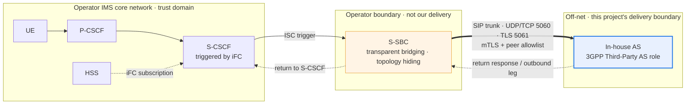
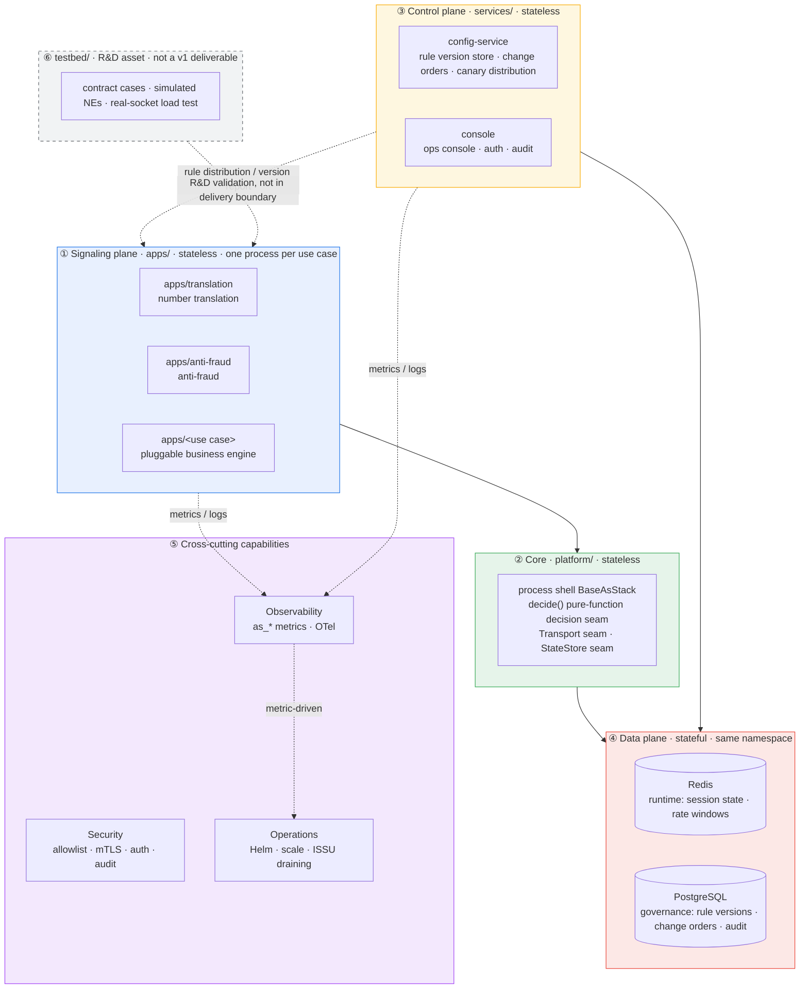

<!--
Inhouse-IMS-AS — Copyright 2026 Dolan Shu <dolan.d.shu@gmail.com>, Apache-2.0

Licensed under the Apache License, Version 2.0 (the "License");
you may not use this file except in compliance with the License.
You may obtain a copy of the License at

    http://www.apache.org/licenses/LICENSE-2.0

Unless required by applicable law or agreed to in writing, software
distributed under the License is distributed on an "AS IS" BASIS,
WITHOUT WARRANTIES OR CONDITIONS OF ANY KIND, either express or implied.
-->

# In-house IMS Application Server — product one-pager

> **Status block (read this before the rest of the document)**
>
> - **Product name**: `In-house IMS Application Server`, **formally adopted as the product / documentation descriptor name** (G8-2; **not a trademark / not a brand claim**), first appearing annotated with the 3GPP Third-Party AS role; hereafter abbreviated in-house AS (`docs/plan.md` §0 "Product Decision Log", G8 line).
> - **git repo name**: reported renamed to `inhouse-ims-as` by the maintainer (G8-3; repo name and remote URL only; this repo has not had its remote or local path changed); chart name (`3rdparty-as`, see `deploy/helm/Chart.yaml`), image name (`registry.example.com/3rdparty-as`), and OTel service name **remain `3rdparty-as` unchanged**.
> - **Target scenario**: **xx Operator internal production-readiness / release review** —— G8-1 official wording, recorded in `docs/plan.md` §0 decision log.
> - **This file belongs to**: `docs/product-packaging-plan.md` §1 first-batch deliverable **1.1 (product one-pager + naming)**.
> - **B6 review status**: this document has left a review record with the B6 review —— [`../reviews/product-packaging-review-checklist-2026-10-12.md`](../reviews/product-packaging-review-checklist-2026-10-12.md) §6 (2026-10-12 initial review) and §7 (2026-10-12 closed-loop re-review); **conclusion pending maintainer confirmation**, and before confirmation it is not used as a basis for external delivery or acceptance (`AGENT.md` §3.3).
> - **This document contains no capacity/performance numbers**: O1 (capacity target) **is unresolved** (`docs/plan.md` §5.1). The M6 dev-host measurements are internal reference, not external metrics; `AGENT.md` §2 forbids publishing any CPS / CAPS / BHCA / concurrency / latency numbers before O1 is resolved. This document therefore has **no** capacity section and **no** latency KPI.

---

## 1. Value proposition

in-house AS is a **multi-service hosting platform**: each business use case is an independent process (`apps/`, one process per use case, one fault domain, one canary unit), business engines are pluggable, and adding a service requires no core-network change. Bringing a new service online only needs "add an app + a config change order" — **no change to the IMS core network** —— the S-CSCF triggers ISC based on the iFC subscription in the HSS, and the S-SBC does transparent bridging to deliver the call off-net. The platform is therefore **not bound by any core-network vendor's service release version**: business logic runs in our own processes, and the core-network side only sees a standard ISC trigger. The delivery form is **single-tenant, on-premises**, with data (runtime and governance state) all remaining in the customer's data center, never leaving the customer boundary.

---

## 2. What we are / are not

| Dimension | What we are | What we are not | Rationale and basis |
|---|---|---|---|
| Network role | An external AS **outside** the operator IMS network, triggered by the S-CSCF via iFC | Not a core-network NE, not a replacement for S-CSCF / S-SBC / HSS | The core network is the operator's; we only implement the external AS (S-CSCF / S-SBC / HSS appear only as `testbed/` simulators, `AGENT.md` §1) |
| Access semantic | Only **one** access semantic: ISC (triggered by the S-CSCF) | No "on-net / off-net" dual-mode adapter; the SIP trunk is only a transport layer, not a second business semantic | S-SBC transparent bridging makes both sides unaware (ADR-0003 accepted; REQ-NF-5) |
| Service plane | Only **signaling**: SIP messages and business decisions; headers and SDP passed through as-is | No media: no RTP, no transcoding, no DTMF, no MRF, no media anchoring | Off-net media relay would create triangular routing and introduce voice-compliance issues; media capability retains only a seam with trigger conditions written down (ADR-0004 accepted) |
| Call records | Call trace by **Call-ID**, for complaint tracing and anti-fraud evidence | No CDR: no collection, no delivery, no archiving, no rating | A CDR is a billing record; an off-net third-party AS does not intervene (ADR-0017 accepted) |
| Charging | Not involved in charging; the charging domain (OCS / charging NE) is **N/A**, absent from this product's architecture diagram | No charging, no rating, no CDR distribution | Charging data belongs to the operator's charging domain; this product's data plane has only Redis / PostgreSQL (ADR-0017 accepted) |
| Compliance | In-boundary security: trunk peer allowlist + end-to-end TLS + console auth and full audit | No lawful interception (LI); IRI comes from on-net NEs | A third-party AS intervening in LI would introduce cross-jurisdiction exposure (ADR-0016 accepted) |
| Interface plane | Outward only a SIP trunk; control plane exposes only the AS-internal API | No **Diameter Sh** | Data comes from our own data plane; Sh is not needed (`AGENT.md` §2 non-goal, no separate ADR) |
| Deployment form | Single-tenant, on-premises, one namespace hosting one complete system | No multi-tenant / shared-instance logical isolation | An operator delivery is itself one system per customer; single-tenant gives natural physical isolation and data stays in the data center (REQ-NF-9; `AGENT.md` §2) |
| Config governance | Change order → approval → write PostgreSQL → canary distribution → rollbackable | Config **does not use GitOps**; not ops directly UPDATING the database | We should not require operator ops to learn Git just to change a number range (ADR-0006 accepted) |
| Deliverables | Helm + standard Deployment / ConfigMap / Secret is the only production form | No Operator (CRD) | Standard Helm is sufficient (ADR-0013 accepted) |
| Capacity wording | Only declares "how to measure", not "how much it can handle" | **Before M6 measurement and maintainer adjudication, publish no capacity numbers** | O1 unresolved; `deploy/alerts/README.md` states explicitly "no capacity-class alerts" (`AGENT.md` §2) |

---

## 3. Position in the network

- The S-SBC is transparent to both sides: to the S-CSCF, the AS is an on-net AS; to the AS, the peer is the S-CSCF. Therefore this system implements only ISC (ADR-0003).
- **The charging domain is not in the diagram**: this product has no interface to the charging domain, marked **N/A** (no CDR / charging, ADR-0017).
- **When ISC / iFC trigger is unavailable**: the call is not routed through this AS; the AS side does not intervene. The iFC trigger logic belongs to the S-CSCF / HSS, outside our delivery boundary; the AS only implements the business decision after the ISC trigger.

---

## 4. Architecture overview

**Key decision seams (swap parts, not architecture)**

| Decision seam | Location | Nature | Basis |
|---|---|---|---|
| `decide()` pure function | Core | The decision module has no socket, no clock, no global state → TDD can be forced | `AGENT.md` §5; `apps/` business decisions are pure functions |
| Transport seam | Core | Peer admission and transport policy are replaceable (allowlist, certificate, listen) | ADR-0016 accepted |
| StateStore seam | Core | Runtime store is replaceable (memory / Redis); single data-plane responsibility | ADR-0007 accepted |
| One process per use case | `apps/` | Each use case has an independent Deployment, independent Service, independent scale unit | ADR-0002 accepted; the chart renders one Deployment per `useCases` entry |
| ISSU = draining | Core + ops | Drain traffic → draining → exit only at zero; no in-flight call migration | ADR-0009 accepted |
| ISC trigger unavailable | Network boundary | Call does not route through this AS; AS side does not intervene (no iFC logic on the AS side) | ADR-0003 accepted; REQ-NF-5 |

---

## 5. Key KPIs (definitional, no values)

Metric names and semantics take `platform/src/as_platform/telemetry/metrics.py` as the single authority; the collection path is the process's `/metrics` endpoint (Prometheus text format, `HealthServer`, requires `AS_HEALTH_PORT`). **This page gives definitions only — no thresholds, no target values.**

| KPI | Definition | Data source | Current observability status (stated honestly) |
|---|---|---|---|
| In-flight calls | Number of in-flight calls currently carried by a single instance | `as_active_calls{use_case,pod}` | Production path **has** a producer, but coverage is limited: it only increments/decrements on dialog established / terminated events under the reSIProcate runtime (`AS_ENABLE_SIP_RUNTIME=1` and `_resip_runtime` built); otherwise only `AS_M5_SIMULATED_ACTIVE_CALLS` can simulate. reSIProcate production-path behavior E1 is still un-accepted (`docs/plan.md` §5.1 O3), so **no production evidence yet** |
| Downscale removable flag | Downscale protection decision: `1` = removable, `0` = protected or draining | `as_downscale_removable{use_case,pod}` | Production path **wired**: the metrics loop writes periodically based on guard config and draining status. No threshold, no target value |
| State-store availability | Redis reachability: `1` = reachable, `0` = unreachable | `as_state_store_available{use_case}` | Production path **wired but conditional**: probed only when env var `REDIS_URL` is non-empty; when `REDIS_URL` is unset the series **does not exist** (not 0) |
| SIP response count | SIP responses counted by `use_case` / `status_class` / `status_code` | `as_sip_responses_total{use_case,status_class,status_code}` | Production path **has no data producer yet**: only the `AS_M5_PROBE_SIP_STATUS` probe (written once at process startup, not set in on-prem production); the product SIP adapter calling this path on every final response **is still pending wiring**. Therefore the `ASHighErrorRatio` alert depending on it will not fire now (see `deploy/alerts/README.md` metric-contract table) |
| Rule-hit count | Number of decisions made by each rule | `as_rule_hits_total{rule}` | Definition and write interface exist, but **no production caller** (only unit tests call it), and it is not in `deploy/alerts/README.md`'s alert-contract table |
| Telemetry-dropped count | Number of telemetry events dropped by the bounded queue | `as_telemetry_dropped_total{use_case}` | Bounded queue enabled only when `OTEL_EXPORTER_OTLP_ENDPOINT` is configured (when unconfigured the sink is `NoOpSink`, so no count is produced); and the queue's exporter currently defaults to `NoOpExporter`, **real OTLP backend wiring still incomplete** |

> **Note: there are currently no latency / throughput / CPS metrics.** `MetricKind` has only `COUNTER` and `GAUGE` (`platform/src/as_platform/telemetry/metrics.py`), no histogram type, and the metric registry contains no latency or throughput series; the thresholds in `deploy/alerts/README.md` are all ratios, relative changes, or state conditions, with no absolute capacity values. Therefore this page **lists no latency KPI and no capacity KPI** —— the capacity model and measurement methodology will be written into [`docs/product/ne-datasheet.md`](ne-datasheet.md) after O1 is resolved.

---

## 6. Three-step deployment

Helm is the only production delivery form (ADR-0013), chart name `3rdparty-as`.

| Step | What to do | Notes |
|---|---|---|
| 1. Prepare environment and dependencies | Confirm K8s version and API, node resources, Helm and RBAC; prepare runtime Redis and governance PostgreSQL (or enable the chart's `stateStores`); run pre-deployment environment validation | Validation script in [`docs/delivery/preflight.sh`](../delivery/preflight.sh) (validates K8s / resources / dependency services / Helm / RBAC) |
| 2. Install | Install the chart with `helm upgrade --install`; each business use case renders as an independent Deployment | **This page does not repeat the values parameters** —— parameters and render behavior take [`deploy/helm/README.md`](../../deploy/helm/README.md) as authority; the delivery checklist and command sequence are in [`docs/delivery/install-guide.md`](../delivery/install-guide.md) |
| 3. Connect and verify | Peer the SIP trunk with the operator S-SBC (UDP/TCP 5060, TLS 5061, mTLS + peer allowlist); trigger ISC via the iFC subscription on the S-CSCF / HSS side; verify calls and decisions with a simulated peer or a real S-SBC | iFC trigger is configured on the S-CSCF / HSS side, not on the AS side; the AS only implements the business decision after the ISC trigger |

**Out of scope**: production ingress (7.2d) and real-cluster evidence are currently still **blocked**; this page offers no in-cluster verification conclusions, and no air-gapped offline-package steps (see [`docs/delivery/airgap-package.md`](../delivery/airgap-package.md)).

---

## 7. Current status and open items (stated honestly; must not be cited as accepted)

| Item | Status |
|---|---|
| M8 release candidate | Artifacts ready, **exit sign-off not completed** (`docs/plan.md` §0) |
| E1 reSIProcate production-path behavior | **Pending acceptance** (O3 / O2) |
| E4 TLS certificate hot-rotation | **Pending acceptance**; no lab evidence for operator PKI |
| E5 state externalization and recovery | **Pending acceptance** (REQ-NF-1 sign-off still belongs to M8) |
| e2e tests | `pytest -m e2e` **8 cases stably passing** (Wave 1 five `testbed/e2e/test_sip_first_edition.py` + Wave 2 three `testbed/e2e/test_s1_replay_contract.py`; when native extension is missing they fail, not skip); REQ-F-1 = **automated subset covered / full text still open** (14 messages header-by-header diff not covered, see `../acceptance/test-plan.md` REQ-F-1 section 2026-10-12 appended block) |
| O1 capacity target | **Unresolved** —— therefore this document has no capacity numbers |
| O4 call-trace retention period | **Resolved (G6, 2026-10-10)**: default 10 days, deploy-configurable; **implementation not delivered** —— the trace store / query / delete capability does not currently exist; must not be stated as "the system already purges at 10 days" |
| D5 trace-storage selection | **Resolved (G6, 2026-10-10)**: in-cluster PostgreSQL; **implementation not delivered** (lands with the trace-storage capability) |
| O5 disaster-recovery tier | **Resolved (G7, 2026-10-10)**: in-site N+1 + cross-site 1+1 warm standby (reusing ADR-0008 topology; **no rack / AZ-level fault-tolerance promised**); RPO / RTO values still unresolved; the chart still renders single-replica, with no evidence of failover behavior |

---

## 8. Documentation index

| Document | Content | Location |
|---|---|---|
| **This file** | Positioning, value proposition, architecture overview, KPI definitions, three-step deployment | `docs/product/one-pager.md` |
| [`compliance-matrix.md`](compliance-matrix.md) | 3GPP / GSMA / RFC compliance matrix (Sh and charging marked N/A with rationale) | `docs/product/` |
| [`ne-datasheet.md`](ne-datasheet.md) | NE profile: KPI definitions, alert list, dependencies, resource specs, capacity model (capacity values blocked by O1) | `docs/product/` |
| [`responsibility-matrix.md`](responsibility-matrix.md) | Responsibility-boundary matrix RACI: AS vs S-CSCF / HSS / charging domain / NMS / security domains | `docs/product/` |
| [`version-lifecycle.md`](version-lifecycle.md) | Version lifecycle and EOL strategy (REQ-NF-16 / ADR-0027) | `docs/product/` |
| [`security-privacy.md`](security-privacy.md) | Security and privacy compliance (PDPO); retention (O4) and storage selection (D5) values resolved (G6), implementation not delivered | `docs/product/` |
| [`../operations/runbook-l1.md`](../operations/runbook-l1.md) | L1 operations manual (NOC daily and alert handling) | `docs/operations/` |
| [`../operations/runbook-l2.md`](../operations/runbook-l2.md) | L2 operations manual (deep troubleshooting and signaling analysis) | `docs/operations/` |
| [`../operations/fault-demarcation.md`](../operations/fault-demarcation.md) | Fault-demarcation manual: AS / S-CSCF / HSS / charging-domain four-party demarcation | `docs/operations/` |
| [`../operations/rollback-playbook.md`](../operations/rollback-playbook.md) | Service drain / rollback + iFC-side coordination manual | `docs/operations/` |
| [`../operations/backup-restore.md`](../operations/backup-restore.md) | Backup and restore plan + drill-record template (blocked by real-cluster environment) | `docs/operations/` |
| [`../delivery/install-guide.md`](../delivery/install-guide.md) | Delivery checklist, image sync, `helm install` command sequence | `docs/delivery/` |
| [`../delivery/airgap-package.md`](../delivery/airgap-package.md) | Offline install package (image sync + `helm package`) creation and use | `docs/delivery/` |
| [`../delivery/preflight.sh`](../delivery/preflight.sh) | Pre-deployment environment validation script | `docs/delivery/` |
| [`../../deploy/helm/README.md`](../../deploy/helm/README.md) | **Authoritative** description of Helm chart parameters and render behavior | Existing |
| [`../architecture/system-architecture.md`](../architecture/system-architecture.md) | Design baseline: network position, layering, config governance, redundancy and ISSU, security boundary, open items and risks | Existing |
| [`../plan.md`](../plan.md) | Milestone status, product decision log, open items (O1–O5) | Existing |
| [`../product-packaging-plan.md`](../product-packaging-plan.md) | The packaging plan this file belongs to, and the deliverable list | Existing |
| [`../acceptance/test-plan.md`](../acceptance/test-plan.md) | Acceptance criteria and automated-layering boundaries (e2e marker status) | Existing |
| [`../../deploy/alerts/README.md`](../../deploy/alerts/README.md) | Alert ruleset and metric contract (why there are no capacity-class alerts) | Existing |
| [`../../AGENT.md`](../../AGENT.md) | Collaboration rules: non-goals, coding conventions, gate, DoD | Existing |

> The links marked `docs/product/`, `docs/operations/`, `docs/delivery/` in the table above **are all persisted** and can be opened directly; among them, **the parts depending on a real cluster / peer coordination are still blocked** (G-P1-10), as noted in each document's blockages.

---

## 9. Traceability

- **Corresponding deliverable**: `docs/product-packaging-plan.md` §1 first-batch **1.1 (product one-pager + naming)**; engineering-fact constraints are in the plan §0.3.
- **Review remediation items already applied**:
  - **G-P0-6** (insufficient basis for the target-scenario decision) → the target scenario is downgraded to **current default direction (discussed and confirmed, pending formal decision landing)**, see the status block; the formal landing location is `docs/plan.md` §0 "Product Decision Log".
  - **G-P2-6** (insufficient basis for the product name being "confirmed") → the whole text uses a **temporary documentation name** and states "not a formally approved product name"; the git repo rename is limited to the repo name and remote URL, while chart / image / OTel service names are unchanged.
  - **2026-10-12 addition (G8)**: the "downgrade to default direction / temporary name" handling of the two items above has been superseded by the G8-1 / G8-2 / G8-3 adjudications —— the official target-scenario wording and the descriptor name are both recorded in `docs/plan.md` §0 decision log; this paragraph is retained as the audit chain.
- **REQs referenced**: `REQ-NF-1` (no session loss on process restart), `REQ-NF-2` (bounded per-process state), `REQ-NF-3` (horizontally scalable), `REQ-NF-4` (ISSU), `REQ-NF-5` (S-SBC transparent bridging), `REQ-NF-9` (single-tenant on-premises), `REQ-NF-13` (OTel three-signal export), `REQ-NF-14` (alert ruleset), `REQ-NF-16` (version lifecycle and EOL); `REQ-F-1` (basic call signaling sequence), `REQ-F-2` (B2BUA two-leg different Call-IDs), `REQ-F-5` (Route / Record-Route handling), `REQ-F-7` (hit block policy returns 603 Decline). Definitions in `docs/requirements/prd.md`.
- **ADRs referenced (status per each file header)**: ADR-0002 (one process per use case, accepted), ADR-0003 (S-SBC transparent bridging / single ISC, accepted), ADR-0004 (media seam, accepted), ADR-0005 (OTel observability, accepted), ADR-0006 (config governance, accepted), ADR-0007 (data-plane split, accepted), ADR-0009 (ISSU / draining, accepted), ADR-0013 (Helm-only production form, accepted), ADR-0014 (three-layer testbed, accepted), ADR-0016 (in-boundary security, accepted), ADR-0017 (no CDR, accepted), ADR-0021 (runtime override granularity, accepted), ADR-0026 (in-cluster state storage, accepted), ADR-0027 (version lifecycle and EOL, accepted). **ADR-0023 (Redis checkpoint, proposed) and ADR-0025 (managed rule-runtime bundle, draft) have not passed**, and this document draws no conclusions from them.
- **What was not done**: no capacity numbers (O1 unresolved); no Diameter Sh and no CDR / charging content (N/A with rationale); no M6 dev-host numbers cited as external metrics; nothing un-accepted presented as passed.
