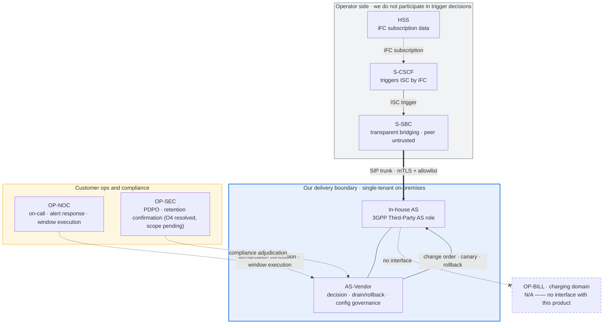

<!--
Inhouse-IMS-AS — Copyright 2026 Dolan Shu <dolan.d.shu@gmail.com>, Apache-2.0

Licensed under the Apache License, Version 2.0 (the "License");
you may not use this file except in compliance with the License.
You may obtain a copy of the License at

    http://www.apache.org/licenses/LICENSE-2.0

Unless required by applicable law or agreed to in writing, software
distributed under the License is distributed on an "AS IS" BASIS,
WITHOUT WARRANTIES OR CONDITIONS OF ANY KIND, either express or implied.
-->

# In-house IMS Application Server — responsibility-boundary matrix (RACI)

> **Status block (read this before the rest of the document)**
>
> - **Product name**: `In-house IMS Application Server`, **formally adopted as the product / documentation descriptor name** (G8-2; **not a trademark / not a brand claim**), first appearing annotated with the 3GPP Third-Party AS role; hereafter abbreviated in-house AS (`../plan.md` §0 "Product Decision Log", G8 line). git repo name: reported renamed to `inhouse-ims-as` by the maintainer (G8-3; repo name and remote URL only; this repo has not had its remote or local path changed); chart name (`3rdparty-as`), image name, and OTel service name **remain `3rdparty-as` unchanged**.
> - **This file belongs to**: `../product-packaging-plan.md` §1 third-batch deliverable **3.3 (responsibility-boundary matrix / RACI)**. Per the plan §3.2, this deliverable is **Class A** (no dependency on open items; can start immediately).
> - **⚠️ The iFC trigger logic belongs to the S-CSCF / HSS, not the AS side** (review **G-P0-5** adjudicated). This product **only implements the business decision after the ISC trigger, and drain / rollback**. iFC-side canary triggering by number range / percentage **must be configured on the S-CSCF / HSS side**; the AS side cannot do it on their behalf. Every RACI row in this document is written to this boundary.
> - **⚠️ The charging domain is N/A throughout**: no CDR, no delivery, no archiving, no rating (ADR-0017 accepted); **Sh-related activities are N/A** (`AGENT.md` §2 non-goal); **LI / IRI are N/A** (ADR-0016 accepted).
> - **This document contains no capacity / performance numbers**: O1 (capacity target) **is unresolved** (`../plan.md` §5.1 O1); `AGENT.md` §2 forbids publishing any CPS / CAPS / BHCA / concurrency / throughput / latency numbers before the measurement is adjudicated. The `5060` / `5061` appearing in the text are **protocol port constants**, not capacity metrics.
> - **B6 review status**: this document has left a review record with the B6 review —— [`../reviews/product-packaging-review-checklist-2026-10-12.md`](../reviews/product-packaging-review-checklist-2026-10-12.md) §6 (2026-10-12 initial review) and §7 (2026-10-12 closed-loop re-review); **conclusion pending maintainer confirmation**, and before confirmation it is not used as a basis for external delivery or acceptance (`AGENT.md` §3.3).
> - **Un-accepted items must not be treated as accepted**: E1 (reSIProcate production-path behavior) / E4 (TLS certificate hot-rotation) / E5 (state externalization and recovery) **are un-accepted**; e2e: `pytest -m e2e` **8 cases stably passing** (fail, not skip, when native is missing), REQ-F-1 = automated subset covered / full text still open; REQ-S-4 is only an **engineering slice**, M4/M4b engineering closure ≠ REQ acceptance; M8 RC artifacts ready but **exit sign-off still on hold** (RC ready ≠ passed).
> - **Cross-links**: this document cross-links with [`../operations/fault-demarcation.md`](../operations/fault-demarcation.md) (fault-demarcation manual) and [`../operations/rollback-playbook.md`](../operations/rollback-playbook.md) (service drain / rollback + iFC-side coordination manual), both **persisted**; but the parts depending on a real cluster / peer coordination are **still blocked** (G-P1-10).
> - **Review entry**: the **execution record** for this productization packaging is in [`../reviews/product-packaging-execution-record-2026-10-10.md`](../reviews/product-packaging-execution-record-2026-10-10.md) —— it is an **execution record, not a maintainer-signed review record** (the "conclusion pending maintainer confirmation" in the "B6 review status" line above still holds).

---

## 1. Party definitions

| Code | Role | Belongs to | Relationship to this product |
|---|---|---|---|
| **AS-Vendor** | In-house IMS Application Server maintainer (our side) | Author of this document | Delivers and maintains all AS components: `apps/` business engines, `platform/` core, `services/` control plane, `deploy/` deployment assets. **Implements only the external AS** (`AGENT.md` §1) |
| **OP-NET** | Operator network department (S-CSCF side) | Customer | Owns the S-CSCF; holds usage rights to the iFC subscription data; **the implementer of the iFC trigger logic**. Triggers ISC by iFC and delivers to the AS via the S-SBC |
| **OP-SBC** | S-SBC NE | Customer (**not our delivery**) | The **peer** of the SIP trunk; transparent bridging, topology hiding. The trunk is untrusted; peer admission is validated on the AS side (ADR-0016) |
| **OP-HSS** | HSS | Customer | The **store** of the iFC subscription data; iFC canary triggering requires their-side coordinated configuration |
| **OP-BILL** | Charging domain (OCS / charging NE) | Customer | **N/A** —— no interface with this product. No CDR / charging / rating (ADR-0017) |
| **OP-NOC** | NMS / NOC | Customer | Handles alert response, daily inspection, change-window execution; operates with our-side rollback decisions |
| **OP-SEC** | Security and compliance | Customer | The **responsible party** for PDPO and data-residency; the confirmer of retention period and cross-border arrangements (O4 value resolved: default 10 days, deploy-configurable; scope and cross-border arrangement still pending OP-SEC confirmation); the commissioning party for and the exporter-standard adjudicator of penetration testing |
| **3P** | Third-party interoperability party (e.g., integrator, S-SBC vendor) | Designated by customer | Participates in interoperability testing and joint debugging under customer authorization; **does not directly hold any credentials of this product** (`AGENT.md` §11: never commit keys / certificates / real captures) |

**One-line boundary**: the AS side only owns "the decision after the ISC trigger, drain, and rollback"; all access decisions before the trigger (iFC subscription, triggering, canary) are on the OP-NET / OP-HSS / OP-SBC side.

### 1.1 Boundary diagram and responsibility surfaces

**Reading the diagram**: ① Everything inside the dashed "operator side" box is **not our deliverable**; ② between us and the customer's ops/compliance is a **collaboration** relationship (demarcation conclusion comes from OP-NOC, retention from OP-SEC), not a unilateral decision by us; ③ the charging domain is dashed with no connecting line —— **no interface means no responsibility**.

---

## 2. RACI matrix (main deliverable)

**Legend**: `R` = Responsible (the person doing the work) · `A` = Accountable / final responsible (the person who signs off, always the unique one per row) · `C` = Consulted · `I` = Informed · **`对方` (other party)** = the activity is entirely on the operator side, **we do not participate**.

| # | Activity | AS-Vendor | OP-NET | OP-SBC | OP-HSS | OP-BILL | OP-NOC | OP-SEC | 3P |
|---|---|---|---|---|---|---|---|---|---|
| ① | **iFC subscription and trigger configuration** (subscription data, canary trigger by number range / percentage) | I | **A**/R | C | **R** | — | I | — | — |
| ② | **S-CSCF → S-SBC → AS trunk setup and interoperability test** | R | C | **A**/R | I | — | I | — | C |
| ③ | **trunk TLS certificate issuance and rotation** (each side issues/updates its own; keys not shared across parties) | R (AS-side cert and hot-update) | C | **A**/R (S-SBC-side cert) | — | — | I | C | — |
| ④ | **AS-side number / number-range rules and change orders** | **A**/R | C | — | — | — | I | — | — |
| ⑤ | **business-decision canary** (number range / stable-hash percentage, ADR-0021) | **A**/R | I | I | — | — | I | — | — |
| ⑥ | **drain / rollback after ISC trigger** (AS-side runtime override, hot decision without restart) | **A**/R | C | C (executes drain) | — | — | **R** (operates) | — | — |
| ⑦ | **NOC on-call and alert response** | C (escalate to L2) | I | I | — | — | **A**/R | — | — |
| ⑧ | **fault demarcation** | R (AS-side self-check) | C | C | C | — | **A** (demarcation conclusion) | — | C |
| ⑨ | **interface capture and log forensics** (provided by AS side, see §3) | **A**/R | C | C | — | — | C | C | — |
| ⑩ | **change-window coordination** | R (AS-side window) | **A** (network-side window) | C | I | — | R (execute) | I | I |
| ⑪ | **backup and restore** (incl. PostgreSQL streaming replication + backup + PITR) | **A**/R | I | I | — | — | C (execute window) | C | — |
| ⑫ | **capacity planning and O1 adjudication** | R (provides measurement methodology) | **A** (target adjudication) | C | — | — | C | — | — |
| ⑬ | **version upgrade and EOL notice** | **A**/R (issued per ADR-0027) | I | I | — | — | I | I | I |
| ⑭ | **PDPO compliance and retention adjudication (O4)** | C (provides mechanism and scope) | I | — | — | — | I | **A**/R | — |
| ⑮ | **penetration testing** | R (provides environment and scope) | C (peer coordination) | C (peer coordination) | — | — | I | **A** (export standard) | C |
| ⑯ | **performance-evidence collection** (internal measurement wording, see discipline below) | **A**/R | I | I | — | — | I | — | — |
| ⑰ | **Sh-related activities** (subscriber-data query, etc.) | — | — | — | — | — | — | — | — |
| ⑱ | **CDR / charging-related activities** | — | — | — | — | — | — | — | — |
| ⑲ | **LI / IRI-related activities** | — | — | — | — | — | — | — | — |

**Four boundaries that must be shown honestly**

1. **① iFC canary triggering requires S-CSCF / HSS-side coordinated configuration.** The AS side is only responsible for the decision and drain **after** the trigger (**G-P0-5**, **G-P1-10**). The review has explicitly corrected the erroneous wording "iFC canary is an AS-side deliverable"; iFC triggering by number range / percentage requires OP-NET / OP-HSS configuration, which the AS side cannot do on their behalf.
2. **⑤ AS-side canary ≠ iFC canary.** What the AS side can do is **business-rule canary** and **runtime override**: the decision granularity is fixed at **number prefix (number range) + optional stable-hash percentage**, and the decision must be idempotent (ADR-0021 accepted; implementation in `src/platform/src/as_platform/gating/overrides.py:39-97`, `in_bucket` uses `fnv1a32(call_id) % _BUCKETS` to guarantee the same answer on repeated evaluation). The deployment-level master switch goes through the change pipeline, not a new channel (ADR-0020; ADR-0006).
3. **⑰⑱⑲ all N/A**: Sh —— data comes from our own data plane (`AGENT.md` §2); CDR / charging —— ADR-0017 accepted, and explicitly "call trace is not a billing record" (ADR-0017 decision ③); LI / IRI —— belongs to on-net NE functions, and a third-party AS intervening introduces cross-jurisdiction exposure (ADR-0016 accepted).
4. **⑯ performance evidence is internal measurement.** O1 unresolved, this document **states no values**; the M6 dev-host measurement carries the "internal measurement / not external / not SLA" qualifier, and `testbed/` is an R&D asset (ADR-0014), **must not serve as operator IOT or live-network capacity evidence** (`../product-packaging-plan.md` §0.3 item 8).

---

## 3. Interface-capture responsibility

| Link segment | Who captures | What is captured | What we can provide | Limits |
|---|---|---|---|---|
| **S-CSCF → S-SBC** (ISC trigger) | **Other party** (OP-NET / OP-SBC) | iFC trigger context and trigger result | **Not provided** | This segment does not pass through the AS at all. The AS side has no capture of this segment and holds no iFC trigger logs |
| **S-SBC → AS trunk** (SIP over TLS `5061`) | **Each side captures its own side** | The signaling flow on each side's process/NE | ① **Call-ID-correlated JSON log-field contract** (see below); ② the `as_*` series at the `/metrics` endpoint | **Under TLS, capture decryption is each party's own responsibility; keys are not shared across parties**. The AS side **does not accept** copying the peer's private key for decryption; **never commit real captures** (`AGENT.md` §11 / §13; `SECURITY.md`) |
| **AS → downstream** (`AS_SIP_NEXT_HOP` outbound leg) | **Other party** (downstream NE / OP-NET side) | The request received on the downstream side | The AS side provides the inbound / outbound two-leg Call-ID correlation fields (`outgoing_call_id` / `inbound_call_id`) | The landing result of the outbound signaling can only be evidenced by the downstream side |
| **AS internal** (`apps/` → `platform/` → Redis / PostgreSQL) | **Our side** | Decision result, state-store interaction, config version | All provided by the AS side | Internal network; PG password and audit HMAC key go through Secret, **not into logs** |
| **`testbed/` simulated link** | **Our side** (R&D) | All | All | ⚠️ **Not live-network evidence**. Simulation results (incl. callload, M7.1 simulation platform, dev-host harness) are R&D / demo assets; ADR-0014 explicitly excludes testbed from v1 deliverables |

**Exact contract the AS side can provide (for the other party to align retrieval keys)**

| Item | Content | Location |
|---|---|---|
| JSON log fields | `timestamp` / `level` / `trace_id` / `call_id` / `direction` / `method` | [`../acceptance/m8-resip-runtime-log-contract.md`](../acceptance/m8-resip-runtime-log-contract.md) §1-§2 (frozen field and event table) |
| Event table | `RESIP_RUNTIME_LISTENING` / `UAC_INVITE_SENT` / `UAC_NEW_SESSION` / `UAC_FAILURE` / `UAS_FAILURE_MAPPED` / `OUTBOUND_CANCEL_FORWARD` / `UAS_ANSWER_RELAYED` / `RELOAD_CERTIFICATES` + various `*_ERROR` / `*_CORRELATION_MISS` | Same §2 field-contract table |
| Two-leg Call-ID correlation | Inbound `inbound_call_id` ↔ outbound `outgoing_call_id` (B2BUA two-leg different Call-IDs) | Contract event `RESIP_RUNTIME_UAC_INVITE_SENT`'s `inbound_call_id` + `outgoing_call_id` |
| Parser and tests | `src/platform/src/as_platform/sip/resip_runtime_log_contract.py`; `src/platform/tests/test_resip_runtime_log_contract.py` (`contract` marker) | Field stability guarded by contract tests (a C++ rename / key change goes red) |
| Metrics | `/metrics` (Prometheus text format, `HealthServer`, port from `AS_HEALTH_PORT`) | `src/platform/src/as_platform/telemetry/metrics.py` (authoritative definition); ⚠️ the chart does not wire scraping (no scrape annotation, no ServiceMonitor) |

**What the AS side explicitly does NOT provide**

| Not provided | Reason | Basis |
|---|---|---|
| **IRI / LI** | Belongs to on-net NE functions; a third-party AS intervening introduces cross-subject / cross-jurisdiction exposure. This ADR **reserves no collection point for it** —— reserving a collection point equals reserving the possibility of being required to enable it | ADR-0016 accepted |
| **CDR / billing record** | No collection, no delivery, no archiving, no rating. Replaced by a Call-ID-based call trace, and **explicitly declared that the trace is not a billing record** | ADR-0017 accepted (decisions ①③) |
| **cross-side decrypted capture** | Keys not shared across parties | `AGENT.md` §11 |
| **payload logs** (off by default) | `AS_PAYLOAD_LOGS_ENABLED` / `telemetry.payloadLogsEnabled` default `false` (`deploy/helm/values.yaml:319`; `deploy/helm/templates/configmap.yaml:65`). Enabling is an explicit, auditable action | ADR-0016; `AGENT.md` §13 |

---

## 4. Fault-ownership quick reference

> Full playbook and checklist in [`../operations/fault-demarcation.md`](../operations/fault-demarcation.md) (**persisted**; but the full playbook's real-cluster evidence is still blocked, M8 7.2d not unlocked). This document only gives the first-round ownership judgment and AS-side self-check actions.

| Symptom | Preferred owner | AS-side self-check action | Escalation path |
|---|---|---|---|
| Inbound call does not reach AS (peer has no INVITE at all) | **Other party** (OP-SBC / OP-NET) | Check whether we received a connection: `as_downscale_removable`, Pod status, Service Endpoints | OP-NOC → OP-NET. The AS side **must not demarcate first when it has no evidence** |
| No inbound-leg log on AS side but complaint stands | **Pending**, both sides align | Check `/metrics` for whether the `use_case` series is produced; check whether ingress rejected the peer | OP-NOC pulls both timelines → joint demarcation |
| `403 Forbidden` | **AS side** | Plaintext rejected when TLS is required (`src/platform/src/as_platform/sip/ingress.py:178-194`, any transport other than `tls`/`sips` is rejected), or peer allowlist miss —— **both share 403** | AS L2 → customer PKI / network dept |
| `603 Decline` | **Usually not a fault** (expected business decision) | Check the effective rule version and the hit policy (anti-fraud over-limit) | If rules differ from expectation → change-order rollback (ADR-0006) |
| `404 Not Found` | **Usually not a fault** (no matching rule) | Check whether number-range / prefix rules cover | Rule issue → change order |
| `487 Request Terminated` | Usually **caller gave up** | Align with contract scenario S4; note native DUM semantics still in acceptance (E1 un-accepted) | Abnormal count → AS L2 |
| TLS handshake failure | **Both sides** (cert chain / fingerprint allowlist / CA config) | Check whether the CA pointed to by `AS_TLS_CA_PATH` includes the peer's issuing chain; check whether the peer fingerprint is in `AS_PEER_ALLOWED_CERT_FINGERPRINTS` (`src/platform/src/as_platform/runtime/transport_env.py:86-89`). **Keys not shared across parties** | Both sides' PKI owners jointly |
| `ASCallStateStoreUnavailable` triggered | **AS side** (Redis unreachable) | This metric **is produced only when `REDIS_URL` is non-empty**; when unconfigured the series does not exist (not 0), and the rule never fires | AS L2 / platform side |
| `ASRestartLoop` triggered | **AS side** | The only currently triggerable `as.*` rule; data source is external kube-state-metrics | AS L2 |
| Config changed but not effective | **AS side** | Whether the change order reached the "effective" state; whether canary distribution completed; whether each instance's reported `current_rule_version` is consistent | AS L2 / config-service owner |
| Drain instruction issued but calls still arrive | **Other party** (OP-SBC / OP-NET side iFC / drain not configured) | Confirm the AS-side override took effect; **the AS side does not actively drain in-flight calls** (§5) | OP-NOC → OP-NET |
| Console cannot log in / privilege escalation | **AS side** | Role matrix `viewer`/`approver`/`admin` (`src/services/console/src/as_console/access.py:26-39`); password is `pbkdf2-sha256` (`src/services/config-service/src/as_config_service/auth.py:191-201`); sessions revocable (same file `RevokedSession`, `:128-134`) | AS L2; **privilege-escalation event also notifies OP-SEC** |
| Audit record missing / suspected altered | **AS side** | Audit table is append-only, enforced by `BEFORE UPDATE OR DELETE` / `BEFORE TRUNCATE` triggers (`src/services/config-service/src/as_config_service/audit_store.py:102-104`) | AS L2 **+ OP-SEC** (audit-integrity event) |
| Abnormal calls under high load | **Pending** | ⚠️ **Must not demarcate using capacity numbers**. O1 unresolved, no capacity-class rule among `as-*` alerts; use `ASActiveCallsSurge` (relative change) + M6 harness (internal measurement) to troubleshoot | Joint capacity study (O1) |

---

## 5. Change-window collaboration mechanism

### 5.1 Four-party structure of the window

| Step | Who raises | Who approves | Notes |
|---|---|---|---|
| AS-side change (image `helm upgrade`, config change order, cert rotation) | **AS-Vendor** | AS-Vendor internal + **OP-NOC** informed | Config goes change order → approval → write PG → canary distribution → rollbackable (ADR-0006). **No GitOps** (`AGENT.md` §2) |
| Operator network-side change (iFC subscription / trigger canary, trunk priority, drain) | **OP-NET / OP-NOC** | **OP-NET** | **AS side does not raise or approve on their behalf** |
| Stateful-component maintenance (PostgreSQL / Redis) | **AS-Vendor** proposes plan | **OP-NOC** approves window | The chart's built-in is **single-replica**, **not HA** (`../product/ne-datasheet.md` §7); O5 / D3 values **resolved (G7)**: in-site N+1 + cross-site 1+1 warm standby, Redis primary/replica + Sentinel; chart still renders single-replica, implementation not delivered |
| Cross-site switchover | **AS-Vendor** provides switchover script | **OP-NOC + OP-NET** (S-SBC-side trunk priority changed by the other party) | ADR-0008: in-site N+1 zero single-point + cross-site **1+1 warm standby (not active-active)**; switchover is an **ops action**, must be drilled |

### 5.2 Hard constraints in the window

| Constraint | Content | Basis |
|---|---|---|
| **ISSU = draining** | Upgrade / restart / scale-down all follow: stop accepting new requests → existing calls run to completion on the original process → exit after `active_calls` reaches zero. **No in-flight call-state migration**, and **no path of "exit immediately on termination signal"** | ADR-0009 accepted; orchestration-side `preStop` + `terminationGracePeriodSeconds` (`deploy/helm/templates/deployment.yaml:49-53`) |
| **AS side does not actively drain in-flight calls** | What we can guarantee is "**do not actively drain in-flight calls**"; **whether a call enters this AS is decided by the S-SBC / S-CSCF-side iFC config and drain action** | G-P0-5 / G-P1-10; this product has no iFC logic |
| **Config and cert changes do not restart the process** | Cert rotation is a **config hot-update**; allowlist and cert go through the same change pipeline | ADR-0016; `TransportSeam.reload` returns a new snapshot rather than mutating in place (`src/platform/src/as_platform/sip/transport.py:110-132`); dual-cert overlap window in `src/platform/src/as_platform/sip/ingress.py:70-100` |
| **drain / rollback decision maker** | **AS-side decision + OP-NOC execution + OP-NET coordination**. Runtime override is a **hot decision, no restart** (ADR-0021); the deployment-level master switch goes through change orders (ADR-0020 / ADR-0006) | ADR-0020 / ADR-0021 accepted |
| **rollback is not "one-click zero-impact"** | The scope of a runtime override is the AS-side business logic; pulling calls away from this AS still requires S-SBC / S-CSCF-side coordination | G-P1-10; operations manual in [`../operations/rollback-playbook.md`](../operations/rollback-playbook.md) (**persisted**; but real-cluster drill still blocked) |
| **real-cluster evidence still missing** | Rolling upgrade / scale-down without dropping calls under real SIP load, and backup/restore drills, are **still blocked**; M8 7.2d not unlocked | `../product-packaging-plan.md` §0.3 items 3 / 8; `docs/acceptance/test-plan.md` |

---

## 6. Open items and blockages

| Item | Blockage source | Impact | Responsible party |
|---|---|---|---|
| iFC-side canary trigger by number range / percentage, joint debugging | **OP-NET / OP-HSS-side config** | End-to-end canary and rollback drill cannot close the loop; the AS side can only self-prove override effectiveness | OP-NET (AS side provides interface conventions) |
| E4 TLS cert hot-rotation has no lab evidence | M8 acceptance + operator PKI (REQ-S-2 / REQ-S-3) | ③ dual-cert overlap window and rotation have only mechanism and testbed-only evidence | AS-Vendor + OP-SEC / OP-NET |
| E1 reSIProcate production-path behavior | M8 acceptance (O2 / O3) | ②⑧ interoperability and demarcation conclusions lack production evidence; the 14-message full B2BUA replay not signed off | AS-Vendor |
| E5 state externalization and recovery | REQ-NF-1 sign-off belongs to M8 | ⑪ recovery path has only engineering-slice evidence | AS-Vendor |
| O1 capacity target unresolved | Maintainer adjudication | ⑫⑯ cannot give capacity wording; all capacity-class alerts deferred | Maintainer + OP-NET |
| O4 call-trace retention period | Value **resolved (G6)**: default 10 days, deploy-configurable; **implementation not delivered** | The landing of trace TTL, storage capacity, and purge behavior depends on the trace store / query / delete capability implementation; scope and cross-border arrangement still pending OP-SEC confirmation | **OP-SEC** (AS side provides mechanism and scope) |
| D5 trace-storage selection | Value **resolved (G6)**: in-cluster PostgreSQL; **implementation not delivered** | The landing of §2 data-retention and backup strategy depends on the trace-storage implementation | OP-SEC + AS-Vendor |
| O5 disaster-recovery tier | Value **resolved (G7)**: in-site N+1 + cross-site 1+1 warm standby; no rack / AZ-level fault-tolerance promised; RPO / RTO values unresolved | Chart still renders single-replica, no failover-behavior evidence; Redis / PG HA landing depends on implementation | OP-NET (customer SLA) |
| D1 Python 3.10 end-of-life | Any delivery after that date | Must first verify migration or register as an accepted risk (see [`security-privacy.md`](security-privacy.md) §6) | Maintainer |
| REQ-S-4 formal acceptance | Only an **engineering slice** | ⑮ security-related conclusions must not be written as passed acceptance | AS-Vendor + OP-SEC |
| Penetration testing not executed | No artifact, no schedule | ⑦⑮ security baseline has no independent verification | **OP-SEC** (commission) + AS-Vendor (execute) |
| e2e coverage incomplete | M8 | `pytest -m e2e` 8 cases stably passing (fail, not skip, when native missing); REQ-F-1 = automated subset covered / full text still open —— full call + console end-to-end has no automated evidence; the 14-message header-by-header diff is not covered | AS-Vendor |

---

## 7. Traceability

| Item | Content |
|---|---|
| **Corresponding deliverable** | `../product-packaging-plan.md` §1 third-batch **3.3 (responsibility-boundary matrix / RACI)**; per §3.2 it is **Class A** (no external blockage). Engineering-fact constraints are in the plan **§0.3** (esp. item 3 operator PKI no lab evidence, item 8 testbed boundary) |
| **Review opinions applied** | **G-P0-5** —— iFC trigger logic belongs to S-CSCF / HSS, not the AS side; this document's status block, §1, §2 rows ①⑤⑥ and §5.2 are all written to this boundary (review record [§ Adjudication](../reviews/product-packaging-plan-review-2026-10-09.md)) **G-P1-10** —— depends on S-CSCF-side coordination and real-cluster drills: §2 rows ①②③⑤⑥⑩ all mark the other-party role, §5 states the AS side only guarantees not actively draining in-flight calls, §6 registers the joint-debug blockage **G-P0-4** —— no Sh / no charging: §2 rows ⑰⑱ all N/A with rationale, §3 "what the AS side explicitly does not provide" lists CDR and IRI **G-P2-3** —— no `sh-interface`-style naming |
| **REQs referenced** | `REQ-F-13` (Call-ID-based trace query), `REQ-F-7` (`603 Decline`), `REQ-F-2` (two-leg different Call-IDs), `REQ-NF-4` (ISSU), `REQ-NF-5` (S-SBC transparent bridging), `REQ-NF-7` (no CDR → call trace substitute), `REQ-NF-9` (single-tenant on-premises), `REQ-NF-10` (runtime override traceable), `REQ-NF-13` (OTel three signals / log fields), `REQ-NF-14` (alert ruleset), `REQ-NF-16` (version lifecycle and EOL), `REQ-G-1` (feature gating), `REQ-S-1` / `REQ-S-2` / `REQ-S-3` (peer allowlist / end-to-end TLS / cert hot-rotation), `REQ-S-4` (console auth and audit, **engineering slice only**). Definitions in `../requirements/prd.md` |
| **ADRs referenced** | ADR-0002 (one process per use case), ADR-0003 (S-SBC transparent bridging / single ISC), ADR-0005 (OTel observability), ADR-0006 (config governance / change orders), ADR-0007 (data-plane split), ADR-0008 (redundancy / cross-site 1+1 warm standby), ADR-0009 (ISSU = draining), ADR-0010 (scale-down protection), ADR-0013 (Helm-only), ADR-0014 (three-layer testbed), **ADR-0016 (in-boundary security; no LI / no charging)**, **ADR-0017 (no CDR)**, ADR-0018 (version-number semantics), ADR-0019 (SIP-stack selection), ADR-0020 (feature layered gating), **ADR-0021 (runtime override granularity)**, ADR-0024 (console password and sessions), ADR-0026 (in-cluster state storage), ADR-0027 (version lifecycle and EOL). Status per `../architecture/adr/README.md` registry; **ADR-0023 / ADR-0025 still draft, this document draws no conclusions from them** |
| **Key code basis** | Peer admission `src/platform/src/as_platform/sip/transport.py:249-298` (empty-policy reject `:272-273`); mTLS defaults `transport.py:86,88-93`; plaintext reject `src/platform/src/as_platform/sip/ingress.py:178-194`; dual-cert overlap window `ingress.py:70-100`; env vars `src/platform/src/as_platform/runtime/transport_env.py:52-103`; fail-closed render `deploy/helm/templates/deployment.yaml:11-16`, `validate-install.yaml:6,9,12`; draining `deployment.yaml:49-53`; NetworkPolicy `deploy/helm/templates/state-networkpolicy.yaml:1-29`; role matrix `src/services/console/src/as_console/access.py:26-74,152-185`; password and sessions `src/services/config-service/src/as_config_service/auth.py:191-232`; append-only audit `src/services/config-service/src/as_config_service/audit_store.py:102-104`; runtime override `src/platform/src/as_platform/gating/overrides.py:39-97`; log-field contract `docs/acceptance/m8-resip-runtime-log-contract.md` |
| **Same-batch deliverables** | [`one-pager.md`](one-pager.md) (1.1), [`compliance-matrix.md`](compliance-matrix.md) (1.2), [`ne-datasheet.md`](ne-datasheet.md) (1.3), [version-lifecycle.md](version-lifecycle.md) (3.5), [security-privacy.md](security-privacy.md) (3.4) and the `docs/operations/` directory **are all persisted** |
| **Persisted cross-linked docs** | [`../operations/fault-demarcation.md`](../operations/fault-demarcation.md) (§4 full playbook), [`../operations/rollback-playbook.md`](../operations/rollback-playbook.md) (§5.2 rollback), [`../operations/alert-response-matrix.md`](../operations/alert-response-matrix.md) (§4 alert ownership), [`../operations/backup-restore.md`](../operations/backup-restore.md) (§2 backup and restore RACI), [version-lifecycle.md](version-lifecycle.md) (§5.2 version and rollback). Among them, the parts depending on a real cluster / peer coordination are **still blocked** (G-P1-10) |
| **Status discipline** | This document only registers **responsibility division and evidence status**, not acceptance conclusions. M8 exit sign-off still on hold (**RC ready ≠ passed**); E1 / E4 / E5 un-accepted; O1 / D1 unresolved, O4 / D5 **resolved (G6, implementation not delivered)**, O5 / D3 **resolved (G7, chart still single-replica)**; e2e: `pytest -m e2e` **8 cases stably passing**, REQ-F-1 = automated subset covered / full text still open; REQ-S-4 only an engineering slice. **B6 review status**: this document has left a review record with the B6 review —— [`../reviews/product-packaging-review-checklist-2026-10-12.md`](../reviews/product-packaging-review-checklist-2026-10-12.md) §6 (2026-10-12 initial review) and §7 (2026-10-12 closed-loop re-review); **conclusion pending maintainer confirmation**, and before confirmation it is not used as a basis for external delivery or acceptance (`AGENT.md` §3.3) |
