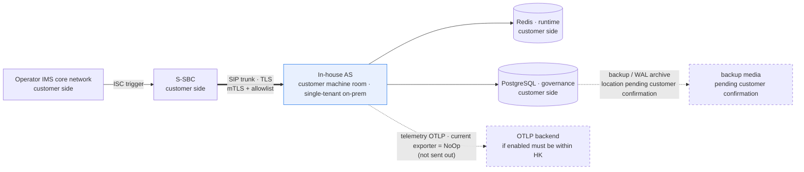

<!--
Inhouse-IMS-AS — Copyright 2026 Dolan Shu <dolan.d.shu@gmail.com>, Apache-2.0

Licensed under the Apache License, Version 2.0 (the "License");
you may not use this file except in compliance with the License.
You may obtain a copy of the License at

    http://www.apache.org/licenses/LICENSE-2.0

Unless required by applicable law or agreed to in writing, software
distributed under the License is distributed on an "AS IS" BASIS,
WITHOUT WARRANTIES OR CONDITIONS OF ANY KIND, either express or implied.
-->

# In-house IMS Application Server — Security and Privacy Compliance Statement (PDPO)

> **Status block (read this first)**
>
> - **Product name**: `In-house IMS Application Server`, **formally adopted as the product / document description name** (G8-2; **not a trademark / not a brand claim**), first occurrence labeled 3GPP Third-Party AS role, hereafter abbreviated in-house AS. git repo name: the maintainer has reported renaming it to `inhouse-ims-as` (G8-3; only the git repo name and remote URL; this repo performed no remote or local-path change); chart name (`3rdparty-as`), image name, and OTel service name **stay unchanged as `3rdparty-as`** (`../plan.md` §0 "product decision record" G8 row).
>   - **Appended 2026-10-10 (G8, synced; original above preserved unchanged)**: the description name `In-house IMS Application Server` has been **formally adopted as the description name** (not trademark / not brand), and the qualifier "document provisional name" is **outdated**; the repo rename `inhouse-ims-as` is reported **completed** by the maintainer, so the "proposed to change" wording is likewise outdated. **Boundary**: chart name / image name / OTel service name remain `3rdparty-as`, **this round did not change the remote or local path**. Landing see `../plan.md` §0 decision record G8 row and [`../handoff/2026-10-11-open-adjudication-register.md`](../handoff/2026-10-11-open-adjudication-register.md) §7. **The positioning "this document is not legal advice" is unchanged.**
> - **Ownership of this document**: `../product-packaging-plan.md` §1 third batch deliverable **3.4 (Security Compliance Statement / PDPO)**. Per that plan §3.2 it is **Class B**: the **retention-period part is blocked by O4 / D5**.
>   - **Appended 2026-10-10 (G6, synced; original above preserved unchanged)**: the **values** of O4 / D5 are **decided** — retention default **10 days, deployment-configurable**; storage selection **in-cluster PostgreSQL**. Therefore the meaning of "blocked" in this row has changed from "awaiting decision" to "awaiting implementation": **trace storage / query / deletion capability is not implemented this round**, and this document **must not** be described as "system already purges at 10 days". Landing see `../plan.md` §0 decision record G6 / B2 + D5 row and register §7.
> - **⚠️ This document is not legal advice.** This document is engineering- and delivery-side compliance **explanatory material**, for review by the customer's security and compliance departments; the applicability determination of PDPO, the role delineation (data processor / data controller), and the final compliance conclusion **are made by the customer and its legal counsel**.
> - **⚠️ This document states no retention days or time periods** (review **G-P1-8**, **G-P1-5**): the **call-trace retention period (O4) and the trace-storage selection (D5) values are both decided (G6, 2026-10-10) — default 10 days, deployment-configurable; in-cluster PostgreSQL** (`../plan.md` §0 decision record G6 row; §5.1 O4, §5.2 D5); **implementation not landed**, so this document **must not** be described as "system already purges at 10 days". ADR-0017 decision ④ states explicitly "mechanism lands first, values do not" — writing a default value out equals answering a compliance question on the customer's behalf; and the trace storage / query / deletion capability does not currently exist. Therefore the retention-period column in §2 uniformly writes "**fill in after O4 is decided**", and the storage column writes "**pending D5 decision**".
>   - **Appended 2026-10-10 (G6, synced; original above preserved unchanged)**: the premise "both undecided" in the sentence above **has been overturned** — the decided default value is **10 days, deployment-configurable**. But **§2's retention column and §3.1's "fill in after O4 is decided" remain as-is**: because trace storage / query / deletion **have no implementation now**, writing down a number of days would mislead the customer into thinking the system already has that purge behavior. **What remains to be filled is "the criterion after implementation lands", not "the decided value"**; the specific scope still to be confirmed by OP-SEC and the customer is likewise **not** closed by this.
> - **⚠️ No penetration test has been executed**: there are **no penetration-test artifacts in the repo** (verification method see §7). §7 only writes **suggested scope, prerequisites, expected deliverables, and exit criteria**.
> - **⚠️ Dependency vulnerability scanning: no ready scan artifact in the repo** (verification method see §6). The four-tier test gates contain **no** SCA / image-scan / SBOM step. §6 writes the current state and plan, and fabricates no results.
> - **This document contains no capacity / performance numbers**: O1 undecided (`../plan.md` §5.1), `AGENT.md` §2 forbids publishing any CPS / CAPS / BHCA / concurrency / throughput / latency numbers before the measured decision exists.
> - **B6 review status**: this document has left a review record alongside the B6 review — [`../reviews/product-packaging-review-checklist-2026-10-12.md`](../reviews/product-packaging-review-checklist-2026-10-12.md) §6 (first review 2026-10-12) and §7 (closure re-review 2026-10-12); **conclusion pending maintainer confirmation**, and until confirmed it is not an external delivery or acceptance basis (`AGENT.md` §3.3).

---

## 1. Scope and legal framework

### 1.1 Scope of application

| Item | Content |
|---|---|
| Covered objects | All data assets collected/generated by the in-house AS (§2), data-retention and deletion mechanisms (§3), data residency and cross-border (§4), implemented security measures (§5), vulnerability and dependency security (§6), penetration testing (§7) |
| Deployment form | **Single-tenant, on-premises**: one namespace carries one complete system (incl. its own Redis / PostgreSQL / AS Pod group). **Data does not leave the customer machine room** (REQ-NF-9; ADR-0026 accepted; `../product/ne-datasheet.md` §1) |
| Out of scope | Media plane (no media, ADR-0004), billing plane (no CDR / billing, ADR-0017), Diameter plane (no Sh, `AGENT.md` §2), **lawful interception LI / IRI** (ADR-0016), compliance matrix (see [`compliance-matrix.md`](compliance-matrix.md)), responsibility boundary (see [`responsibility-matrix.md`](responsibility-matrix.md)) |

### 1.2 Legal framework and six-principle mapping

**Framework**: Hong Kong Personal Data (Privacy) Ordinance (PDPO). The reason for choosing PDPO over a graded-protection standard is the maintainer's 2026-10-09 confirmation (the operator is a listed company, with internal-control requirements). **This document only does the engineering-side mapping, not legal interpretation.**

| PDPO principle | How we satisfy it | Evidence | Gap |
|---|---|---|---|
| **Data collection limitation** | Collect only the numbers and Call-IDs necessary for business decision and complaint tracing; do not collect CDR, do not collect media, do not reserve collection points for LI | ADR-0017 decision ① (none of the four actions are done, **no collection point reserved**); ADR-0016 (**no collection point reserved for it** — reserving a collection point equals reserving the possibility of being required to enable it); ADR-0004 (no media) | The **minimum-necessary list** of collected items needs customer compliance confirmation; whether a number is "personal data" in the PDPO sense needs the customer's legal determination (§1.3) |
| **Purpose limitation** | Numbers / traces are used **only** for complaint tracing and anti-fraud evidence; **no billing, no rating, no inter-network settlement**; call traces are **explicitly not a CDR** | ADR-0017 decisions ②③ (no delivery channel, no rating; the stated purpose is to prevent it being treated downstream as a billing data source) | If the customer proposes a new purpose (e.g., disclosure to a third party), a new ADR + document chain is required; no export may be added in the implementation (ADR-0017 consequences) |
| **Data security** | Peer allowlist + end-to-end mTLS + console roles/passwords/revocable sessions + append-only audit + non-root container + NetworkPolicy + credentials via Secret / customer PKI + fail-closed render | §5 full table (each item has `file:line`) | Cert hot-rotation **E4 not accepted**, operator PKI **has no lab evidence**; console is **engineering-slice only**, **REQ-S-4 not accepted**; no penetration test (§7); no vulnerability-scan artifact (§6) |
| **Retention** | The purge mechanism is formalized as a feature (configurable), **values do not land** | ADR-0017 decision ④; REQ-NF-7 (purge task formalized as a feature, but default value undecided) | **O4 (retention period) undecided** → **this document writes no number of days**; **D5 (storage selection) undecided**. **Appended 2026-10-10 (G6, synced; same-row original preserved unchanged)**: O4 value decided as **default 10 days, deployment-configurable**, D5 selection decided as **in-cluster PostgreSQL**; but trace storage / query / deletion **not implemented this round**, so "this document writes no number of days" **still holds** — its basis now is "no implementation to write", not "no decision to write". **Must not** infer from this row that the system already purges at 10 days. |
| **Transparency** | This document together with [`one-pager.md`](one-pager.md) / [`ne-datasheet.md`](ne-datasheet.md) / [`compliance-matrix.md`](compliance-matrix.md) forms the data-explanation package for the customer; the product description name is formally adopted (G8-2, not trademark / not brand claim) + status labeling + honest disclosure of unaccepted items | §2 asset list of this document; the status blocks of the three same-batch documents | The **end-user-facing privacy notice text** (user-side notice / number-usage notice) is **outside this deliverable's scope**; the customer must provide it separately per its user-notice obligation |
| **Data access & correction** | Data correction = change config (number ranges / rules / number segments), via change order → approval → write PG → canary distribution; console supports role authorization + full audit | ADR-0006 change pipeline; `src/services/console/src/as_console/access.py:26-74` | **Call traces are recorded per message, and this product provides no post-hoc rewriting capability** (traces are immutable); see §3.3 |

### 1.3 Role delineation (**pending customer and legal confirmation; this document must not assert it unilaterally**)

| Item | Status |
|---|---|
| Our role in this product (data processor / data controller, one or both) | **Pending confirmation by the customer and its legal counsel.** This document **does not assert** any delineation |
| Impact of determination | Directly affects the request-handling path in §3, the cross-border arrangement in §4, and contract terms; **must be delineated first by the customer's legal counsel**, and all descriptions in this document are premised on this |
| Facts we can provide | The **collection points, processing methods, storage locations, access control, and audit** of the data are verifiable engineering facts (§2, §5); **the purpose of use and the external-provision behavior of the data are decided by the customer** (§1.2 purpose-limitation row) |

---

## 2. Data asset inventory

| Data item | Content | Source | Purpose | Possibly personal data? | Storage location | Retention period |
|---|---|---|---|---|---|---|
| **MSISDN / called number** | Number string, number-range prefix | Called-party part of inbound INVITE / outbound rewrite target | Number-range rule matching, number translation | **Possibly** — a number can identify an individual; final determination pending customer legal | ① in process (decision); ② config DB `as_config` rule-version row (number range / prefix); ③ call trace | Fill in after O4 decided (rule side follows config-version-DB lifecycle; trace side follows trace TTL) **Appended 2026-10-10 (G6)**: O4 value = default 10 days, deployment-configurable; **trace side has no implementation yet**, so this column stays empty. |
| **Calling number** | Number string (if parsed and used in the message) | Calling-party part of inbound INVITE | Anti-fraud policy judgment, number translation | **Possibly**; same manual determination | Same as above (in-process decision + trace; **whether persisted to the governance DB depends on the trace-storage selection D5**) | Fill in after O4 decided **Appended 2026-10-10 (G6)**: same as above, O4 value decided but nothing to write yet |
| **Call-ID** | SIP Call-ID string (one each inbound / outbound, different on the two B2BUA sides) | SIP message header | **Search key for call traces** (REQ-F-13); correlates the two legs; correlated with trace | **Possibly** — can be combined with other fields to locate an individual | Trace store (**pending D5 decision: PostgreSQL or independent short-retention store**); as a JSON field in logs | Fill in after O4 decided **Appended 2026-10-10 (G6)**: D5 selection decided = **in-cluster PostgreSQL** (no longer a binary choice), but trace storage / query **not implemented this round**, so the storage location still awaits landing |
| **Call trace** (by Call-ID) | Per-message SIP message record: direction in/out, timestamp, method, response code | The AS's own data plane | **Complaint tracing and anti-fraud evidence.** Explicitly not a CDR: no delivery channel, no rating, no inter-network settlement | **Possibly**; same as above | **Pending D5 decision** | Fill in after O4 decided **Appended 2026-10-10 (G6)**: both values decided (10 days configurable / in-cluster PostgreSQL), **implementation not landed**; this row registers the data-asset category and selection conclusion, **not "the system is already collecting"** |
| **Rules and number-range config** | Number-range prefix, translation map, anti-fraud limits, feature switches | Submitted by ops via change order | Business-decision input | Usually **not** personal data (config, not user data); if the number range itself can reverse-infer a user group it needs review | PostgreSQL `as_config` schema's **immutable version rows** (ADR-0006) | Follows the config-version-DB retention policy (**pending customer and OP-SEC confirmation**); evaluated separately from the personal-data retention period |
| **Console audit log** | Operator, timestamp, operation type, before/after values; **append-only** | Every console operation | Accountability, compliance evidence, change tracing | Usually **not** (operator identifier may be personal data) | PostgreSQL `console_audit` schema (`src/services/config-service/src/as_config_service/audit_store.py:493-494`; `deploy/helm/values.yaml:123`) | Pending customer and OP-SEC confirmation (REQ-S-4 states "audit-log retention = compliance requirement, frozen at M4" → **not frozen**) |
| **Credentials and certificates** | TLS private key / cert chain / CA, peer-cert-fingerprint allowlist, PG password, console password verifier (`pbkdf2-sha256`), audit HMAC key | Customer PKI / customer Secret / `as-config-migrate` bootstrap | Access admission, connection encryption, governance-DB access, console authorization, audit integrity | Usually **not** personal data; **sensitive credentials, never into logs** | k8s Secret (customer PKI / customer vault) → mounted as file (`defaultMode: 0440`); **TLS material never goes into the chart's credential Secret** (`deploy/helm/templates/secret.yaml:51-55`) | Follows cert validity + rotation cycle (**pending customer PKI policy**) |

**Three notes to be read together**

1. **Assets that do not exist (because we do not do them)**: **CDR / call detail** (ADR-0017 decision ①), **media / voice content** (ADR-0004: no RTP / transcoding / DTMF / MRF / media anchoring), **Diameter Sh subscription data** (`AGENT.md` §2), **IRI / LI** (ADR-0016). **These rows are not listed in the table because they are simply not collected** — adding them would imply existence.
2. **Payload logging off by default**: `AS_PAYLOAD_LOGS_ENABLED` / `telemetry.payloadLogsEnabled` defaults to `false` (`deploy/helm/values.yaml:319`; `deploy/helm/templates/configmap.yaml:65`). Enabling is an **explicit, auditable** operation (ADR-0016). Therefore **message payloads are not persisted by default**.
3. **Call-trace storage and query have no implementation yet**: the search key is Call-ID (REQ-F-13; ADR-0017 decision ②) is a **design convention**; there is **no code hit** for a trace-store or trace-query API in the repo's `platform/` and `services/`, and `../plan.md` §5.4 explicitly records "no trace store/API; REQ-F-13 / M4b-7.4 supplementary tests not done, M4b-8 marked BLOCKED". Therefore this section registers the **data-asset category and pending storage selection**, not the fact "the system is already collecting".

---

## 3. Retention scope and deletion mechanism

### 3.1 Mechanism ready vs. pending landing / pending decision

| Stage | Status | Content and basis |
|---|---|---|
| **Trace-purge mechanism** | **Mechanism formalized as a feature, default value undecided** | REQ-NF-7 ("purge task formalized as a feature, but default value undecided"); ADR-0017 decision ④ |
| **Trace-retention value** | 🔴 **Pending O4 decision** | `../plan.md` §5.1 O4 (call-trace retention period / customer compliance requirement). **This document writes no number of days** (G-P1-8) **Appended 2026-10-10 (G6, synced; same-row original preserved unchanged)**: O4 **value decided** (default 10 days, deployment-configurable), so the 🔴 in this row has changed to "**awaiting implementation landing**" rather than "awaiting decision" — trace storage / query / deletion **not implemented this round**, so this document **still writes no number of days**, and **must not** be described as "system already purges at 10 days". Landing see `../plan.md` §0 decision record G6 row. |
| **Trace-storage selection** | 🔴 **Pending D5 decision** | `../plan.md` §5.2 D5 (PostgreSQL or independent short-retention store / related to O4). ADR-0017 consequences state explicitly "before the retention period is settled, the storage selection lacks a key input, so this ADR does not decide the selection" **Appended 2026-10-10 (G6, synced; same-row original preserved unchanged)**: D5 **selection decided = in-cluster PostgreSQL**, the binary choice no longer holds; but **implementation not landed**, so this row's 🔴 also turns to "awaiting implementation". The above reservation in ADR-0017 targeted **the moment of decision** and is not retroactively modified by this round's decision. |
| **Audit and governance-data deletion** | 🟡 **Pending landing / pending confirmation** | Audit table is append-only (`audit_store.py:102-104`: `BEFORE UPDATE OR DELETE` row trigger + `BEFORE TRUNCATE` table trigger), so **deletion cannot rely on UPDATE/DELETE**. Any purge must go through **an explicit controlled ops-layer operation + change order + audit trail**, and is bound by audit-compliance constraints; audit-retention period pending OP-SEC confirmation (REQ-S-4 states "frozen at M4" → **not frozen**) |
| **Config-version-DB data deletion** | 🟡 **Pending confirmation** | The change-order state machine rejects illegal transitions (ADR-0006), immutable version rows; deletion policy needs evaluation together with the audit-retention requirement |
| **Credential rotation and destruction** | 🟡 **Mechanism ready, cycle pending** | Cert rotation is a config hot-reload (ADR-0016; `transport.py:110-132`, ingress overlap window `ingress.py:70-100`); destruction of old certs is the responsibility of each side's own PKI process |

### 3.2 Rationale for "mechanism lands first, values do not" (ADR-0017 decision ④ original spirit)

The retention period directly determines storage capacity and purge-task behavior. **Writing a default value out equals answering a compliance question on the customer's behalf** — if this default is shorter than the customer requires, it causes loss of evidence data; if longer, it constitutes retention beyond necessity. Therefore this document and the product docs uniformly leave this item **blank** (this is a deliberate blank, not an omission).

> **Appended 2026-10-10 (G6, synced; original above preserved unchanged)**: the maintainer decided O4 = **default 10 days, deployment-configurable** on 2026-10-10, i.e., the premise set above — "a default value equals answering a compliance question on the customer's behalf" — **has been overturned at the product-default level**. A product needs a deployable default criterion.
> **But this document still writes no number of days, and the reason changes accordingly, becoming stricter**: trace storage / query / deletion **are not implemented this round** (register §7 records "not equivalent to having implemented trace storage/query/deletion"). Writing 10 days **without an implementation** would only mislead the customer and reviewers into reading it as "the system already purges at 10 days" — that is not answering a compliance question on the customer's behalf, but **stating a behavior that does not exist**.
> Therefore the blank remains a deliberate blank. It is filled only after ① trace storage lands and ② OP-SEC and the customer confirm their respective scopes. **This section constitutes neither legal advice nor customer acceptance.**

### 3.3 Access & correction request handling flow

| Step | Who | What |
|---|---|---|
| 1 | **Customer-side intake** | The customer (as the party to the relationship with the data subject) handles the access / correction request. **We do not intake directly from the data subject** |
| 2 | **Customer written instruction** | Provide the search key (Call-ID / number range / time range) and the correction content in writing. We do not infer the request scope ourselves |
| 3 | **We execute the query** | Search and export via the trace channel by Call-ID (**note: the trace store and query API have no implementation yet**, see §2 note 3; the actually exportable scope is subject to the implementation at delivery, must not be pre-promised) |
| 4 | **We execute the correction** | Number / number-range corrections = **change config**, via change order → approval → write PostgreSQL → canary distribution (ADR-0006). **Not** ops directly running UPDATE on the DB, nor managing config with git (`AGENT.md` §2) |
| 5 | **Uncorrectable items** | **Call traces are recorded per message and cannot be rewritten after the fact** (append-only semantics). Therefore correction can only act on config and future calls, not rewrite historical traces. If the customer requires rewriting history, ADR-0017 must be re-adjudicated |
| 6 | **Trail** | Every console operation is authorized and audited (ADR-0016; REQ-S-4). The audit itself is append-only (`audit_store.py:102-104`) |
| 7 | **Scope dispute** | If the request involves billing data — this product **does not collect it** (ADR-0017), cannot provide it; the claim should be directed to the operator's billing domain |

**This document promises no response-time limit** (the period must be agreed with the customer SLA; this document does not unilaterally write a number of days).

---

## 4. Data-stays-in-HK principle and cross-border

### 4.1 Principle and item-by-item facts

| Item | Conclusion | Basis / gap |
|---|---|---|
| **Data does not leave the customer machine room** | ✅ By design | Single-tenant on-premises, one namespace one system (REQ-NF-9; ADR-0026 accepted). The data plane has only Redis (runtime) and PostgreSQL (governance) (ADR-0007) |
| **Cross-border transfer** | ✅ **No cross-border transfer** — there is **no** channel in the repo that sends data externally | The only outbound candidate is the telemetry OTLP exporter, and **it is currently `NoOp`**: `src/platform/src/as_platform/telemetry/__init__.py:77` `NoOpExporter`, `:129` queue exporter defaults to `NoOpExporter`; `:89-95` `default_sink()` returns `NoOpSink`. Therefore **telemetry is not sent out**.**Pending confirmation**: if a real OTLP backend is connected in future, that backend **must be located within Hong Kong**; otherwise a cross-border transfer compliance assessment must be done first |
| **Logs and images must not be uploaded to third-party SaaS** | ✅ Discipline item | `AGENT.md` §11 / §13: "never commit keys, certificates, or real-traffic captures"; `SECURITY.md` "what must never be committed". The delivery-chain image goes through the customer internal registry (`../product/ne-datasheet.md` §8: there is **no** public registry in the repo) |
| **Backup media and WAL archive location** | 🔴 **Pending customer confirmation** | The architecture requires PostgreSQL streaming replication + backup + PITR (ADR-0007 / ADR-0008 context; `../architecture/system-architecture.md` §7), but the chart **has no backup Job** (`../product/ne-datasheet.md` §8); **whether the backup landing location, cross-site, or out-of-HK needs customer confirmation** |
| **Cross-site DR** | 🟡 Architecture decided, parameters open | ADR-0008 accepted: in-site N+1 zero-single-point + cross-site **1+1 warm standby (not active-active)**, switchover via S-SBC-side trunk priority.**DR tier O5 undecided** (N+1 nodes / N+M racks or AZ).**Cross-site itself is a cross-border assessment object** (if the standby is within HK there is no cross-border) **Appended 2026-10-10 (G7, synced; same-row original preserved unchanged)**: **O5 decided** — baseline is **in-site N+1 + cross-site 1+1 warm standby**, consistent with the existing ADR-0008 description above this row, no rewrite of this row's conclusion needed.**Boundary must not be overstated**: the decision explicitly **does not promise rack / AZ-level fault tolerance**, so "N+M rack / AZ" is no longer an option; **RPO / RTO values still undecided**, this document does not fill them in. The remaining 🟡 meaning is "standby physical location and parameters unconfirmed", still pending customer confirmation (see this section's "backup media and WAL archive location" row). |
| **Introducing an external backend in future** | 🔴 Must do a compliance assessment first | Any OTLP backend, log-aggregation platform, or alerting platform located outside HK must complete a cross-border transfer compliance assessment and update this document before going live |

### 4.2 Stays-in-HK argument chain (for direct citation in review)

**Three pillars of the argument chain**: ① single-tenant on-premises gives natural physical isolation (`AGENT.md` §2 selection-basis table); ② the product's only outbound channel does not land currently (`NoOpExporter`); ③ the delivery form creates no external dependency (Helm + customer internal registry, ADR-0013).

---

## 5. Implemented security measures

> Every row gives `file:line`. **Unaccepted items are labeled honestly, not written as accepted.**

| Measure | Implementation location | Description |
|---|---|---|
| **Peer allowlist** (IP / CIDR / `host:port` / cert fingerprint) | `src/platform/src/as_platform/sip/transport.py:249-298` (`authorize_peer`), `:48-63` (`PeerPolicy`) | **Cert hit or address hit either one passes**; under mTLS the cert is the dimension that truly identifies the peer (source address is forgeable, cert is not). Supports IPv6 bracket endpoint syntax; malformed CIDR / endpoint token authorizes nobody |
| **Empty-policy deny (fail-closed)** | `src/platform/src/as_platform/sip/transport.py:272-273` | Empty policy (both sets empty) **authorizes nobody**. Reason: whoever can impersonate the S-SBC can inject calls, so an unfilled allowlist must not become a pass-through hole (ADR-0016; `AGENT.md` §13) |
| **End-to-end mTLS, client cert required by default** | `src/platform/src/as_platform/sip/transport.py:86` (`require_client_certificate: bool = True`), `:88-93` (`ca_path` empty → `raise ValueError`); env parsing `src/platform/src/as_platform/runtime/transport_env.py:66-71` | Only server-only TLS is an **explicit config**, not the default. Priority: `AS_TLS_REQUIRE_CLIENT_CERT` → `SIP_TLS_REQUIRE_CLIENT_CERT` → default `True` |
| **Reject plaintext before parse** | `src/platform/src/as_platform/sip/ingress.py:178-194` (`reject_plaintext_when_tls_required`), `:24` (accepts only `tls` / `sips`) | Rejection happens **before** `decide()` and message parsing. ⚠️ Plaintext rejection and allowlist miss **share `403`**, distinguish when troubleshooting (see [`responsibility-matrix.md`](responsibility-matrix.md) §4) |
| **Cert hot-reload (no restart, no in-flight call loss)** | Mechanism: `transport.py:110-132` (`reload` returns a new snapshot rather than mutating in place), `ingress.py:52-68` (`install`), `ingress.py:70-100` (`install_with_overlap` dual-cert overlap window), `:140-164` (legacy connections use the retired policy within the overlap period) | 🔴 **E4 has no lab evidence → status is open**, must not be described as acceptance-passed. Full acceptance of hot rotation depends on the operator PKI (REQ-S-2 / REQ-S-3) |
| **Console roles + password + revocable sessions** | Role matrix `src/services/console/src/as_console/access.py:26-39` (`viewer` / `approver` / `admin`), `:60-74` (`ROLE_PERMISSIONS`), `:152-166` (`authorize` judges by "whether granted" → a newly added permission defaults to deny for everyone), `:169-185` (submitter cannot approve own change); password `src/services/config-service/src/as_config_service/auth.py:191-201` (`pbkdf2-sha256$v1$600000$32`, independent random salt per account), `:227-232` (verify), `:166-171` (minimum-length constraint), `:118-134` (`IssuedSession` / `RevokedSession`, raw token returned only to the caller at issuance, revoked object contains no token material) | 🔴 **Engineering slice only**, REQ-S-4 **not accepted**. ADR-0024 already accepted (maintainer sign-off 2026-10-03), but ADR self-describes its evidence boundary: only local PostgreSQL 12.22 verified, 3 publication-DDL tests skipped due to `wal_level=replica`, **PG16 and remote gate untested**, **no production trusted-proxy evidence, no application-layer rate-limit evidence, no REQ-S-4 acceptance** |
| **Full console-operation audit, append-only** | `src/services/config-service/src/as_config_service/audit_store.py:1` (append-only), `:102-104` (row-level `BEFORE UPDATE OR DELETE` + table-level `BEFORE TRUNCATE` trigger throws), `:1064-1110` (`REVOKE ALL ... FROM PUBLIC` + minimal `GRANT`); schema `console_audit` (`:493-494`; `deploy/helm/values.yaml:123`) | Both allow and deny **leave a trail** (`access.py:78` `AuditOutcome.ALLOWED/DENIED`). Audit HMAC key via Secret (`deploy/helm/templates/config-service-deployment.yaml:53-57`) |
| **Governance-DB three-role least privilege** | `deploy/compose/postgres/init/01-dev-roles.sh:9-14`: `as_config_runtime` **NOLOGIN**, `as_config_owner` LOGIN, `as_config_web` LOGIN, `GRANT as_config_runtime TO as_config_web`; chart-side same-structure `deploy/helm/templates/state-postgres.yaml:18-22` | Production roles must be pre-provisioned by the DBA; the chart **does not create or populate** production credentials (`deploy/helm/templates/secret.yaml:16-18` fail; `:44-48` empty placeholder with `as.3rdparty/credentials: "placeholder-replace-before-install"` annotation).**Note**: the `01-dev-roles.sh` file header self-describes as **dev-only**, must not be used directly in production |
| **Credentials via k8s Secret / customer PKI** | `deploy/helm/templates/secret.yaml:19-50` (credential Secret, **placeholder empty strings only**), `:51-55` (**TLS material never stored here**, comes from customer PKI, referenced by `tls.secretName`); mount `deploy/helm/templates/deployment.yaml:176-181` (`defaultMode: 0440`, not world-readable); `deploy/helm/templates/config-service-deployment.yaml:5` (configService enable requires a `secretName`) | ConfigMap contains **no password** (`deploy/helm/templates/configmap.yaml:50-55`: DSN assembled on the Deployment side from host/port/name + Secret) |
| **fail-closed render guard** | `deploy/helm/templates/deployment.yaml:11-13` (`tls.enabled=true` with empty `tls.secretName` → render fails), `:14-16` (`sip.peerAllowlist` empty and `allowEmptyAllowlistForTest` unset → render fails); `deploy/helm/templates/validate-install.yaml:6,9,12` (three install-time guards); `deploy/helm/templates/secret.yaml:16-18` | What falls back on empty is an **availability switch, not a security switch** — the security side uniformly refuses to render. Ingress side `config-service-ingress.yaml:7-8` (supports only ingress-nginx, else render fails), `:11` (`tlsSecretName` required), `:37-38` (force ssl-redirect + force-ssl-redirect) |
| **NetworkPolicy: only this system's Pods → PG / Redis** | `deploy/helm/templates/state-networkpolicy.yaml:1-29`: `podSelector` selects `state-postgres` / `state-redis`, `ingress.from` only `app.kubernetes.io/part-of: 3rdparty-as`, ports only `5432` and `stateStores.redis.port` | Rendered only when `stateStores.enabled` and `stateStores.networkPolicy.enabled` (`:1`). ⚠️ Depends on the customer cluster's CNI actually enforcing NetworkPolicy |
| **Non-root run + drop all capabilities** | `deploy/helm/templates/deployment.yaml:190-194` (`runAsNonRoot: true`, `runAsUser: 10001`, `runAsGroup: 10001`, `fsGroup: 10001`), `:169-172` (`allowPrivilegeEscalation: false`, `capabilities.drop: ["ALL"]`) | uid 10001 is the process's real user; the TLS Secret is mounted readable via `fsGroup` + `0440` |
| **No ServiceAccount token mounted** | `deploy/helm/templates/serviceaccount.yaml:16` (`automountServiceAccountToken: false`), comment see `:1-8` | Reason stated: the AS process is stateless, only talks to Redis / PG / OTLP collector, **does not need to access the K8s API** (ADR-0002; REQ-NF-9) |
| **Payload logging off by default** | `deploy/helm/values.yaml:319` (`payloadLogsEnabled: false`) → `deploy/helm/templates/configmap.yaml:65` (`AS_PAYLOAD_LOGS_ENABLED`) | Explicitly toggleable; enabling is an auditable operation (ADR-0016; `AGENT.md` §13).**Therefore message payloads are not persisted by default** |
| **OTLP exporter currently NoOp** | `src/platform/src/as_platform/telemetry/__init__.py:77` (`NoOpExporter`), `:89-95` (`default_sink()` → `NoOpSink`), `:116,129` (queue exporter defaults to `NoOpExporter`); `src/platform/src/as_platform/__main__.py:193` (reads `OTEL_EXPORTER_OTLP_ENDPOINT`); chart default `telemetry.otlpEndpoint: null` (`configmap.yaml:63`) | ✅ **Current telemetry is not sent out** (the strongest pillar of data-stays-in-HK). 🔴 Gap: **real OTLP backend wiring incomplete**. ADR-0005 requires export not to block the call path (bounded queue, dedicated thread) |

**Known-not-landed items (must not be treated as present)**

| Item | Status | Basis |
|---|---|---|
| Lab evidence for cert hot-rotation (E4) | **open** | `../plan.md` §5.1 O2/O3; `compliance-matrix.md` §3.6.7 |
| REQ-S-4 formal acceptance | **Not accepted** (engineering slice) | ADR-0024 Evidence limits |
| Production ingress / trusted-proxy | **Not accepted** (7.2d blocked) | `../product/ne-datasheet.md` §8 |
| Prometheus scrape wiring | **Missing** — chart has no `prometheus.io/scrape` annotation, no ServiceMonitor / PodMonitor | `../product/ne-datasheet.md` §5, §10. Consequence: `as_*` series not collected in a standard deployment, the `as.*` alerts depending on them effectively cannot fire |
| Penetration test | **Not executed** | §7 |
| Dependency vulnerability scan | **No artifact** | §6 |
| Application-layer rate-limit / hardened reverse proxy | **No evidence** | ADR-0024 Evidence limits |

---

## 6. Vulnerability management and dependency security

### 6.1 Current state (honest, with verification method)

**Verification method** (reproducible): ① read the `gate` / `gate-strict` / `chart-check` / `alert-check` targets in `Makefile` → corresponding to the four-tier test gates; ② full-repo grep `trivy|grype|syft|snyk|bandit|pip-audit|dependabot|osv|sbom|cyclonedx|vulnerability|CVE-` (excluding `.git` / `.venv` / `node_modules`); ③ check all files under `docs/acceptance/artifacts/`; ④ check `docs/reviews/` for any scan / penetration-test records; ⑤ check `CHANGELOG.md` for CVE entries.

| Item | Current state | Conclusion |
|---|---|---|
| **Dependency lock** | ✅ Yes: `uv.lock` + `uv sync --frozen` (lock inconsistency fails); `AGENT.md` §8 "every dependency goes through `uv`, commit `uv.lock` and validate in the gate" | Lock exists, but **a lock does not mean no vulnerability** |
| **Local gates** | ✅ Yes: `make gate` = lint → type → tier① (`Makefile:131`); `make gate-strict` adds ADR-annotation scanning (`Makefile:136`); additionally `make chart-check`, `make alert-check` | All are **correctness** gates, **not security scans** |
| **Security scan in gates** | ❌ **None.** The four-tier test gates contain no SCA, container-image scan, SBOM generation, or dependency-audit step | **No automated dependency-vulnerability detection** |
| **Scan artifacts** | ❌ **No ready scan artifact.** `docs/acceptance/artifacts/` has only `m5/` (alert-check / gate / chart-check samples) and `m8/` (three READMEs `req-s-2-pki`, `req-nf-1-live`, `req-s-3-rotation`, no scan report); `CHANGELOG.md` has no CVE entries; `docs/reviews/` has no penetration-test records | Only mentioned at the discussion level "dependency vulnerability scan / penetration test", no corresponding artifact record |
| **Runtime baseline** | ⚠️ `deploy/docker/Dockerfile:23` runtime image `python:3.10-slim` (builder `:3` is `ghcr.io/astral-sh/uv:python3.10-bookworm-slim`); gate tier① pins Python 3.10 | **D1 open**: Python 3.10 reaches end of life in October 2026 (`../plan.md` §5.2 D1). Two options: ① verify migration to a supported version as early as possible; ② register the EOL runtime as an accepted risk in an ADR. Any delivery after that date must complete one of the two first |
| **Third-party native dependencies** | reSIProcate (C++, Vovida license, ADR-0019 accepted); `testbed/simulators/resip-probe/vendor/` has upstream source / prebuilt tarball | Such dependencies are **outside `uv.lock`'s coverage**, Python SCA cannot scan them — a **blind spot** in the current scanning approach |
| **Prohibited commits** | `AGENT.md` §11 / §13, `SECURITY.md` | **Never commit keys, certificates, tokens, real addresses, real-traffic captures**; the repo holds only placeholders |

### 6.2 Plan (not yet executed, must not be treated as existing capability)

| # | Planned item | Content | Exit |
|---|---|---|---|
| 1 | **Python dependency SCA** | Add a dependency-audit step after gate tier①, do vulnerability detection over the `uv.lock` coverage, output a report as an artifact | Report lands in `docs/acceptance/artifacts/`; new high-severity items must have a disposition record |
| 2 | **Container-image vulnerability scan** | Scan the runtime image produced by `deploy/docker/Dockerfile` (current `python:3.10-slim` baseline) | Same as above; **bound to the D1 disposition** |
| 3 | **SBOM** | Generate an SBOM (component list + versions) for the delivered image, provided to the customer with the deliverable | SBOM item appears in the delivery checklist |
| 4 | **Frequency and exit** | Run with every gate (fast, non-blocking unless high-severity); high-severity exit condition is "**new high-severity found with no disposition record → block**" | Written into a doc at the same level as `deploy/alerts/README.md`; **exit criteria need to be set jointly with OP-SEC** |
| 5 | **Native / non-Python dependencies** | Track reSIProcate's upstream version and known issues manually (`uv.lock` cannot cover them) | Register into `../plan.md` open-items or risk register |
| 6 | **Security-report entry** | `SECURITY.md` already exists: report suspected vulnerabilities privately, no public issue | Already present |

---

## 7. Penetration testing (**not executed**)

> **Current state: not executed. No penetration-test artifact in the repo** (verification method same as §6.1: no records in `docs/reviews/`, no report in `docs/acceptance/artifacts/`, no entry in `CHANGELOG.md`). This section is a **plan**, not a result.

### 7.1 Suggested scope

| # | Scope item | Specific content | Attack-surface source |
|---|---|---|---|
| 1 | **Trunk access surface** | Whether the peer allowlist can be bypassed to inject calls; bypass of the four allowlist forms IP / CIDR / `host:port` / cert fingerprint; whether malformed tokens (malformed CIDR, IPv6 endpoint without brackets) are mistakenly authorized | ADR-0016; `transport.py:146-298` |
| 2 | **TLS and cert rotation** | Whether plaintext can pass when TLS is required; fail-closed when `ca_path` is empty; whether the old policy expires on schedule within the dual-cert overlap window; whether cert hot-reload truly restarts no process and loses no in-flight call | `ingress.py:24,178-194`; `transport.py:86-93`; `ingress.py:70-100` |
| 3 | **Console authorization and privilege escalation** | Role escalation (can `viewer` submit / approve), submitter self-approval bypass (`may_approve`), session usable after revocation, whether empty / unknown role is fail-closed-denied, whether a newly added permission defaults to deny for everyone | `access.py:26-74,152-185`; `auth.py:118-134,191-232` |
| 4 | **Internal API authorization** | Whether `/internal/v1` is accessible unauthenticated; whether the config-service's DSN / HMAC key leaks to responses or logs; misconfiguration consequences of trusted-proxy and `AS_CONFIG_PROXY_HEADERS` / `AS_CONFIG_TRUSTED_PROXIES` | `config-service-deployment.yaml:48-71`; ADR-0024 Evidence limits (**no production trusted-proxy evidence**) |
| 5 | **Config-change approval chain** | Whether effective config can be changed bypassing approval; whether illegal state transitions are rejected; whether rollback can bypass approval; inconsistency window during canary distribution | ADR-0006; `access.py:169-185` |
| 6 | **Logs and data leakage** | Whether enabling payload logging leaks credentials / TLS private keys; whether PG password, audit HMAC key enter logs; whether `console_audit` content is readable via privilege escalation; whether error stacks leak internal paths | `configmap.yaml:65`; `secret.yaml:19-50` |
| 7 | **Container and K8s escape surface** | Whether non-root (uid 10001) + drop ALL is bypassed; whether SA token truly unmounted; whether NetworkPolicy truly only allows this system's Pods | `deployment.yaml:169-194`; `serviceaccount.yaml:16`; `state-networkpolicy.yaml:1-29` |

**Explicitly out of test scope**: media plane (no media, ADR-0004), Diameter plane (no Sh), billing / CDR (not done, ADR-0017), **LI / IRI (not implemented, ADR-0016)** — no attack surface to test.

### 7.2 Prerequisites

| # | Prerequisite | Description |
|---|---|---|
| 1 | **Test window** | Needs a customer-approved window; during the test calls may be actively rejected / forged |
| 2 | **Customer-side peer cooperation** | Needs **OP-SBC** side to cooperate with malformed-signaling injection, dual-cert parallel, trunk-priority switching; needs **OP-NET / OP-HSS** side to cooperate with iFC-trigger-related boundary validation |
| 3 | **Real environment, not simulation** | `testbed/` simulation results are **not** security-test evidence (ADR-0014; v1 does not deliver testbed as a deliverable). Unaccepted E1 / E4 / E5 also limit the testable scope |
| 4 | **Credentials and certificates** | Test certs issued by customer PKI or an isolated test CA; **captures produced by the test must not enter the repo** (`AGENT.md` §11) |
| 5 | **Scope and exit criteria in writing** | Exit criteria decided by **OP-SEC**; this document only gives suggestions (§7.3) |

### 7.3 Expected deliverables and exit criteria (**suggested**)

| Item | Suggestion |
|---|---|
| Deliverable | Test report (method, timeline, finding list, reproduction steps, evidence), per-finding disposition record (fix / risk-accept / not-applicable + reason), retest conclusion |
| Exit criteria (suggested) | ① No **Critical** undisposed item; ② every High item has a **written disposition conclusion** (fix or OP-SEC-accepted); ③ retest confirms fixed items do not recur; ④ report and evidence retention location clear, **real captures not in repo** |
| Pending OP-SEC confirmation | Specific tiers of exit criteria, whether third-party execution is required, retest rounds |

### 7.4 Current state

| Item | Status |
|---|---|
| Executed? | **Not executed** |
| Artifact? | **None** |
| Blocking | No technical blocking; needs **customer window + OP-SBC / OP-NET side cooperation + OP-SEC exit criteria** |
| This document's position | This section **constitutes no** "security test passed" statement; must not be cited in any external material as a security qualification |

---

## 8. Open items and blockers

| Item | Blocking source | Impact | When it can close |
|---|---|---|---|
| **O4 call-trace retention period** | Value **decided (G6)**: default 10 days, deployment-configurable; **implementation not landed** (`../plan.md` §0 decision record G6 row) | The **landing** of §2 retention column, §3.1 purge behavior, storage capacity, and backup policy depends on trace storage / query / deletion implementation → **this document still writes no number of days** (G-P1-8; nothing to write, and must not be described as "system already purges at 10 days") | Fill in after trace storage lands + OP-SEC and customer confirm scope |
| **D5 trace-storage selection** | Value **decided (G6)**: in-cluster PostgreSQL (no longer a binary choice); **implementation not landed** | The **landing** of §2 storage column and §4 backup location follows the trace-storage implementation | After trace storage lands |
| **data processor / data controller role delineation** | Customer and its legal counsel | The request-handling path in §1.3, §3, the cross-border arrangement in §4, contract terms | Customer legal confirmation |
| **Audit and governance-data retention period** | REQ-S-4 says "frozen at M4" → **not frozen** | §3.1 deletion mechanism cannot be finalized | Customer and OP-SEC confirmation |
| **Backup media and WAL archive location** | Customer infrastructure decision | One pillar of the §4 stays-in-HK argument chain awaits fill-in | Customer confirmation (needs O5 DR tier decided together) |
| **O5 DR tier** | Value **decided (G7)**: in-site N+1 + cross-site 1+1 warm standby (following ADR-0008 topology; D3 selects Redis primary/replica + Sentinel, not Cluster); **no rack / AZ-level fault-tolerance promise**; RPO / RTO values undecided | Affects whether Redis crosses AZ, Sentinel topology, PG HA, and **whether the standby is within HK**; chart still renders single-replica, no failover measured behavior evidence | Customer confirms standby location and parameters |
| **D1 Python 3.10 end of life** | `../plan.md` §5.2 D1 | Any delivery after that date must first complete migration verification or register it as an accepted risk in an ADR; directly affects the image-scan baseline (§6) | Maintainer decision |
| **E4 TLS cert hot rotation** | M8 acceptance + operator PKI (REQ-S-2 / REQ-S-3) | The row status in §5 is open; penetration-test scope 2 cannot be fully executed | M8 acceptance |
| **REQ-S-4 formal acceptance** | Engineering slice only | Acceptance status of the console-related rows in §5 | M8 or separate maintainer sign-off |
| **Penetration test** | Customer window + peer cooperation + exit criteria | All of §7 | After OP-SEC commission |
| **Dependency vulnerability scan** | No artifact, no gate step | §6 plan 1–5 pending landing | Close after landing |
| **Whether number / trace is PDPO personal data** | Customer legal determination | The "possibly personal data?" column in §2 and the gap row in §1.2 | Customer legal confirmation |
| **End-user privacy notice text** | Customer's user-notice obligation | Outside this deliverable's scope | Provided by the customer itself |

**2026-10-10 decision-sync note for this table (appended 2026-10-11, original rows above preserved unchanged)**: the **O4 / D5 / O5** rows' "undecided" wording in the table above is outdated — G6 decided O4 (default 10 days, deployment-configurable) and D5 (in-cluster PostgreSQL), G7 decided O5 (in-site N+1 + cross-site 1+1 warm standby).**But none of the three rows close because of this**: trace storage / query / deletion **not implemented this round**; RPO / RTO values **undecided**; standby location still pending customer confirmation. The "when it can close" column above remains valid as-is. Landing see `../plan.md` §0 decision record G6 / G7 rows and [`../handoff/2026-10-11-open-adjudication-register.md`](../handoff/2026-10-11-open-adjudication-register.md) §7.**This document is still not legal advice and constitutes no customer acceptance.**

**Appended 2026-10-12 (B6 closure)**: the main cells of the O4 / D5 / O5 rows above have been updated in-place per the G6 / G7 criterion (readers no longer first see "undecided" wording); this note is retained as the audit chain.

---

## 9. Traceability

| Item | Content |
|---|---|
| **Corresponding deliverable** | `../product-packaging-plan.md` §1 third batch **3.4 (Security Compliance Statement / PDPO)**; per §3.2 it is **Class B**: retention period and storage selection blocked by **O4 / D5**. Engineering-fact constraints see that plan §0.3 (esp. item 3 operator PKI has no lab evidence, item 6 O4 / D5 undecided) |
| **Implemented review comments** | **G-P1-5** — §8 states **O4 / D5** as preconditions equally critical with PDPO, listed alongside PDPO **G-P1-8** — retention period uniformly writes "fill in after O4 is decided", this document has **zero retention days, zero time-period promises** (§2, §3, §8) **G-P0-4** — no Sh / no billing: §2 note 1 and §5 explicitly list "assets that do not exist", with no Sh / CDR / billing statement **G-P0-5 / G-P1-10** (adjacent) — shares the same boundary criterion with [`responsibility-matrix.md`](responsibility-matrix.md) |
| **REQ cited** | `REQ-S-1` (peer-allowlist validation), `REQ-S-2` (end-to-end TLS with S-SBC, cert issued by operator PKI, reject plaintext), `REQ-S-3` (cert hot rotation, dual-cert window), `REQ-S-4` (console-operation authorization and audit, audit immutable; **engineering slice only**), `REQ-NF-7` (no CDR → call trace replaces it; trace retention pending), `REQ-NF-13` (OTel three-signal export; logs are structured JSON), `REQ-NF-14` (alert rule set), `REQ-NF-9` (single-tenant on-premises), `REQ-F-13` (Call-ID-based trace query). Definitions in `../requirements/prd.md` |
| **ADR cited** | **ADR-0016** (in-boundary security: peer allowlist / end-to-end TLS / cert hot rotation / console authorization and full audit; **no LI, no billing**), **ADR-0017** (no CDR, replaced by Call-ID-based call trace; decision ④ retention O4 undecided, decision ⑤ trace and trace separated), **ADR-0024** (console roles + password auth and revocable sessions), ADR-0005 (OTel observability; export must not block the call path), **ADR-0006** (config governance: PostgreSQL version store + change-order state machine, not GitOps), ADR-0007 (data-plane split: Redis runtime / PostgreSQL governance), ADR-0008 (redundancy: in-site N+1 zero-single-point + cross-site 1+1 warm standby), ADR-0009 (ISSU = draining), ADR-0002 (one process per use case, state externalized), ADR-0004 (media seam), ADR-0013 (Helm-only production form), ADR-0019 (SIP stack selection), ADR-0021 (runtime override granularity), ADR-0026 (in-cluster state store). Status per `../architecture/adr/README.md` registry; **ADR-0023 / ADR-0025 still draft, this document draws no conclusion from them** |
| **Document chain cited** | [`../plan.md`](../plan.md) §0 / §5.1 (O1–O5) / §5.2 (D1, D3, D5), [`../reviews/product-packaging-plan-review-2026-10-09.md`](../reviews/product-packaging-plan-review-2026-10-09.md), [`../architecture/system-architecture.md`](../architecture/system-architecture.md) §7 (data plane) / §8 (observability) / §9.2 (security: in-boundary security, no LI), [`../acceptance/m8-resip-runtime-log-contract.md`](../acceptance/m8-resip-runtime-log-contract.md) (log-field contract), [`../requirements/prd.md`](../requirements/prd.md), `SECURITY.md`, `AGENT.md` §11 / §13 |
| **Key code basis** | See the `file:line` in each row of §5 (peer admission `transport.py:249-298`; empty policy `:272-273`; mTLS default `:86-93`; plaintext reject `ingress.py:178-194`; dual-cert overlap `:70-100`; env `transport_env.py:52-103`; fail-closed `deployment.yaml:11-16`, `validate-install.yaml:6,9,12`; credentials `secret.yaml:16-50`; mount `deployment.yaml:176-181`; SA `serviceaccount.yaml:16`; NetworkPolicy `state-networkpolicy.yaml:1-29`; securityContext `deployment.yaml:169-194`; payload logging `values.yaml:319` / `configmap.yaml:65`; NoOp `telemetry/__init__.py:77,89-95,129`; three roles `01-dev-roles.sh:9-14`, `state-postgres.yaml:18-22`; role matrix `access.py:26-74,152-185`; password/session `auth.py:166-232`; audit `audit_store.py:1,102-104,493-494,1064-1110`) |
| **Same-batch deliverables** | [`one-pager.md`](one-pager.md) (1.1), [`compliance-matrix.md`](compliance-matrix.md) (1.2), [`ne-datasheet.md`](ne-datasheet.md) (1.3), [`responsibility-matrix.md`](responsibility-matrix.md) (3.3), [`version-lifecycle.md`](version-lifecycle.md) (3.5) and `docs/operations/` directory **all landed** |
| **Landed cross-linked documents** | [`version-lifecycle.md`](version-lifecycle.md) (§9 lifecycle and EOL). This document **does not link** files under `docs/operations/` (this document does not depend on them; the responsibility boundary and fault-demarcation entry are in [`responsibility-matrix.md`](responsibility-matrix.md)) |
| **Status discipline** | This document **is not legal advice** and **constitutes no compliance conclusion**. This document only registers **facts, mechanisms, and gaps**: M8 exit sign-off still pending (**RC ready ≠ passed**); E1 / E4 / E5 not accepted; REQ-S-4 engineering slice only; e2e: `pytest -m e2e` **8 stable passes** (fails not skips when native missing), REQ-F-1 = automated subset covered / full text still open; O1 / D1 **open**, O4 / D5 **decided (G6, implementation not landed)**, O5 / D3 **decided (G7, chart still single-replica)**; **no penetration-test artifact, no dependency-vulnerability-scan artifact**.**B6 review status**: this document has left a review record alongside the B6 review — [`../reviews/product-packaging-review-checklist-2026-10-12.md`](../reviews/product-packaging-review-checklist-2026-10-12.md) §6 (first review 2026-10-12) and §7 (closure re-review 2026-10-12); **conclusion pending maintainer confirmation**, and until confirmed it is not an external delivery or acceptance basis (`AGENT.md` §3.3) |
