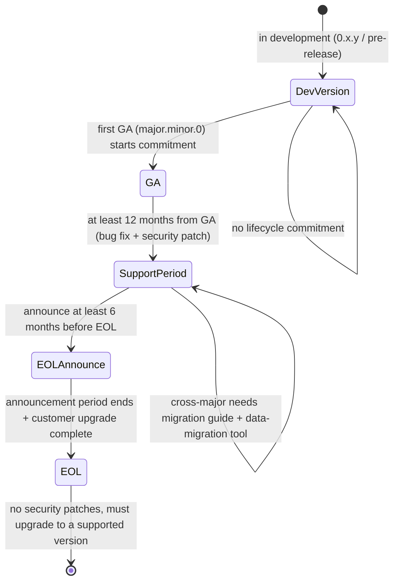

<!--
Inhouse-IMS-AS — Copyright 2026 Dolan Shu <dolan.d.shu@gmail.com>, Apache-2.0

Licensed under the Apache License, Version 2.0 (the "License");
you may not use this file except in compliance with the License.
You may obtain a copy of the License at

    http://www.apache.org/licenses/LICENSE-2.0

Unless required by applicable law or agreed to in writing, software
distributed under the License is distributed on an "AS IS" BASIS,
WITHOUT WARRANTIES OR CONDITIONS OF ANY KIND, either express or implied.
-->

# In-house IMS Application Server — version lifecycle, EOL, and interface-compatibility strategy

> **Status block (read this before the rest of the document)**
>
> - **Product name**: `In-house IMS Application Server`, **formally adopted as the product / documentation descriptor name** (G8-2; **not a trademark / not a brand claim**), first appearing annotated with the 3GPP Third-Party AS role; hereafter abbreviated in-house AS (`docs/plan.md` §0 "Product Decision Log", G8 line).
> - **git repo name**: reported renamed to `inhouse-ims-as` by the maintainer (G8-3; repo name and remote URL only; this repo has not had its remote or local path changed); chart name (`3rdparty-as`, `deploy/helm/Chart.yaml:2`), image name, and OTel service name **remain `3rdparty-as` unchanged**.
> - **This file belongs to**: `docs/product-packaging-plan.md` §1 third-batch deliverable **3.5 (version lifecycle and EOL strategy)** + fourth-batch deliverable **4.3 (API version-compatibility strategy)**, merged into one document.
> - **§3 decisions are landed**: the version-lifecycle and EOL decision is carried by **REQ-NF-16** (`docs/requirements/prd.md:459-470`) + **ADR-0027** (`docs/architecture/adr/0027-version-lifecycle-and-eol.md`, **accepted, 2026-10-09**, registered in `docs/architecture/adr/README.md:43`). This document is a **review-and-ops-facing explanatory document** that faithfully restates ADR-0027's accepted decisions, **without rewriting or expanding** its conclusions.
> - **§7 (deliverable 4.3) has no ADR yet**: the API and interface version-compatibility strategy **has no decision landing**. This document only gives "current inventory + candidate options + points needing a decision", **and no statement may be cited as a confirmed commitment**. Exit conditions in §7.4.
> - **B6 review status**: this document has left a review record with the B6 review —— [`../reviews/product-packaging-review-checklist-2026-10-12.md`](../reviews/product-packaging-review-checklist-2026-10-12.md) §6 (2026-10-12 initial review) and §7 (2026-10-12 closed-loop re-review); **conclusion pending maintainer confirmation**, and before confirmation it is not used as a basis for external delivery or acceptance (`AGENT.md` §3.3).
> - **This document contains no capacity/performance numbers**: O1 (capacity target) **is unresolved** (`docs/plan.md` §5.1); `AGENT.md` §2 forbids publishing any CPS / CAPS / BHCA / concurrency / throughput / latency numbers before the M6 real-socket measurement and maintainer adjudication. This document therefore gives no capacity conclusion.
> - **This document contains no release-status statement**: the M8 status is "**RC artifacts ready, exit sign-off still on hold**" (`docs/plan.md` §4 M8 line); this document does not present any RC artifact as released, nor any un-accepted item as accepted.

---

## 1. Why this document is needed

Operator reviews most easily ask only two kinds of questions:

1. **"Will your versions be a mess?"** —— The customer receives a system, not a pile of component version numbers; they need to know which number is reported outward, which image is installed, which version the chart describes.
2. **"Will upgrades interrupt service?"** —— The ops team needs to know how long the current version is usable, when EOL arrives, how long the upgrade window is, whether service must stop.

These two questions were previously answered by two different things, both incomplete:

- **ADR-0018** only solved "where a release number comes from": the root `VERSION` is the single source, component interface versions are in their respective `pyproject.toml`, and no member may own a `VERSION` file (ADR-0018 §Decision). It did **not** answer "how long a version is supported after release, when support stops, how to upgrade" —— precisely the gap pointed out by review conclusion **G-P1-4** (`docs/reviews/product-packaging-plan-review-2026-10-09.md:250-252`, `:360`): **the SLA/EOL gap does not distinguish that ADR-0018 only covers version numbers**.
- The same review's **G-P1-9** (`:365`) further required §3.5 to "first add requirement + ADR". **That item is closed**: REQ-NF-16 (`prd.md:459-470`) and ADR-0027 were added and registered in the ADR registry (`README.md:43`). This document is the **customer-facing explanation** of that closure action, not a new decision.

The boundary of this document: explain **what the current state is**, **what the accepted decisions are**, **what is not yet decided**. No new commitments, no speaking for the ADR.

---

## 2. Version-number semantics (current state)

### 2.1 Single source and guards

| Fact | Location |
|---|---|
| The product release version's single source is the root `VERSION`, current value **`0.2.0`** | `VERSION:1`; rules in `AGENT.md` §8, `ADR-0018` §Decision |
| `VERSION` must be readable SemVer (stricter than PEP 440) | `tests/test_version_consistency.py:33-37`, `:56-60` |
| `CHANGELOG.md`'s latest heading must equal `VERSION` | `tests/test_version_consistency.py:63-70` |
| Each member's `version` field must be SemVer (member list from `pyproject.toml`'s `tool.uv.workspace.members`) | `tests/test_version_consistency.py:50-53`, `:73-78` |
| **No member may own a `VERSION` file** | `AGENT.md` §8; enforced by `tests/test_workspace_layout.py` (`docs/plan.md:89`) |

### 2.2 Relationship between component interface version and product release version

The component interface version is **each member's `pyproject.toml` `version` field** (under `[project]`), and is **independent** of the product release version: interface `0.3.1` can appear inside product release `1.2.0` (ADR-0018 §Decision). The actual values in the current repo:

| Member | `[project] name` | `version` | Location |
|---|---|---|---|
| `platform/` | `as-platform` | `0.1.0` | `platform/pyproject.toml:3` |
| `apps/anti-fraud/` | `as-anti-fraud` | `0.1.0` | `apps/anti-fraud/pyproject.toml:3` |
| `apps/translation/` | `as-translation` | `0.1.0` | `apps/translation/pyproject.toml:3` |
| `services/config-service/` | `as-config-service` | `0.1.0` | `services/config-service/pyproject.toml:3` |
| `services/console/` | `as-console` | `0.1.0` | `services/console/pyproject.toml:3` |
| `testbed/load/` | `as-load` | `0.1.0` | `testbed/load/pyproject.toml:3` |
| `testbed/simulators/` | `as-simulators` | `0.1.0` | `testbed/simulators/pyproject.toml:3` |

`VERSION` (`0.2.0`) and each member's interface version (`0.1.0`) **being different values is by design, not drift**; the guard blocks "illegal format" and "CHANGELOG header mismatch", not "the two must be equal" (`tests/test_version_consistency.py:7-14`).

### 2.3 Wording discipline: "v1" / "v1.1" in docs are not release versions

> **Original** (`docs/plan.md:16`, product decision log "version naming" line):
> **"No v1 / v1.1 definition (2026-10-07, maintainer). The product version number only looks at the root `VERSION`. 'v1' / 'v1.1' appearing in other documents are not release versions and cannot be used as scope basis. To define them, they must be written here and confirmed by the maintainer."**

Therefore "v1" / "v1.1" appearing in this document and any other deliverable **are not release versions** and must not be cited as delivery scope or version commitment. ADR-0027 §Context accordingly records the current state as "no formally released GA version yet" (`0027:19`).

### 2.4 Known gap: chart version not synced with `VERSION` (recorded honestly; fix wording resolved, first sync not executed)

| Item | Actual value | Location |
|---|---|---|
| chart `version` | `0.0.0-skeleton` | `deploy/helm/Chart.yaml:5` |
| chart `appVersion` | `"0.0.0"` | `deploy/helm/Chart.yaml:6` |
| product release version | `0.2.0` | `VERSION:1` |
| `image.tag` falls back to `Chart.appVersion` when empty | — | `deploy/helm/templates/_helpers.tpl:38-41` |
| `app.kubernetes.io/version` label also takes `image.tag` or `appVersion` | — | `deploy/helm/templates/_helpers.tpl:53`, `:69` |

**Accurate statement of the gap**: the chart's `version` / `appVersion` are currently skeleton placeholder values, **not synced with the root `VERSION`**; because `image.tag` falls back to `appVersion` when empty, **the image tag and the `app.kubernetes.io/version` label also do not currently reflect the product release version**. `tests/test_version_consistency.py` does **not** cover the chart (it only checks `VERSION`, `CHANGELOG.md`, and member `pyproject.toml`).

> **Note (added 2026-10-13)**: the chart version-sync gap described in the paragraph above is factually stale (the chart was first synced to `0.2.0` on 2026-10-12; the `0.0.0-skeleton` / `"0.0.0"` in this table's cells are retained from the original). The handling (retain original + add note) is in [`../next-release-v1.1-plan.md`](../next-release-v1.1-plan.md) §5-1, pending the maintainer's decision on whether to sync.

**Resolved fix (G4 / A6, adjudicated 2026-10-10; script landed 2026-10-12)**: add "at release, align chart `version` / `appVersion` with `VERSION`" as one line in the release checklist, and add a consistency assertion beyond `make chart-check`; `VERSION` remains the single source and the chart value is its **derived artifact**, not a second home. This wording is landed as `scripts/sync-chart-version.sh` (default `--check` read-only, drift exits 1; `--apply` writes); **the timing and value of the first `--apply` are decided separately by the maintainer** (G4 "do not modify `VERSION` and `Chart.yaml` now" remains in effect; this document modifies no chart/code).

---

## 3. Support period and EOL (restating ADR-0027's accepted decisions item by item)

The following is the **full content** of ADR-0027 §Decision (`0027:21-35`, 6 decisions total, of which "upgrade path" includes two lines for adjacent minor and cross-major; the table splits them out), **with nothing added or removed**. The second column is the original wording, the third is the customer-facing explanation, the fourth points back to the ADR line.

| # | Accepted decision (ADR-0027 original wording) | Meaning from the customer's view | Basis |
|---|---|---|---|
| 1 | **Support period**: each minor version is supported for **at least 12 months** from GA; within the support period provide **bug fixes and security patches** | Getting a GA version lets you plan a change cadence of at least a year; defects and security risks within that year are patched by us | `0027:23` |
| 2 | **EOL advance-notice period**: announce EOL **at least 6 months** before version EOL | No "suddenly notified that support stops"; any EOL has a buffer of over half a year to arrange the upgrade | `0027:25` |
| 3 | **Upgrade path (adjacent minor)**: adjacent minor versions (e.g., 1.0 → 1.1 → 1.2) **must support direct upgrade without interrupting service** (ISSU, see ADR-0009) | Daily minor upgrades need no architecture change, no service stop; the precise boundary is in §4.2 | `0027:28` |
| 4 | **Upgrade path (cross-major)**: cross-major versions (e.g., 1.x → 2.0) **must provide a migration guide and data-migration tooling** | A major version is not "just swap an image": there will be written migration steps and tooling, requiring separate scheduling | `0027:29` |
| 5 | **LTS version**: **no LTS defined currently**. If a future operator customer explicitly requires LTS, **a new ADR must be added** to define it (support period, upgrade path, maintenance-cost sharing) | There is no 3–5 year long-term support version to sign now; this is a known gap explicitly accepted by ADR-0027 | `0027:31`, `0027:48`, `0027:55` |
| 6 | **Security patches**: **no security patches after EOL**; customers must upgrade to a supported version | EOL is a real deadline, not "take your time"; security-sensitive customers must complete the upgrade before EOL | `0027:33`, `0027:49` |
| 7 | **Scope of application**: this policy **applies only to GA versions (major.minor.0)**; development versions (0.x.y) and pre-releases **do not enjoy** the lifecycle commitment | The current `VERSION`'s `0.2.0` is a development version, and **the 12-month / 6-month commitments herein do not apply to it**; commitments start from the first GA version | `0027:35`, `:19` |

**Accepted negative consequences** (ADR-0027 §Consequences, must be told honestly in pre-sales):

- The maintenance burden for at least 12 months after each minor release is a real cost for a small team (`0027:47`).
- Some operators may require LTS, which the current policy **does not satisfy** (`0027:48`, `0027:55`).
- No security patches after EOL may be unacceptable to security-sensitive customers and **must be communicated clearly in the pre-sales stage** (`0027:49`).

---

## 4. Release and upgrade process

### 4.1 What a version release must land

| Item | Current state and practice | Basis |
|---|---|---|
| Product release number | bump the root `VERSION` | `AGENT.md` §8, §14; `ADR-0018` |
| Change log | `CHANGELOG.md`, following [Keep a Changelog](https://keepachangelog.com/en/1.1.0/), version following SemVer; heading level `## [x.y.z] - 未发布（Unreleased）` (currently the first line is `## [0.2.0] - 未发布（Unreleased）`, `CHANGELOG.md:6`), under it split by `### 新增（Added）` / `### 变更（Changed）` (`:8`) | format note `CHANGELOG.md:3-4`; heading and section structure `:6`, `:8`, `:20`, `:29`, `:67` |
| Consistency | `CHANGELOG.md`'s latest heading must equal `VERSION`, otherwise the guard fails | `tests/test_version_consistency.py:63-70` |
| chart version | **current gap**: chart `version` / `appVersion` not synced with `VERSION` (see §2.4); should be aligned at release (G4 / A6 resolved wording, script `scripts/sync-chart-version.sh` ready; first `--apply` pending maintainer) | `deploy/helm/Chart.yaml:5-6` |
| image tag | `image.tag` falls back to `Chart.appVersion` when empty; repo address is placeholder `registry.example.com/3rdparty-as`, specified by the customer's internal registry at install | `deploy/helm/values.yaml:76-82`; `deploy/helm/templates/_helpers.tpl:38-41` |
| Release / tagging | **tag is the maintainer's step**, agents do not tag or push | `AGENT.md` §10.4 closing ceremony, §11 |

**Tooling state (recorded honestly)**: the `Makefile` has **no** bump / release / version targets —— existing targets are only `lint` / `type` / `test*` / `chart-check` / `alert-check` / `m2-*` / `m5-*` / `m7-*` / `demo-*` / `gate` / `gate-native` / `gate-strict`. The chart↔`VERSION` consistency already has a script: `scripts/sync-chart-version.sh` (default `--check` read-only, drift exits 1; `--apply` writes, first-execution timing pending maintainer); `VERSION` bump itself still has **no** Makefile target and remains a **manual step**.

### 4.2 Upgrade semantics (ISSU = draining)

The precise semantics of ISSU are defined by **ADR-0009** (accepted), **not** in-flight state migration: ① stop accepting new requests (drain); ② existing calls continue to completion on the original process; ③ exit after `active_calls` reaches zero (ADR-0009 §Decision ①, `0009:18-20`, `:26`). Scale-down follows the same path (ADR-0009 §Decision ③; ADR-0010).

**Therefore the precise meaning of ADR-0027 item 3 "without interrupting service" must be written clearly, not exaggerated**:

- Holds: after draining, **no new calls are accepted**, and existing calls run to completion **losslessly** on the original process (state externalized to Redis, see ADR-0002). "Not migrating state" **does not equal** "can kill the process immediately" —— the process still has in-flight calls whose transaction machine, timers, and sockets are all in this process (ADR-0009 §Context, `:14`).
- Does not hold / not in the commitment: during the upgrade, the **losslessness only covers the "stop accepting new calls" side**; how new calls are handled during draining **depends on S-SBC / S-CSCF-side iFC-trigger deactivation coordination** —— the iFC trigger logic belongs to S-CSCF/HSS, **not the AS side**, which is a **cross-domain dependency** we cannot unilaterally commit to (`docs/product-packaging-plan.md` §2.4, `:82`: iFC triggering by number range / percentage requires S-SBC/HSS-side coordinated configuration, and real-cluster drills are blocked by M8 7.2d).
- Backstop and cost: draining has a **hard timeout**; on timeout a forced exit drops calls, so **it must alert**; the lower bound of the upgrade window ≈ the longest remaining duration of in-flight calls (ADR-0009 §Decision ④, §Consequences; `docs/architecture/新系统整体架构.md:360`, risk R3 `:614`). The specific timeout value is an ops parameter; this document gives no time values.

### 4.3 Upgrade-window discipline

| Component | Upgrade method | Basis |
|---|---|---|
| AS image (each use-case Deployment) | `helm upgrade` (RollingUpdate + `preStop` + extended `terminationGracePeriodSeconds` + PDB); config and certs go hot-update without process restart | ADR-0009 §Decision ②; `docs/architecture/新系统整体架构.md:363` |
| PostgreSQL / Redis (`stateStores`, ADR-0026) | Stateful components, upgraded in a **maintenance window**, not rolling with the AS image; `stateStores.migrateJob` does only a one-time schema migration (owner DSN), and the runtime startup does **no** DDL / migration / grant | `deploy/helm/templates/state-migrate-job.yaml:1-6`, `:52`; `docs/product/ne-datasheet.md` upgrade-discipline line |
| Rollback | See [`../operations/rollback-playbook.md`](../operations/rollback-playbook.md) —— **that file is persisted**; but its iFC / drain part **depends on S-CSCF / HSS-side coordinated config and real-cluster drills**, currently still blocked (G-P1-10) | — |

---

## 5. Version lifecycle state transitions (illustrative, not numeric)

The durations in the diagram come from ADR-0027 (`0027:23`, `:25`, `:33`, `:35`); they are **policy lower bounds**, not a schedule; this document gives no calendar dates.

---

## 6. Deprecation and announcements

| Item | Content | Basis |
|---|---|---|
| Announcement content | Version EOL announcement: which version, when EOL, upgrade path | `0027:25` |
| Minimum lead time | **At least 6 months** (consistent with §3 item 2) | `0027:25` |
| Lead time for deprecation itself | **No decision yet** —— whether "minimum lead time for feature/interface deprecation announcement" uses the same mechanism as "version EOL announcement" is an open item of deliverable 4.3 (§7.3 Q3) | This document's judgment, no ADR |
| Notification responsible party | The version EOL announcement is published to the customer by **us (maintainer / architecture)**; change-window negotiation and iFC / S-SBC-side deactivation coordination are executed by **customer ops + S-CSCF/S-SBC side**, boundary in [`responsibility-matrix.md`](responsibility-matrix.md) | ADR-0027; `AGENT.md` §1 |
| Channel | This document does not adjudicate the channel (release notes / customer notice / announcements page); **open item in §7.3 Q3** | This document's judgment, no ADR |

---

## 7. API and interface version-compatibility strategy (deliverable 4.3 —— **pending decision**)

> **Status of this section: candidate, not commitment.** Deliverable 4.3 has no REQ / ADR / HLD / acceptance chain yet. Per `docs/product-packaging-plan.md` §1 fourth-batch table and §3.2 Class B table, 4.3 depends on a **new decision** above ADR-0018, from the same source as 3.5 (G-P1-9). This section does only three things: inventory the current state (§7.1), list candidates (§7.2), list the points needing someone's adjudication (§7.3). **No statement may be cited as a confirmed strategy.**

### 7.1 Current-state inventory

| Interface plane | Version-identification method | Current state (verified) | Compatibility risk point |
|---|---|---|---|
| AS-internal HTTP API (config-service / console shared) | **URL path prefix `/internal/v1`** | Routed registered with `prefix="/internal/v1"` (`services/config-service/src/as_config_service/api.py:682-714`); console serves static resources at `/` and API at the same prefix (`services/console/README.md:34`) | Version is only in the path; **no** deprecation-period mechanism, **no** old-prefix retention policy. Breaking changes are only passively discovered by contract tests (`contract` marker) |
| SIP trunk (to S-SBC) | **no version number to version** | Standard ISC trigger, S-SBC transparent bridging (ADR-0003); behavior baseline `testbed/contracts/sip-baseline/` | Relies on **behavior-baseline contract** and peer compatibility, not version numbers; we cannot unilaterally upgrade peer capability |
| Decision contract cases | Case filename + `case_id` | `testbed/contracts/decision/cases.json` + `README.md` (field table `README.md:31-44`) | Changing the case set = **interface change**, needs ADR and all implementations' gate re-run (`README.md:101-106`). This one already has a hard rule, **no new decision needed** |
| PostgreSQL config / audit schema | **schema name + env var**, not numeric version | Default `as_config` / `console_audit` (`deploy/helm/values.yaml:122-123`; `AS_CONFIG_SCHEMA` / `AS_AUDIT_SCHEMA`, `services/config-service/src/as_config_service/migrate.py:119`, `:165`) | Schema **has no version number**; migration executed by the `as-config-migrate` one-time Job (`state-migrate-job.yaml:52`). When old and new versions coexist during rolling upgrade, the schema must be bidirectional-compatible (`新系统整体架构.md:361`, risk R4 `:615`) |
| Component interface version | Each member's `pyproject.toml` `version` | All `0.1.0` (see §2.2) | Only the SemVer format is guarded; **the semantics and backward-compatibility commitment are not yet defined** |
| Alert / metric-label contract | **metric name + label name is the contract** | Naming rules (`as_` prefix, snake_case, counter with `_total`, second-class with base-unit suffix) and labels (`severity` + `component`, metrics carry `use_case`) in `deploy/alerts/README.md:39-40`; metric-contract table at `:45-62` | **rules depend on metric names: renaming silently disables them** (alerts stop firing with no error). The README explicitly requires updating the contract table and running `promtool check rules` when renaming (`:87-93`) |

### 7.2 Candidate compatibility strategies (**candidate, undecided**)

1. **Semantic versioning + backward-compatibility commitment**: anchor on the component interface version from §2.2, declare backward compatibility within the same major, breaking changes must bump major. *Candidate*, undecided.
2. **Two-phase deprecation (deprecated → removed)**: new capability first marked deprecated, retained for at least one compatibility window, then removed. Window length **unresolved** (whether to reuse the same value as the 6-month EOL-notice period in §3 is open). *Candidate*, undecided.
3. **Version number in URL path vs Header**: current state is path (`/internal/v1`). Moving to Header keeps the path stable but costs changing all proxy / routing / audit action strings (the audit record stores action strings like `GET /internal/v1/{unmatched_path:path}`). Both paths work, **which to take is undecided**.
4. **Forward / backward compatibility of config schema**: the architecture doc already lists "rule schema bidirectional compatibility" as a **hard prerequisite of ISSU** (`新系统整体架构.md:361`) —— so this is **not a pure candidate but a premise already constrained by the architecture doc**; what is still missing: how to express the schema version number, how `as-config-migrate` handles multi-version coexistence.
5. **Handling of metric-label breaking changes**: because renaming silently disables, the candidate is "dual-write old and new metric names → notify → then delete old name", and fold the contract-table update into the release checklist. *Candidate*, undecided.

### 7.3 Points needing a decision

| # | Open question | Candidate | Impact surface | Suggested decision level | Blocked deliverable |
|---|---|---|---|---|---|
| Q1 | Whether the component interface version gives a **backward-compatibility commitment**, and the boundary is major or minor | ① same-major backward compatible ② no commitment, only SemVer ③ per-component separately | Component boundary, `apps/` third-party access | Architecture (involves ADR-0018 supplement) | 4.3 main body |
| Q2 | Version-identification carrier for the internal API: keep URL path prefix vs move to Header | ① keep `/internal/v1` ② move to Header ③ dual-track | config-service / console routing, audit action strings, Ingress | Architecture | 4.3, `/internal/v1` contract doc |
| Q3 | **minimum lead time** and **publish channel** for deprecation announcements; whether to reuse the same mechanism as the 6-month EOL-notice period in §3 | ① reuse EOL mechanism ② independent and longer ③ independent and shorter | Customer communication, pre-sales | Maintainer + Architecture | 4.3, §6 |
| Q4 | Schema version-number expression and multi-version coexistence strategy for config schema (`as_config` / `console_audit` currently have no version number) | ① schema name carries version ② table/column-level version column ③ rely only on `as-config-migrate` one-time migration | Config governance, ISSU, data migration | Architecture | 4.3, cross-major migration guide (§3 item 4) |
| Q5 | Formal process for metric / label **breaking changes** (dual-write window length, whether ADR needed) | ① dual-write + notify ② directly change and sync alert doc ③ any metric rename requires ADR | Alerts (REQ-NF-14), customer's existing Grafana dashboards | Architecture + Ops | 4.3, `deploy/alerts/README.md` contract-table maintenance |
| Q6 | SIP side has no version number; what carries the compatibility commitment | ① rely only on behavior-baseline contract ② peer capability negotiation ③ constrain via S-SBC-side version | Cross-domain coordination (customer S-SBC) | Architecture + customer | Northbound/southbound chapters in 4.3 |

### 7.4 Exit conditions

To move this section from "candidate" to "commitment", all of the following must be satisfied:

1. Add a **REQ** (carrying the open questions in §7.3; currently **no corresponding REQ entry exists**; REQ-NF-16 only covers version lifecycle, not API compatibility);
2. Add an **ADR** (above ADR-0018, without rewriting ADR-0018's existing decisions), and register it in `docs/architecture/adr/README.md`;
3. Add **HLD/LLD design and acceptance items**, completing the full document chain in `AGENT.md` §3;
4. Obtain an independent **review record** (`AGENT.md` §3.3), and this document is updated accordingly and the "pending decision" mark removed.

Until then, no statement in §7 of this document may be written into an external commitment, SLA, or tender document.

---

## 8. Relationship to other documents

| Topic | Authoritative document | Note |
|---|---|---|
| Version-number semantics (single source, component interface version, no member VERSION file) | [`ADR-0018`](../architecture/adr/0018-release-versioning.md) | accepted 2026-09-28, responding to REQ-NF-11 |
| Version lifecycle and EOL | [`ADR-0027`](../architecture/adr/0027-version-lifecycle-and-eol.md) | accepted 2026-10-09, responding to REQ-NF-16; §3 of this document only restates |
| Requirement entries | [`prd.md`](../requirements/prd.md) REQ-NF-16 (`:459-470`), REQ-NF-11 (`:419-423`) | REQ is the sole standard for design and acceptance |
| ISSU / draining / scale-down drain | [`ADR-0009`](../architecture/adr/0009-issu-draining.md) | accepted; the semantic source of §4.2 |
| In-cluster state storage (PG / Redis, migrateJob) | [`ADR-0026`](../architecture/adr/0026-in-cluster-state-stores-proposal.md) | accepted |
| Helm parameters and chart structure | [`deploy/helm/README.md`](../../deploy/helm/README.md) | Authoritative description of chart parameters |
| Alert and metric contract | [`deploy/alerts/README.md`](../../deploy/alerts/README.md) | Metric-name / label contract table |
| Upgrade rollback | [`../operations/rollback-playbook.md`](../operations/rollback-playbook.md) | **persisted**; real-cluster drill still blocked (G-P1-10) |
| Responsibility boundary (RACI) | [`responsibility-matrix.md`](responsibility-matrix.md) | Exists; basis for customer-coordination division |
| Naming (descriptor name / repo name) | [`docs/plan.md`](../plan.md) §0 decision-log G8 line | G8-2: descriptor name `In-house IMS Application Server` formally adopted (not trademark / not brand claim); G8-3: repo rename `inhouse-ims-as` reported complete by maintainer; chart name / image name / OTel service name still `3rdparty-as` |
| Version-naming discipline (no v1 / v1.1 definition) | [`docs/plan.md`](../plan.md) §0 "version naming" line (`:16`) | Confirmed by maintainer 2026-10-07 |

---

## 9. Open items and blockages

| Item | Status | Blockage source | When closable |
|---|---|---|---|
| 4.3 API version-compatibility strategy has no ADR | **Open** | No REQ / no ADR (§7.3 Q1–Q6) | Go through the four-step exit conditions in §7.4 |
| chart `version` / `appVersion` not synced with `VERSION` | **Wording resolved (G4 / A6), first sync not executed** (known gap) | Sync action carried by `scripts/sync-chart-version.sh` (default `--check` read-only, drift exits 1; `--apply` writes); timing and value of first `--apply` pending maintainer | Maintainer executes first `--apply` |
| Drain-period new-call deactivation coordination + upgrade-drill evidence | Depends on customer side; **no real-cluster evidence yet** | Needs S-CSCF / S-SBC-side iFC deactivation coordination; real-cluster drills blocked by M8 7.2d | After real S-SBC / customer K8s environment is available (M8 7.2d unlocked) |
| Release tag | Executed by maintainer | `AGENT.md` §10.4 / §11: agents do not tag or push | Maintainer executes |
| M8 exit sign-off | **On hold** | `docs/plan.md` §4 M8 line: RC artifacts ready but exit sign-off pending maintainer | Maintainer signs off; this document does not present RC as released |
| The consequence "no security patch after EOL" | **Already accepted in ADR-0027** (`0027:33`, `:49`) | Not blocking, but **must be stated in pre-sales** | Just add to pre-sales material |
| LTS | **Not defined currently** | Requires a new ADR when an operator explicitly requests it (`0027:31`) | After customer raises the need |

---

## 10. Traceability

| Item | Basis |
|---|---|
| Deliverable **3.5** version lifecycle and EOL strategy | `docs/product-packaging-plan.md` §1 third-batch (L95), §3.2 Class B table (L183); decision landing REQ-NF-16 + ADR-0027 |
| Deliverable **4.3** API version-compatibility strategy | `docs/product-packaging-plan.md` §1 fourth-batch (L105); **this document §7 marked pending decision, no ADR** |
| Review **G-P1-4** (SLA/EOL gap does not distinguish that ADR-0018 only covers version numbers) | `docs/reviews/product-packaging-plan-review-2026-10-09.md:250-252`, `:360` —— **closure**: added REQ-NF-16 + ADR-0027, §3 written accordingly |
| Review **G-P1-9** (§3.5 needs REQ + ADR first) | Same file `:365` —— **closed**: REQ-NF-16 (`prd.md:459-470`) + ADR-0027 (`adr/README.md:43` registered, accepted 2026-10-09) |
| REQs referenced | REQ-NF-16 (version lifecycle and EOL), REQ-NF-11 (single version source) |
| ADRs referenced (status per each file header) | ADR-0002 (state externalization / one process per use case, accepted), ADR-0003 (S-SBC transparent bridging, accepted), ADR-0009 (ISSU = draining, accepted), ADR-0010 (scale-down protection, accepted), ADR-0018 (version-number semantics, accepted), ADR-0026 (in-cluster state storage, accepted), ADR-0027 (version lifecycle and EOL, accepted). **ADR-0023 (Redis checkpoint) and ADR-0025 (managed rule-runtime bundle) are both draft, not yet passed**, and this document draws no conclusions from them (`docs/architecture/adr/README.md:39`, `:41`) |
| Main code / config basis referenced in this document | `VERSION:1`; `tests/test_version_consistency.py:56-78`; `deploy/helm/Chart.yaml:5-6`; `deploy/helm/templates/_helpers.tpl:38-41`, `:53`, `:69`; `deploy/helm/values.yaml:76-82`, `:122-123`; `deploy/helm/templates/state-migrate-job.yaml:52`; `deploy/alerts/README.md:39-62`, `:87-93`; `services/config-service/src/as_config_service/api.py:682-714`; `services/config-service/src/as_config_service/migrate.py:119`, `:165`; `services/console/README.md:34`; `testbed/contracts/decision/README.md:31-44`, `:101-106` |
| What this document does not do | No capacity numbers published; no product formal-naming decision written; no tag / commit; no modification of `deploy/helm/Chart.yaml` or any code; no M8 RC or un-accepted item presented as released / accepted |
