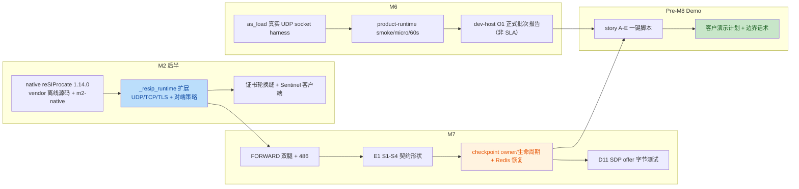

<!--
Inhouse-IMS-AS — Copyright 2026 Dolan Shu <dolan.d.shu@gmail.com>, Apache-2.0

Licensed under the Apache License, Version 2.0 (the "License");
you may not use this file except in compliance with the License.
You may obtain a copy of the License at

    http://www.apache.org/licenses/LICENSE-2.0

Unless required by applicable law or agreed to in writing, software
distributed under the License is distributed on an "AS IS" BASIS,
WITHOUT WARRANTIES OR CONDITIONS OF ANY KIND, either express or implied.
-->

# callload Branch Review Record — M2 Second Half / M6 / M7 / Pre-M8 Demo

## Current Status

| Item | Conclusion |
|---|---|
| Review date | 2026-10-05 |
| Review target | branch `callload` (initial review HEAD `e283538`; HEAD at merge preparation `dc3c951`), scope from merge-base `2318f9c` through the review remediation commits |
| Work covered | M2 second half (native reSIProcate product runtime / TLS / TCP / certificate rotation / Sentinel client), M6 (real socket capacity harness + dev-host O1 batch), M7 (E1 contract / FORWARD two legs / D10 checkpoint recovery / D11 SDP), Pre-M8 customer demo script and plan |
| **Overall conclusion** | **Conditional re-review.** P0/P1 engineering fixes have landed (see [`callload-remediation-adjudication-2026-10-05.md`](callload-remediation-adjudication-2026-10-05.md)); **F8 (structured logging) is still open**; **F6 is only partially closed** (no native transport close callback). The full customer demo must still respect the story C M5 reconciliation and the NF-1 boundary. |
| Gap status | 18 items: **15 fixed**; **1 partially fixed** (F6); **1 not closed** (F8); **1 maintainer item** (F11, not an engineering-queue item). |
| Gate status | Locally measured `make gate` (after remediation): **964 passed, 2 skipped** (only the derived-baseline items remain, pending the M2 probe); the E1/recovery contract is blocked under `make m2-platform-resip` with `AS_REQUIRE_NATIVE_EXTENSIONS=1`. |
| Mainline divergence | `master` leads this branch by 1 commit, `04afc5a` (M5 full-chain review, conclusion "fail"); the **F10 content surface** has been narrowed in pre-m8 / story-c; before merging, `merge master` must pull in that review file (see [`../handoff/2026-10-06-callload-merge-to-master.md`](../handoff/2026-10-06-callload-merge-to-master.md)). |
| Merged into master | **Done (2026-10-06)** — `master` @ `139d299`; see [`../handoff/2026-10-06-callload-merge-to-master.md`](../handoff/2026-10-06-callload-merge-to-master.md). This is **not** milestone sign-off. |
| Maintainer sign-off | None. This record does not constitute M2/M6/M7 milestone exit, nor REQ/test-plan acceptance. |

---

## 1. Review Metadata

- **Review target (commit range)**: `2318f9c..e283538` (from the merge-base of `master` and `callload`).
  - `6778030` M6 pause, to finish M2 at first
  - `6f64f91` M2 handoff
  - `900d1f0` M2 handoff -2
  - `b5a81dd` Merge branch 'master' into callload (merging the M5 gate closure `2318f9c`)
  - `e283538` m7 done (single commit, 165 files, +14670 lines)
- **Review date**: 2026-10-05
- **Reviewer**: AI agent (TRAE, an independent branch review assigned by the maintainer)
- **Review method**: read-only inspection of source code/tests/scripts + locally measured `make gate` + two independent verification subagents cross-checking every finding item by item (consensus threshold 2/2, or retained after the lead reviewer's factual correction).
- **Evidence exclusion statement**: as required by the maintainer, this review **neither accepted nor cited** any pre-existing slice review under `docs/reviews/` as evidence; all conclusions come from source code, tests, `docs/plan.md`, `docs/acceptance/test-plan.md`, the handoff originals and measured output. F10 only states the branch fact that "an unmerged review exists on the mainline".

## 2. What the Branch Did (Change Overview)



| Area | Main additions |
|---|---|
| Product runtime | `platform/native/resip_runtime/` (1486 lines of C++), `platform/native/resip_two_leg/`, `platform/native/resip_recovery/`; Python binding layer `sip/resip_runtime.py`, `sip/call_controller.py`, `runtime/sip_stack_service.py` |
| State/recovery | `state/call_checkpoint.py` (owner + generation CAS), `sip/recovery*.py`, Redis integration and the D10 harness |
| M6 | `testbed/load/` (harness.py 1219 lines, 1353 lines of tests, 5 measurement scripts, REQ-NF-15) |
| Demo | `scripts/demo-review/` (story-a…e, lib, run-all, bundle fixtures), `docs/handoff/pre-m8-demo-review-plan.md` |
| Build | vendored offline reSIProcate source package (30 MB) + Ubuntu 20.04 prebuilt package (6 MB), `make m2-native` |

## 3. Positive Confirmations (Should Be Preserved)

1. **Gate measured green**: all four `make gate` steps passed, 951 passed; the decision layer remains pure functions and the marker layering is not broken.
2. **M6 methodology is compliant**: the harness uses real UDP sockets (ADR-0014 / REQ-NF-15) and produces `summary.json`/`resources.json`; the O1 report repeatedly marks itself as "dev-host, not an external SLA", consistent with the capacity red lines in AGENT.md §2.
3. **M2 offline build path is reproducible**: the vendored source is pinned to upstream commit `632e215c` with a `SHA256SUMS`, and `make m2-native` does not depend on a network clone.
4. **Good demo boundary discipline**: `pre-m8-demo-review-plan.md` §7 proactively declares S-SBC/carrier PKI, US-3 live trace, caller/regex v1.1, no HPA/CPS commitment, and CDR/LI/media as non-goals; the scripts uniformly use `set -euo pipefail`, write artifacts to disk, and emit an explicit SKIP when the environment is missing.
5. **Checkpoint commit safety has engineering depth**: owner semantics + generation CAS (`save_if_generation`) and the lifecycle slice are both covered by tests.

## 4. Issue List

> Severity: blocker (blocks merge/customer demo) > major (must be closed before M8) > minor > note.
> Every item was confirmed by two independent verifiers reading the code (F13 retained after the lead reviewer corrected the wording to match the facts).

### F1[blocker]The product native runtime hardcodes 127.0.0.1 for both the listening address and Contact, so it cannot receive external S-SBC traffic

- **Evidence**: `platform/native/resip_runtime/runtime_module.cxx:1048` (UDP), `:1063` (TCP), `:1087-1093` (TLS) — three occurrences of `stack.addTransport(..., Data("127.0.0.1"))`; Contact hardcoded at `:1147`; LISTENING log at `:1175-1185`; the SDP template `o=/c=` at `:618-620` are also 127.0.0.1. The transport config parsing has no bind/interface field at all.
- **Why it is a problem**: inside a container/pod only loopback traffic can be received, so in the product form S-SBC is unreachable, which directly removes the acceptance premise of REQ-S-2 (TLS peer service) and REQ-NF-9 (reachability of an independent deployment). All runtime integration tests fail to expose it because they only hit loopback.
- **Fix suggestion**: inject the listening address from the transport config (env on the Python side, e.g. `AS_SIP_BIND_ADDRESS` defaulting to `0.0.0.0` plus `AS_SIP_ADVERTISED_ADDRESS`), let C++ read it and generate Contact/SDP; add a non-loopback binding integration test (docker network / dual addresses).

### F2[major]The Recovery TU hardcodes Contact to 127.0.0.1 when forwarding an upstream BYE, and does not replay route_set from the checkpoint

- **Evidence**: `platform/native/resip_recovery/recovery_module.cxx:241-258` (`handleUpstreamBye` builds `sip:as@127.0.0.1:<port>`); the checkpoint clearly parses `routeSet` (`:42`, `:150`) but the BYE writes no Route header.
- **Why it is a problem**: after a restart the pod IP is not loopback; the BYE of a dialog with Record-Route will misroute, and subsequent in-dialog requests come back to the wrong Contact. This directly weakens the M8 acceptance of REQ-NF-1 "after kill, the upstream BYE is still routed correctly".
- **Fix suggestion**: use the actual/advertised address in Contact; have the outbound-leg BYE carry the checkpoint route_set; add an integration test for "recovery BYE with Record-Route".

### F3[major]The UAC leg checkpoint written to Redis is a hardcoded placeholder, not the real outbound-leg dialog state

- **Evidence**: `platform/src/as_platform/runtime/sip_stack_service.py:227-246`, where `_on_dialog_established` fabricates `local_tag="as-uac-local"`, `remote_tag="peer-remote"`, `route_set=()`, `local_cseq=3`, `remote_cseq=1` and a random call_id.
- **Why it is a problem**: the real outbound Call-ID/tag/CSeq should be produced by the DUM UAC dialog. After recovery the downstream cannot correlate by tag/CSeq, so 481/packet loss is expected; what the D10 harness demonstrates is the "mechanism chain", not real dialog recovery.
- **Fix suggestion**: once the FORWARD UAC dialog is established, feed the real outbound identifiers and route set back to Python via a callback and then persist the checkpoint; the recovery integration test should assert that the downstream really accepts the BYE, not merely that the logs match.

### F4[major]Every downstream non-486 failure is mapped to 502, violating REQ-F-10 (480/408 must be passed through)

- **Evidence**: `runtime_module.cxx:838` (`downstreamStatus == 486 ? 486 : 502`); `platform/src/as_platform/sip/call_controller.py:19-20,97-103` has the same logic, and `test_outbound_non486_final_maps_to_502` at `platform/tests/test_call_controller.py:133` locks in the wrong behaviour.
- **Why it is a problem**: test-plan §REQ-F-10 explicitly requires 486/480/408 and similar codes to be forwarded upstream unchanged, and not rewritten to another code.
- **Fix suggestion**: pass through the 4xx/5xx/6xx codes that are safe to forward (at least 408/480/486/503/504), and use 502 only for genuinely internal errors that have no corresponding semantics; rewrite that unit test accordingly and add contract cases.

### F5[major]The TLS peer fingerprint cache is only added to and never evicted, so it grows without bound over long runs

- **Evidence**: `runtime_module.cxx:94-130` (`peerFingerprints` / `peerFingerprintsByEndpoint` are written only by `storePeerFingerprint`), `:180-220` writes on every handshake; there is no close callback, TTL or capacity cap.
- **Why it is a problem**: with frequent reconnects from long-lived S-SBC sessions the map keeps swelling and lookups degrade; the M6/O1 long stability stress run does not observe target-side memory, so it will not expose this.
- **Fix suggestion**: look up and delete on connection close via a callback; during the transition add a capacity cap/LRU; add a long-run memory assertion.

### F6[major]connection_id is registered but never deregistered, so the legacy set semantics of the certificate-rotation overlap are distorted and unbounded

- **Evidence**: `platform/src/as_platform/sip/resip_runtime.py:251` calls `register_connection` for every INVITE, and there is no caller of `unregister_connection` anywhere in the repo (`sip/ingress.py:128-132` provides the deregistration entry point but nobody calls it); `_registered_connection_ids`/`_legacy_connection_ids` (`ingress.py:47-48,91,151-153`).
- **Why it is a problem**: the legacy set should represent "connections that already existed before the rotation window opened", but in reality it accumulates "all connections in history", so the old-certificate grace judgement during the dual-certificate overlap of REQ-S-3 will wrongly keep passing for a long time; the set itself is unbounded.
- **Fix suggestion**: have C++ call back into Python to deregister when the transport closes/is destroyed; in the short term switch to a sliding window per peer endpoint with a cap.

### F7[major]SipStackService.from_env loads no production TLS/peer-policy/listening configuration at all; the default seam certificate is empty and only loopback is trusted

- **Evidence**: `runtime/sip_stack_service.py:63-75` (`_default_transport_seam`: cert/key paths are empty strings, allowed_addresses only covers the local host), `:136-165` — `from_env` parses none of the relevant environment variables.
- **Why it is a problem**: the certificates injected by Helm/Secret and the carrier trunk allowlist have nowhere to be read in the product process; external traffic is rejected wholesale by fail-closed. Together with F1 this forms the root cause of "the runtime only works on the demo machine's loopback".
- **Fix suggestion**: add env parsing and validation for `AS_TLS_CERT_PATH/KEY_PATH/CA_PATH`, `AS_PEER_ALLOWED_ADDRESSES`, `AS_PEER_ALLOWED_CERT_FINGERPRINTS`, and bind/advertised address; with an empty certificate and TLS enabled, fail closed at startup and emit a clear log.

### F8[major]All C++ diagnostics are plain std::cout/cerr text output, which does not satisfy the REQ-NF-13 structured logging requirement

- **Evidence**: about 20 sites in `runtime_module.cxx`, e.g. `:784,815,827,842,866,923,1175-1194` (cout) and `:535,594,791,871,928,1014` (cerr).
- **Why it is a problem**: there are no timestamp/level/trace_id/call_id/direction fields (REQ-NF-13 requires JSON that can be correlated with metrics/trace); the customer's log platform cannot parse it.
- **Fix suggestion**: hand the events back to the Python side through a callback for unified structured logging, or wrap a C++ logging macro carrying level and call_id and define the field contract; add field assertions before M8.

### F9[major]`make gate` does not build the native extensions, so core product SIP path tests silently skip and the gate guards nothing

- **Evidence**: a local `make gate` measured **10 skipped**: 3 in `test_e1_contract_resip_runtime.py`, 4 in `test_e1_contract_resip_runtime_full.py` (S1–S4), and 1 in `test_sip_recovery.py`, all skipped because `_resip_runtime`/`_resip_recovery` are not built (the skip statement is at `test_e1_contract_resip_runtime_full.py:44-48`).
- **Why it is a problem**: the main M2-second-half/M7 deliverables (product stack S1–S4, TLS, recovery) are all skipped when there is no .so, yet the gate stays green — AGENT.md §9 requires the first milestone that introduces tests for a layer to make that layer blocking; right now the core capability has no blocking verification.
- **Fix suggestion**: add a native build step to `make gate` (or a separate mandatory target), make the key E1/recovery tests fail instead of skip when the extensions are missing, per the milestone policy; print the extension version/sha before the demo smoke run.

### F10[major]The branch kept stacking M6/M7 without merging the mainline commit `04afc5a` whose M5 full-chain review is a "fail", and the customer story C was not reconciled

- **Evidence**: `git log callload..master` shows only `04afc5a M5 review` (merge-base `2318f9c`); that commit adds `docs/reviews/m5-full-chain-review-2026-10-05.md`, whose conclusion is "fail, recommend revoking/downgrading the M5 engineering gate sign-off". §3.5/story C of the customer demo plan on this branch still presents the alerting rule set, scale-down criteria and the Helm production form as delivered capabilities (`scripts/demo-review/story-c.sh:62-70`).
- **Why it is a problem**: while that review is unmerged and unadjudicated, demonstrating the same batch of M5 artefacts to the customer carries the substantive risk that "the demo is judged by an independent review to be a non-working capability"; long-term divergence will also lose the review record at merge time.
- **Fix suggestion**: merge/rebase the mainline first, reconcile the M5 review item by item (accept/reject/fix), and only then decide the story C talk track and demo scope; keep the branch from deleting that file before the merge.

### F11[major]Commit granularity and commit messages violate AGENT.md §11, making review/bisect/rollback infeasible

- **Evidence**: the single commit `e283538 m7 done` carries 165 files and +14670 lines, mixing four work lines (M2/M6/M7/demo); the 5 commit messages (`m7 done`, `M2 handoff -2`, `M6 pause, to finish M2 at first`, etc.) all fail Conventional Commits (`feat/fix/...` + scope).
- **Why it is a problem**: individual behaviour changes cannot be traced to an ADR/REQ, a single capability cannot be reverted, and this review could only read the diff as a whole; AGENT.md §11 requires one logical change per commit.
- **Fix suggestion**: split subsequent commits strictly and write conventional messages with REQ/ADR references; how existing history is handled (whether to restructure it before the merge) is an explicit per-instance maintainer decision — the agent will not rewrite history or force-push on its own.

### F12[minor]The as_load CLI returns 0 as soon as a single session is established, so a high load-test failure rate is masked by the exit code

- **Evidence**: `testbed/load/src/as_load/__main__.py:57` (`return 0 if summary["counts"]["established_sessions"] else 1`).
- **Why it is a problem**: 60000 attempts with only 1 success still returns 0; as the evidence tool for REQ-NF-15 this misleads automated consumers (the existing M6 shell script makes a separate `>=1` check, which is a partial mitigation).
- **Fix suggestion**: add `--min-success-rate`/`--max-unresolved` judgements and exit non-zero when the error count is non-zero; output the success rate explicitly in the summary.

### F13[minor]run-all-automated always prints OK at the end, without distinguishing pass/skip/fail

- **Evidence**: `scripts/demo-review/run-all-automated.sh:27-36` (after Redis is unreachable and story-d is SKIPped it still prints `run-all-automated: OK`; the SKIP for a missing kind behaves the same way at story-c.sh:30-37).
- **Why it is a problem**: the organizer may read "D/C did not run at all" as all-green in the pre-meeting smoke; the "the A/B/D/E fully automated path has been run through" claim in plan §4 depends on the local machine happening to have Redis/a native toolchain.
- **Fix suggestion**: add a strict-mode flag (`--require-redis/--require-kind/--require-native`), and print a final summary `PASS n / SKIP m(names) / FAIL f` written into the artifact summary.

### F14[minor]M6 measurement scripts hardcode the output directory /tmp, with no configurability and no retention policy

- **Evidence**: `testbed/load/scripts/m6-product-runtime-smoke.sh:72`, `m6-o1-formal-report.sh:259`.
- **Fix suggestion**: support `AS_M6_OUTPUT_ROOT` (default /tmp) and validate writability before starting; archive formal batches / prevent overwriting.

### F15[minor]VERSION/CHANGELOG were not updated with this batch of product deliverables, so the DoD is not closed

- **Evidence**: `git diff master..callload -- VERSION CHANGELOG.md` shows no change; the only pyproject change is a ruff exclude comment.
- **Why it is a problem**: the AGENT.md §14 DoD requires "a CHANGELOG entry; bump the product version when the delivered content changes". This branch delivers, for the first time, a runnable product SIP runtime, recovery capability and a capacity harness.
- **Fix suggestion**: add the CHANGELOG entry and the VERSION bump uniformly before the M8 candidate is packaged, aligned with `tests/test_version_consistency.py`.

### F16[minor]The CallController recovery methods lack unit-level coverage

- **Evidence**: the 10 cases in `platform/tests/test_call_controller.py` (`:37-209`) do not cover `restore_from_checkpoint` / `route_in_dialog_bye`; at present they are only indirectly covered by the integration/recovery slice.
- **Fix suggestion**: add unit tests: two-leg correlation is queryable after recovery, repeated recovery is idempotent/errors, routing an unknown call_id returns None.

### F17[note]The vendored prebuilt package has narrow portability, carries the author's build paths, and puts 36 MB of binaries into the repo

- **Evidence**: `testbed/simulators/resip-probe/vendor/` (source tar 30 MB, prebuilt 6 MB, `SHA256SUMS`); handoff `docs/handoff/2026-10-04-m2.md` records that the prebuilt contains the absolute RUNPATH `/tmp/as-resiprocate-m2-build-20261004` and absolute CMake cache paths, and only supports Ubuntu 20.04 / OpenSSL 1.1.
- **Fix suggestion**: keep the source package (its offline-build value is clear); evaluate moving the prebuilt to a release artifact/object store instead of long-term git history; or note the shelf life and rebuild command in vendor/README (some notes already exist; an expiry date is still needed).

### F18[minor]The demo plan promises a 487 scenario, but none of the five one-click stories execute S4

- **Evidence**: §3.1/§5 of `pre-m8-demo-review-plan.md` "signalling half-day: …486/487"; `test_e1_contract_resip_runtime_full.py:185` has a real-UDP `test_e1_s4_caller_cancel_returns_487`, but the story-a…e scripts never call it.
- **Fix suggestion**: add a one-click S4 step to story B or to a new signalling half-day script, or delete the 487 promise from the session agenda to avoid having no evidence on the day.

## 5. Pre-M8 Disposition Priority

| Priority | Items | Rationale |
|---|---|---|
| P0 (customer demo / before merge) | F1, F7, F10 | Determines whether the product process can leave loopback and be reached by S-SBC; determines whether story C can be told to the customer |
| P1 (hard gate for M8 acceptance) | F2, F3, F4, F9, F6, F5 | Truthfulness of the REQ-NF-1, REQ-F-10 and REQ-S-3 evidence, and the gate's actual coverage of the product path |
| P2 (before packaging) | F8, F11, F15, F12, F13, F14, F16, F18, F17 | Observability, engineering hygiene, the evidence chain and demo repeatability |

## 6. Measurement Record (2026-10-05, local machine)

```text
$ make gate
ruff format --check .   OK
ruff check              OK
mypy                    OK
pytest -m 'unit or contract'
951 passed, 10 skipped, 194 deselected, 11 warnings in 8.84s
SKIP 原因分布：
  test_e1_contract_resip_runtime.py        ×3  _resip_runtime 未构建
  test_e1_contract_resip_runtime_full.py   ×4  _resip_runtime 未构建（含 S1–S4）
  test_sip_recovery.py                     ×1  _resip_recovery 未构建
  test_derived_baseline.py                 ×2  Route/Record-Route 待 M2 probe 补
```

This result is only local gate evidence (AGENT.md §9); the integration layer after `make m2-platform-resip-build` was not run, and neither were the PG/Redis/kind/performance batches.

## Adjudication

| ID | Source | Issue summary | Adjudication | Remediation plan | Status | Verification method | Remarks |
|---|---|---|---|---|---|---|---|
| F1 | This review; runtime_module.cxx | native runtime listening/Contact/SDP hardcoded to 127.0.0.1 | Accepted | configurate `bind_address`/`advertised_address` | **Fixed** | `transport_env.py` + C++ transport config | blocker |
| F2 | This review; recovery_module.cxx | recovery BYE Contact/route_set | Accepted | Contact from the checkpoint URI; Route replay | **Fixed** | recovery_module.cxx | major |
| F3 | This review; sip_stack_service.py | UAC checkpoint placeholder | Accepted | native return of `uac_leg` on the FORWARD path | **Fixed** | the accept-all harness may still have a placeholder leg | major |
| F4 | This review; runtime + call_controller | non-486 → 502 | Accepted | REQ-F-10 pass-through set | **Fixed** | `test_call_controller.py` | major |
| F5 | This review; runtime_module.cxx | unbounded fingerprint | Accepted | 2048 cap eviction | **Fixed** | C++ storePeerFingerprint | major |
| F6 | This review; ingress/resip_runtime | connections only registered, never deregistered | Accepted | cap + deregistration on termination | **Partially fixed** | missing transport close callback | major |
| F7 | This review; sip_stack_service | from_env loads no TLS/peer config | Accepted | `transport_env.py` | **Fixed** | `test_transport_env.py` | major |
| F8 | This review; runtime_module.cxx | cout/cerr are not structured | Accepted | Python JSON callback or macro | **Not closed** | before M8 | major |
| F9 | This review; gate skip | native untested yet still green | Accepted | gate native build step + `AS_REQUIRE_NATIVE_EXTENSIONS` | **Partially fixed** | `native_extensions.py` | major |
| F10 | This review; story-c / M5 review | demo and M5 not reconciled | Accepted (content) | story C L1 talk track | **Fixed** | pre-m8 + story-c banner | major |
| F11 | This review; commit granularity | Conventional Commits | Maintainer | history not restructured | **Maintainer** | — | major |
| F12 | This review; as_load | misleading exit code | Accepted | `--min-success-rate` etc. | **Fixed** | `as_load/__main__.py` | minor |
| F13 | This review; run-all-automated | SKIP still prints OK | Accepted | PASS/SKIP/FAIL + `--strict` | **Fixed** | `run-all-automated.sh` | minor |
| F14 | This review; m6 scripts | /tmp hardcoded | Accepted | `AS_M6_OUTPUT_ROOT` | **Fixed** | m6-*.sh | minor |
| F15 | This review; VERSION | not bumped | Accepted | 0.2.0 + CHANGELOG | **Fixed** | VERSION/CHANGELOG | minor |
| F16 | This review; CallController | recovery lacks unit tests | Accepted | restore/route_bye cases | **Fixed** | `test_call_controller.py` | minor |
| F17 | This review; vendor | prebuilt shelf life | Partially accepted | vendor README section | **Fixed (documentation)** | moving it out of git is a maintainer decision | note |
| F18 | This review; 487 / S4 | demo does not run S4 | Accepted | story-b step 4 | **Fixed** | `story-b.sh` | minor |
